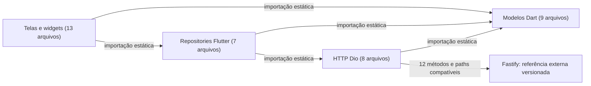
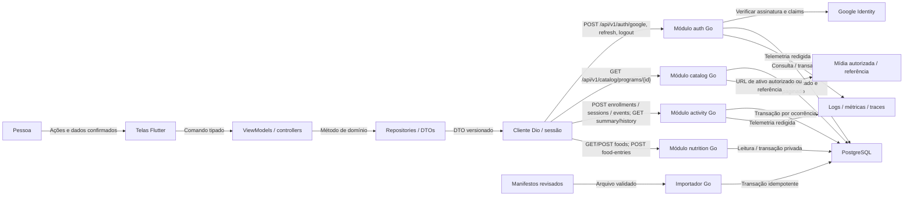

# Arquitetura do TrainForge — comece aqui

> Gerado de código e registros versionados por `tools/gerar_documentacao.py`. Não editar este arquivo à mão. Revisão das entradas: `9147d3cd1695ebc5`.

**Leia este arquivo e os links abaixo no GitHub ou no editor. Não é necessário iniciar Python, Go, API, banco ou servidor para consultar.** Os diagramas Mermaid são texto versionado e renderizado pelo GitHub.

## O que existe e o que é proposta

| Área | Evidência e limite |
| --- | --- |
| Flutter neste clone | 43 arquivos Dart; análise estática, sem teste runtime |
| Backend Fastify externo | Referência auditada em 2026-10-21, commit `523f6d9609be`; 29 rotas extraídas. O clone não contém esse código |
| Go neste clone | 16 arquivos Go de aplicação; 7 registros net/http detectados |
| Produto | Android e iOS; primeiro desenvolvimento/teste em Android |
| Conteúdo | Pesquisa concluída nos recortes; publicação/prática/direitos continuam por item |

## Mapa atual: estrutura e correspondências

Setas de importação não são traces. Correspondência HTTP não confirma autenticação, DTO completo ou resposta em execução.

## Arquitetura proposta: ainda a implementar

A proposta Go não vira código atual por estar no desenho. Detalhes, camadas e limites de capacidade estão nos documentos revisados.

## Explorar por assunto

- [Telas, destinos e jornadas](gerado/telas-e-fluxos.md)
- [Quem chama quem, entradas e respostas](gerado/chamadas-http.md)
- [Modelos e relações do banco](gerado/banco.md)
- [Go: comentários, registros e especificação](gerado/go-e-swagger.md)
- [Progresso, dependências e tarefas](gerado/progresso.md)

- [Camadas do backend Go](camadas-go.md)
- [Como a documentação se atualiza](documentacao-dinamica.md)
- [Swagger por comentários](swagger-go.md)
- [Arquitetura proposta e decisões](arquitetura-alvo.md)
- [Diagnóstico e achados](diagnostico-atual.md)
- [Plano macro da V1](../execucao/v1/plano-macro.md)
