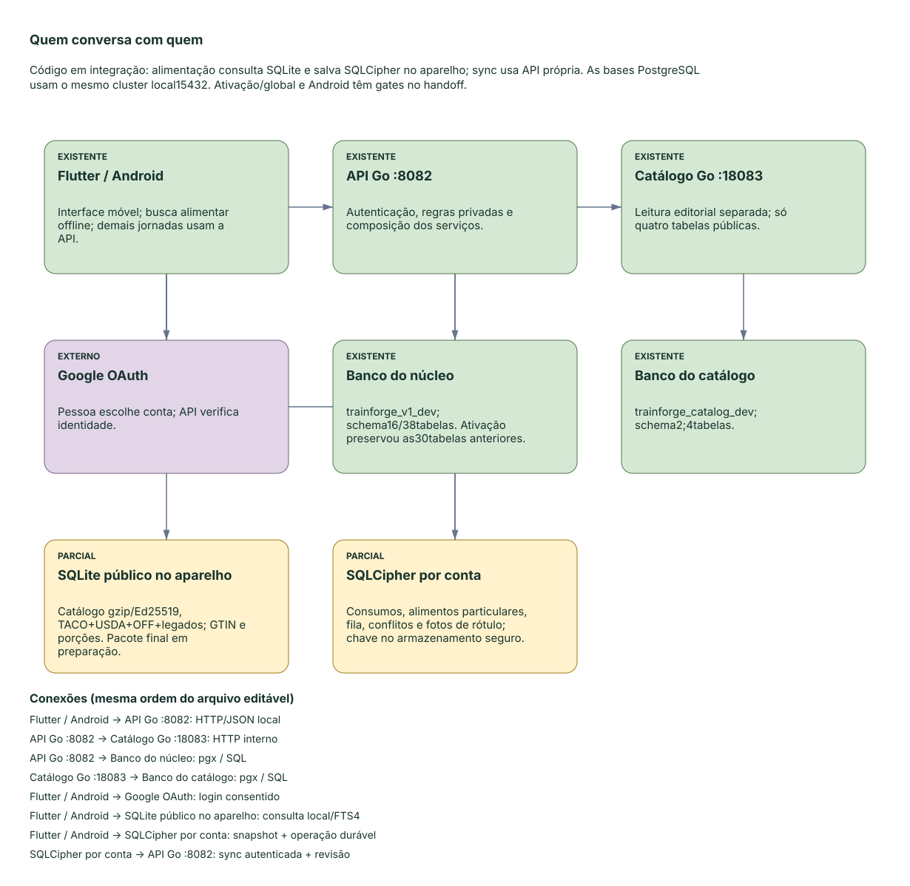

# Arquitetura do TrainForge

O TrainForge tem um aplicativo **Flutter para Android/iOS**, uma **API Go** e um **catálogo Go separado**, com PostgreSQL e papéis próprios. SDK mínimo: **Go 1.27.4**, com patch de segurança conferido em17/11/2026. O núcleo reúne autenticação, privacidade, configuração, alimentação e execução; o catálogo fornece referências públicas. Estado consolidado em **16/11/2026**.

O celular envia HTTP para a API; a API consulta o banco privado ou encaminha cinco leituras ao catálogo. O celular não acessa PostgreSQL diretamente. Regras, revisões, titularidade e idempotência ficam no servidor. Go usa pgx/SQL e Goose, sem ORM; Prisma pertence ao backend histórico.

| Quero entender | Leitura |
|---|---|
| Responsabilidades e caminho de uma ação | [Camadas e fluxos](camadas-e-fluxos.md) |
| Dados, versões e regras de contrato | [Modelo e contratos](modelo-e-contratos.md) |
| Por que Go e como o catálogo foi separado | [Decisões e evolução](decisoes.md) |
| Autorização, recuperação e limites de capacidade | [Segurança e operação](seguranca-operacao.md) |
| Como atualizar documentos, Swagger e mapas | [Manutenção](manutencao.md) |
| Ver os desenhos por assunto | [15 mapas](diagramas/README.md) ou [índice visual local](diagramas/index.html) |
| Consultar detalhes exatos | [APIs](diagramas/apis.md), [tabelas/colunas](diagramas/banco.md), [inventário do código](gerado/referencia.md) |

A API 0.10.0 tem 38 operações; o núcleo está no schema 13 com 30 tabelas e o catálogo no schema 2 com quatro. Login local, leituras, configuração e capacidades de alimentação/execução possuem evidências próprias. Tabela, endpoint ou tela não significam jornada integral aprovada.

**Prática continua condicionada a conteúdo humano aprovado.** Há referências de consulta e motor de execução, mas nenhum programa/instrução/dose/mídia liberado por esta documentação. Seleção/adesão/agenda, foto, fila offline durável, master, carga, distribuição release e validação nativa iOS conservam etapas próprias. A ausência real de programa é um estado esperado.

Para iniciar, observar logs e parar, use o [guia de operação](../aprendizado/operacao-local.md). Para retomar implementação e saber a próxima história, leia o [handoff](../execucao/v1/handoff.md) e o [backlog](../execucao/v1/backlog.md). Os guias podem ser lidos sem iniciar nenhum serviço.
