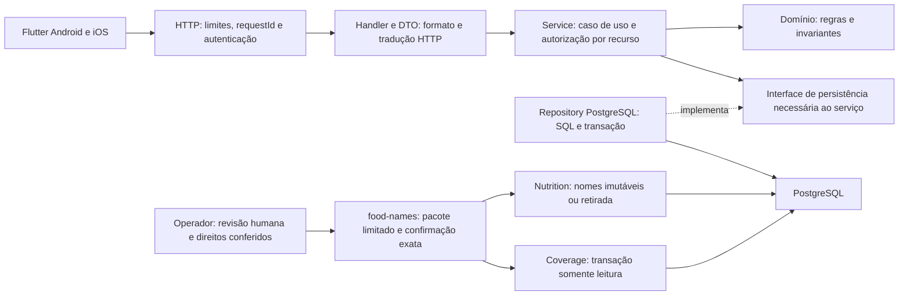

# Camadas e responsabilidades do backend Go

Conferida em **28/10/2026**: API **0.8.0 /34 operações**, PostgreSQL local schema13/30tabelas. Auth, catalog, nutrition, privacy e trainingconfig têm capacidades integradas; nutrition inclui refeições atômicas e metadados versionados. Activity ainda reserva o domínio, sem execução entregue. Adesão, agenda e treino completo não estão implementados. O backend é um monólito modular: um processo Go, módulos por domínio, dependências explícitas e PostgreSQL. As camadas são responsabilidades internas, sem chamadas de rede entre elas.

## Por que um monólito modular

Monólito descreve a unidade de execução e publicação; não exige um arquivo único ou responsabilidades misturadas. cmd/api/main.go compõe configuração, pool, serviços e handlers e controla a vida do servidor. As requisições seguem para os handlers; cálculos, validações e SQL ficam nos módulos. A estrutura atual tem exceções de acoplamento registradas abaixo e ainda precisa evoluir; o nome da arquitetura não é aprovação automática da qualidade.

Neste momento, o mesmo produto ainda está consolidando contratos, jornadas e conteúdo. Refeição, consumos, versões e idempotência precisam ser gravados juntos: a transação PostgreSQL atual desfaz tudo se um item falhar, com teste SQL já executado. Separar esses dados em bancos de microserviços exigiria coordenação distribuída, filas/outbox e compensações, além de autenticação entre serviços, observabilidade e operação adicionais.

O monólito pode receber réplicas e otimização por módulo, mas isso não comprova capacidade para milhões. Estado em memória, limites por instância, orçamento de conexões, consultas, banco e concorrência precisam ser avaliados antes de múltiplas instâncias. Os testes de carga030 e a auditoria028 seguem pendentes. Microserviços também não garantem segurança ou escalabilidade por si só.

Uma extração futura deve responder a necessidade medida: módulo com perfil de carga distinto, trabalho pesado assíncrono, disponibilidade própria ou equipe/publicação independentes. Processamento de imagens é um candidato possível, ainda não implementado nem decidido como serviço. Manter módulos, contratos e responsabilidades claros facilita essa decisão; a extração não será automática nem necessariamente dispensará migração de dados.



O diagrama expressa a separação de responsabilidades; não afirma que cada operação já possui todas essas camadas. Exceção atual:na escrita alimentar, EntryHandler usa NutritionStore concreto, com SQL/transações em postgres_entries.go e cálculo/regras em entries.go; a fronteira de caso de uso/interface ainda precisa de refinamento ao expandir o módulo. Ver a [auditoria do produto](../execucao/v1/auditoria-produto-2026-10-24.md).

A seta de implementação representa dependência/contrato, não chamada HTTP. Em execução, service usa a implementação injetada do repository, que consulta o banco. Não há chamada HTTP entre essas camadas.

| Responsabilidade | Deve fazer | Limite |
|---|---|---|
| `handler.go`, `dto.go` | Decodificar/validar formato de body/query/path, obter identidade, chamar service e traduzir falha/status | Não executar SQL nem decidir prescrição/conteúdo |
| `service.go` | Coordenar caso de uso, autorização do recurso, idempotência, fronteira transacional e integrações necessárias | Não depender de request/reply do framework ou de widgets |
| `model.go` e regras específicas | Estado válido, versão editorial, unidades, transições e invariantes | Não importar HTTP, pgx ou dependência de UI |
| `repository.go` | Interface pequena requerida pelo consumidor para leitura/escrita | Não criar CRUD genérico gigantesco por convenção |
| `postgres.go` | SQL parametrizado, queries projetadas/paginadas e execução transacional | Não aceitar titular vindo do body como autorização |
| `platform` | Config, conexão/pool, servidor, logs/telemetria e serviços técnicos comuns | Não virar pasta de regras de negócio sem dono |
| `cmd/api` | Montar dependências e iniciar/parar o processo | Não conter o domínio inteiro |

```text
services/api/                     # auth/catálogo/registro alimentar/privacidade reais; demais incrementais
  cmd/api/main.go
  cmd/import-content/main.go
  internal/
    auth/
    catalog/
    activity/doc.go                # domínio reservado, sem execução entregue
    nutrition/
    privacy/
    trainingconfig/
    platform/{config,httpapi,postgres}/
    swaggerdocs/docs.go            # gerado por Swaggo, não editar
  migrations/
```

O esquema ilustra nomes e fronteiras; arquivos separados só quando houver responsabilidade real. Interfaces ficam próximas do consumidor; composição manual em `cmd`, antes de escolher container de injeção. Uma regra pequena não precisa virar uma interface e três adapters. Módulos não acessam tabelas privadas de outro por conveniência; operações cruzadas têm responsabilidade explícita.

## Fronteira dos nomes revisados

O contrato editorial e a validação ficam em names.go; a escrita transacional restrita ao operador em names_postgres.go; a resolução em lote e a projeção pública em names_read.go/names_localized.go. O runtime recebe somente leitura das tabelas editoriais. A composição de CLI fica em cmd/food-names e internal/foodnamesops; o loader lê pacotes limitados, sem rede, e usa as regras e primitivas de persistência do módulo nutrition. Retirada e cobertura ficam em names_withdraw.go e names_coverage.go. Não há endpoint editorial, novo serviço ou migration nesta fatia. Hashes vinculam os documentos de revisão e direitos, mas não provam a identidade humana nem a validade jurídica: a publicação continua dependendo dessa verificação. Flutter usa um contrato tipado opcional separado do repositório original; IDs, versões, base e nutrientes não são reescritos para traduzir.

A migration 00011 corrige somente o idioma de novos nomes particulares sem declaração explícita para und. A função mantém autorização, locks e limites; registros históricos não são reescritos.

## Capacidade: critérios que vão além das camadas

Contas cadastradas e requisições simultâneas são cargas diferentes. A primeira versão deve preservar possibilidade de adicionar instâncias sem estado local indispensável, mas **capacidade exige medição** da mistura de chamadas, concorrência, volume, hardware e banco.

- Queries projetadas e paginadas, índices conforme consultas, ausência de N+1 e pool limitado pela capacidade real do PostgreSQL.
- Timeouts/context cancellation, corpo/paginação limitados, transações curtas e idempotência/constraints para concorrência. Não abrir goroutines/conexões sem limite para “ser rápido”.
- Catálogo público autorizado com cache/ETag por versão; dados privados isolados por titular. O cliente evita busca redundante e preserva estado com política explícita de validade.
- Autenticação validada, autorização em cada recurso, rotação/revogação de refresh, SQL parametrizado, proxy confiável, rate limit e logs redigidos.
- Baseline com throughput, p50/p95/p99, erros, saturação de CPU/memória/pool e planos de consulta. Replicas/filas/cache distribuído entram por necessidade medida.

Plano de validação: [segurança e operação](seguranca-operacao.md), histórias012/013/028/029/030 e critérios de entrega035. Nenhum número de capacidade foi certificado por este desenho. A [decisão de arquitetura](arquitetura-alvo.md) continua distinguindo migração de linguagem e revisão do domínio.

A privacidade coordena explicitamente a exportação e o ciclo dos dados de todos os módulos privados conhecidos, com inventário de schema e transação única. Não é acesso casual entre módulos: a responsabilidade está em privacy e migrations, com testes de titularidade e privilégios. [Implementação, limites por instância e histórico de aceite](../execucao/v1/privacidade-013.md).


## Fundação de nomes editoriais048 —26/10

names.go contém contrato limitado, validação estrutural/revisão e versão própria, semHTTP/pgx. names_postgres.go contém SQL parametrizado, transação, vínculo exato/visibilidade da fonte e persistência idempotente com evidências correspondentes. Nenhum handler chama essa primitiva; publicação operacional humana ainda falta. Runtime não recebe escrita nas duas tabelas editoriais da00009. TesteSQL foi descartável; Go/SQL não foram semanticamente indexados peloGraphifyFlutter. [Modelo e limites](dominio-e-banco.md).


Leitura26/10:names_read.go resolve um lote deaté50identidades/versões emumaquery, com fallback original e retirada semreviver antigo. names_localized.go implementa consulta paginada/detail emsnapshotrepeatable-read, busca poralias e revisão poridioma. FoodReader usa o contrato opcionalLocalizedFoodRepository; semlocale mantém o caminho original. FoodHandler valida parâmetros e mapeia revisão alterada para409; não executaSQL. Nenhumhandler publica nomes. [Contrato e limites](contratos-v1.md).
