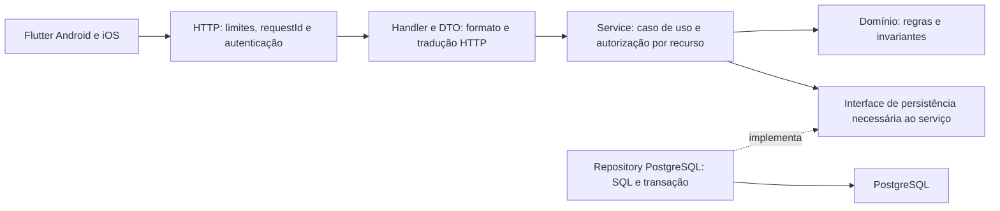

# Camadas e responsabilidades do backend Go

Proposta refinada em **21/10/2026**, ainda sem implementação. API como monólito modular, organizada por domínio (`auth`, `catalog`, `activity`, `nutrition`), com dependências explícitas e PostgreSQL. As camadas são responsabilidades de cada módulo; não são serviços de rede separados.



A seta de implementação representa dependência/contrato, não chamada HTTP. Em execução, service usa a implementação injetada do repository, que consulta o banco. Não há chamada HTTP entre essas camadas.

| Responsabilidade | Deve fazer | Limite |
|---|---|---|
| `handler.go`, `dto.go` | Decodificar/validar formato de body/query/path, obter identidade, chamar service e traduzir falha/status | Não executar SQL nem decidir prescrição/conteúdo |
| `service.go` | Coordenar caso de uso, autorização do recurso, idempotência, fronteira transacional e integrações necessárias | Não depender de request/reply do framework ou de widgets |
| `model.go` e regras específicas | Estado válido, versão editorial, unidades, transições e invariantes | Não importar HTTP, pgx ou dependência de UI |
| `repository.go` | Interface pequena requerida pelo consumidor para leitura/escrita | Não criar CRUD genérico gigantesco por convenção |
| `postgres.go` | SQL parametrizado, queries projetadas/paginadas e execução transacional | Não aceitar titular vindo do body como autorização |
| `platform` | Config, conexão/pool, servidor, logs/telemetria e serviços técnicos comuns | Não virar pasta de regras de negócio sem dono |
| `cmd/api` | Montar dependências e iniciar/parar o processo | Não conter o domínio inteiro |

```text
services/api/                     # futuro
  cmd/api/main.go
  cmd/import-content/main.go
  internal/
    auth/
    catalog/{handler,dto,service,model,repository,postgres}.go
    activity/
    nutrition/
    platform/{config,http,postgres,observability}/
    swaggerdocs/docs.go            # gerado por Swaggo, não editar
  migrations/
```

O esquema ilustra nomes e fronteiras; arquivos separados só quando houver responsabilidade real. Interfaces ficam próximas do consumidor; composição manual em `cmd`, antes de escolher container de injeção. Uma regra pequena não precisa virar uma interface e três adapters. Módulos não acessam tabelas privadas de outro por conveniência; operações cruzadas têm responsabilidade explícita.

## Milhares de usuários: critérios que vão além das camadas

Contas cadastradas e requisições simultâneas são cargas diferentes. A primeira versão deve preservar possibilidade de adicionar instâncias sem estado local indispensável, mas **capacidade exige medição** da mistura de chamadas, concorrência, volume, hardware e banco.

- Queries projetadas e paginadas, índices conforme consultas, ausência de N+1 e pool limitado pela capacidade real do PostgreSQL.
- Timeouts/context cancellation, corpo/paginação limitados, transações curtas e idempotência/constraints para concorrência. Não abrir goroutines/conexões sem limite para “ser rápido”.
- Catálogo público autorizado com cache/ETag por versão; dados privados isolados por titular. O cliente evita busca redundante e preserva estado com política explícita de validade.
- Autenticação validada, autorização em cada recurso, rotação/revogação de refresh, SQL parametrizado, proxy confiável, rate limit e logs redigidos.
- Baseline com throughput, p50/p95/p99, erros, saturação de CPU/memória/pool e planos de consulta. Replicas/filas/cache distribuído entram por necessidade medida.

Plano de validação: [segurança e operação](seguranca-operacao.md), histórias012/013/028/029/030 e critérios de entrega035. Nenhum número de capacidade foi certificado por este desenho. A [decisão de arquitetura](arquitetura-alvo.md) continua distinguindo migração de linguagem e revisão do domínio.
