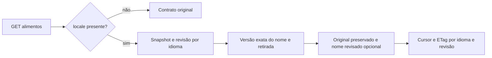

# Contratos da V1 — implementado e planejado

**CódigoGo0.6.0/25operações**:saúde,sessão,catálogo,referências alimentares,privacidade ealimentação particular. Leitura opcional poridioma/revisão foi validada emSQL/HTTPdescartável. Últimoambiente humano:Go0.5.1/migration8;GoogleAndroiddebug,privacidade econsumo real já confirmados.00009/10nãoaplicadas àbase entregue;Flutter ainda semnomes revisados. Demais rotas propostas continuam futuras. [Registro alimentar](../execucao/v1/alimentacao-registro.md), [auth](../execucao/v1/auth-local-fechamento.md).

## Leitura de nomes048 — códigoGo0.6.0,26/10

Continuam25operações. GET /api/v1/foods e GET /api/v1/foods/{id} ganharam parâmetros opcionais, documentados no [Swagger gerado](../../contracts/generated/swagger-v1.json). Validados porSQL/HTTP em banco descartável; migrations00009/00010 ainda não aplicadas à base entregue. O Flutter/APK15 continua no contrato original até a integração cliente. [Recibo](../execucao/v1/food-names-read-verification.json).

| Elemento | Contrato |
|---|---|
| locale | Opcional, somente pt-BR/pt-PT/en/es; ausente preserva resposta e cursor originais. Usa tag com hífen, não localeName dointl(pt_BR) |
| namesVersion | Opcional na lista, string decimal da revisão do idioma. O cursor já a carrega; revisão alterada retorna409food_name_catalog_changed para reiniciar a consulta |
| reviewedName | Opcional por alimento; nome revisado, idioma/hash próprio, crédito/licença e hashes de evidência. Ausente se não houver revisão ou a última versão tiver sido retirada |
| nameCatalog | Idioma e revisão da leitura; incluído somente no modo localizado. Não afirma cobertura global nem revisão clínica |
| nameOriginal/nameLocale/versionId/basis/nutrients | Preservados exatamente; tradução não trocafoodId oufoodVersion, nem muda preparo/base/cálculo |
| Busca | Nome original e nome/alias revisado do idioma, substring literal; ordenação porfoodId, sem mesclar homônimos. Lista paginada1–50, querymáxima100bytes |
| Cache/cursor | Snapshotrepeatable-read entre revisão e nomes. Cursor vincula query/fonte/limite/idioma/revisão; ETag inclui os dados retornados e é revalidado após visibilidade/retirada |

A00010 mantém revisão monotônica poridioma no mesmo commit de publicação/retirada. Repetir a mesma versão não incrementa a revisão. A seleção da última versão do nome precede a consulta de retirada: retirar a última não revive uma tradução antiga. Aliases internos não são expostos noDTO; dados/credenciais do revisor também não.

Ainda faltam publicação operacional com comprovação humana/direitos, cobertura editorial real e integraçãoFlutter(invalidação de consultas/cache ao trocar idioma ou receber409). Nenhumnome foi publicado; fixtures só noSQLdescartável. Aplicar9/10egrants na base entregue apenas no incremento de integração, preservando os registros. Isso não é medição de capacidade nem nova validaçãoGoogle.
