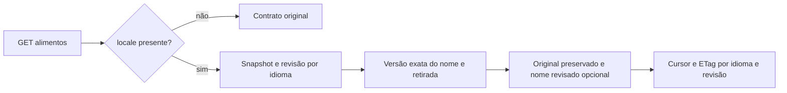

# Contratos da V1 — implementado e planejado

**CódigoGo0.6.1/25operações**, clienteFlutter integrado e schema11/26tabelas locais. Migrations9–11 autorizadas pelo autor e aplicadas após SQLdescartável. LeituraHTTP com a base real passou nos4idiomas; conta,consumo,sessões e6369versões preservados. APK0.3.3+16 preparado,sem instalação. Publicação humana de nomes/cobertura eaceites continuam pendentes. [Integração](../execucao/v1/frontend-food-names-verification.json),[ativação local](../execucao/v1/food-names-local-activation.json).

## Leitura de nomes048 — códigoGo0.6.0,26/10

Continuam25operações. GET /api/v1/foods e GET /api/v1/foods/{id} ganharam parâmetros opcionais, documentados no [Swagger gerado](../../contracts/generated/swagger-v1.json). Validados porSQL/HTTP emdescartável e depois porleitura na base real. Migrations9–11 aplicadas comautorização explícita,cliente integrado eAPK16 preparado. [Recibo](../execucao/v1/food-names-read-verification.json).

| Elemento | Contrato |
|---|---|
| locale | Opcional, somente pt-BR/pt-PT/en/es; ausente preserva resposta e cursor originais. Usa tag com hífen, não localeName dointl(pt_BR) |
| namesVersion | Opcional na lista, string decimal da revisão do idioma. O cursor já a carrega; revisão alterada retorna409food_name_catalog_changed para reiniciar a consulta |
| reviewedName | Opcional por alimento; nome revisado, idioma/hash próprio, crédito/licença e hashes de evidência. Ausente se não houver revisão ou a última versão tiver sido retirada |
| nameCatalog | Idioma e revisão da leitura; incluído somente no modo localizado. Não afirma cobertura global nem revisão clínica |
| nameOriginal/nameLocale/versionId/basis/nutrients | Preservados exatamente; tradução não trocafoodId oufoodVersion, nem muda preparo/base/cálculo |
| Busca | Nome original e nome/alias revisado do idioma, substring literal; ordenação porfoodId, sem mesclar homônimos. Lista paginada1–50, querymáxima100bytes |
| Cache/cursor | Snapshotrepeatable-read entre revisão e nomes. Cursor vincula query/fonte/limite/idioma/revisão; ETag inclui os dados retornados e é revalidado após visibilidade/retirada |

A00010 mantém revisão monotônica poridioma no mesmo commit de publicação/retirada. Repetir a mesma versão não incrementa a revisão. A seleção da última versão do nome precede a consulta de retirada: retirar a última não revive uma tradução antiga. Aliases internos não são expostos noDTO; dados/credenciais do revisor também não.

Flutter já invalida consulta/cursor ao trocar idioma e reinicia uma vez após409, preservando busca digitada,identidade eoriginal. Ainda faltam publicação operacional com comprovação humana/direitos,cobertura editorial eaceites.0nomes publicados; fixtures só nostestes.9–11egrants foram aplicados comautorização, sem mudar registros. Isso não é medição de capacidade nem nova validaçãoGoogle.

00011:OwnFoodInput não recebe idioma do nome. Novas declarações e projeção privada usamund(não informado), preservando nomes e linhas antigas em vez de assumir português ou oidioma daUI. Autorização/idempotência originais dafunção foram preservadas e testadas emSQLdescartável.
