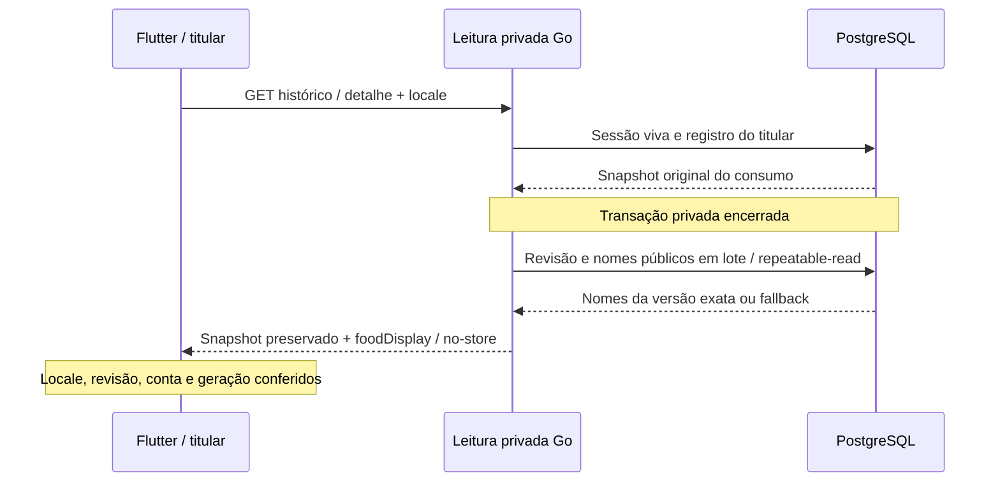
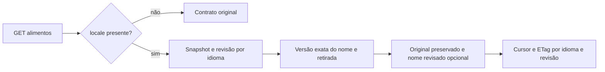

# Contratos da V1 — implementado e planejado

**Go 0.8.1 / 34 operações**, schema13/30tabelas local. Cliente de refeições e APKdebug0.4.3+25 integrados com refinamento de descoberta; aceite de nova refeição ainda pendente. Configuração047 encerrada funcionalmente. O parágrafo alimentar a seguir descreve a entrega anterior, preservada. A leitura localizada alcança biblioteca, seleção, histórico e detalhe/correção de consumo. Nenhuma migration nova; corpos e chaves de mutação permanecem iguais. [SQL/HTTP isolados](../execucao/v1/food-names-consumption-verification.json).

## Prontidão operacional0.8.1 —29/10

GET /api/v1/health/ready mantém200/503 e Problem genérico. Agora exige relações, leitura/escrita permitidas, funções e papel não elevado compatíveis com o runtime, além da conexão. Consulta apenas catálogos/permissões, sem dados privados. Falta de objeto/grant, privilégio inesperado, erro ou cancelamento falham como dependency_unavailable. Live continua separado. Não é auditoria completa deDDL, assinatura das funções, backups ou capacidade. [Testes e limites](../execucao/v1/ci-sql-verification.json).

## Refeições045 — contrato SQL/HTTP e cliente integrado

Go0.8.0 acrescenta cinco operações privadas. Migration13 validada em descartável e aplicada localmente com checkpoint/comparação; cliente e leitura Android integrados. [Semântica e evidências](../execucao/v1/refeicoes-045.md).

| Operação | Contrato |
|---|---|
| POST /api/v1/me/meals | title opcional0–80, occurredAt/timezone, reviewed:true, items1–32 EntryInput completos com revisão0. Confirma grupo e novos consumos atomicamente; não aceita IDs antigos para vínculo implícito |
| GET /api/v1/me/meal-diary | date/timezone obrigatórios, locale opcional. Diary contém entries únicos, grupos por entryIds, ungroupedEntryIds, totais e complete. Limite100 e otherActiveItems tornam o recorte explícito |
| GET /api/v1/me/meals/{id} | Metadados e itens originais do titular, incluindo tombstones; conta alheia404. locale opcional afeta somente foodDisplay |
| PATCH mesmo caminho | revision esperada, reviewed:true, title/occurredAt/timezone. Corrige metadados sem mudar tempos ou quantidades individuais; nova versão de grupo |
| DELETE mesmo caminho | revision esperada e reviewed:true. Exclui grupo e seus consumos ativos atomicamente, preservando tombstones/revisões |
| Escrita e erro | Bearer, titular da sessão e revalidaçãoSQL; chaveUUID estável, resposta idempotente24h, corpo estritoUTF8 até64KiB, datas com precisão de microssegundos. Erros existentes400/401/404/409/413/415/429/503; no-store |
| Reenvio após correção/exclusão | Confere o resultado atual contra a resposta salva; conflito em vez de reapresentar uma refeição antiga ou recriar consumos |
| Privacidade | meals/mealItems/mealVersions na exportação; exclusão confirmada/restore limpa os três conjuntos. Antes da13, seções novas vazias, sem quebrar o ciclo existente |

Revisão de metadados não substitui revisão do consumo. Remover um item preserva os demais e o grupo; imagem e fila offline ainda dependem042/026. Não considerar fixtures como refeição humana ou concluir045 somente com esses endpoints.

## Configuração privada047 — 27/10/2026

| Elemento | Contrato implementado |
|---|---|
| GET /api/v1/me/training-configuration | current:null ou snapshot privado com contract/revision/configuration/confirmedAt; resourceLabels/unavailableResources fora do snapshot |
| PUT mesmo caminho | revision esperada, reviewed:true, configuration completa; Idempotency-Key UUID por intenção. Sem userId no body. Nova versão=esperada+1 |
| GET …/resources | q original literal até100runes, limit1–20, cursor vinculado à conta/busca/limite. Identidade composta fonte/equipamento e nome original/fonte; sem dose ou mídia |
| Campos | environments1–3; resources declared1–32refs ou none/unknown com[]; personal/caregiver_break; fusoUTC/IANA/offset; availability1–28 com weekday1–7, minutesAvailable1–1440 e startTimeHH:MM/null |
| Mutação | Corpo estrito16KiB/UTF8/sem chaves duplicadas, review explícito, revisão otimista e transação idempotente24h. Mesma chave/corpo recupera versão anterior, mesmo após retirada de recurso; outro significado conflita |
| Segurança | Bearer e revalidação SQL de credencial/titular; X-TrainForge-Account opcional valida igualdade, não concede identidade. no-store,60/min/conta |
| Erros |400invalid_training_configuration com fields de caminhos/códigos fixos;401invalid_credential;409training_configuration_conflict;413/415/429;503training_configuration_unavailable. Sem valor privado/SQL na mensagem |
| Privacidade | Exportação inclui trainingConfigurations; exclusão confirmada e restore/ledger limpam versões. Runtime só lê tabela/view e executa funções restritas |
| Cliente | Rascunho em memória; saída com aviso; retorno e idioma preservam respostas; retry incerto mantém corpo/chave; conflito não descarta silenciosamente; conta/geração descartam respostas antigas |

[Matriz completa, implementação e limites de aceite](../execucao/v1/configuracao-treino-047.md). Configuração é declaração de rotina, não avaliação física, elegibilidade ou prescrição. Seleção015 e composição044 continuam com seus gates.

## Leitura privada localizada — 27/10/2026

| Elemento | Contrato |
|---|---|
| GET /api/v1/me/food-entries | date/timezone obrigatórios; locale opcional pt-BR/pt-PT/en/es e namesVersion opcional. Sem locale, contrato/cursor original. Limite1–20, default10 |
| GET /api/v1/me/food-entries/{id} | Nova leitura do consumo ativo do titular, com locale opcional. Alheio ou excluído retorna404; credencial inválida/revogada401. Sem pesquisa de titular por parâmetro |
| foodDisplay | Metadados opcionais por registro: foodId/foodVersion exatos, nameCatalog e reviewedName opcional. Fora de calculation; nunca persistidos no snapshot, na exportação ou na resposta idempotente de escrita |
| nameCatalog | Revisão por idioma no envelope da página e em foodDisplay. Snapshot repeatable-read da revisão e de todos os nomes da página |
| Cursor | Conta, dia, fuso e modo localizado/idioma/revisão vinculados. Carrega revisão, mesmo sem reenviar namesVersion. Revisão alterada retorna409 food_name_catalog_changed; Flutter recarrega a primeira página sem mesclar gerações |
| Privacidade | Bearer e guarda de conta existentes, sessão revalidada em SQL, filtro por user_id. Cache-Control:no-store. Biblioteca pública não recebe IDs da conta nem registros privados |
| Lote/conexões | Consulta privada encerra sua transação antes da projeção pública. Uma consulta SQL de nomes por página, alvos deduplicados; pool com uma conexão ensaiado sem bloqueio |
| Integridade | Identidade/versão, calculation, preparo, base, quantidade, nutrientes e histórico inalterados. Declaração personal/own mantém nome e idioma declarado, sem tradução |
| Detalhe/correção | Leitura individual atualiza metadados ao abrir, retomar e após corrigir. Idioma/resposta antiga não substitui geração nova. Edição usa FoodReference de apresentação separado; envia somente o contrato original |

O idioma da interface segue o aparelho por padrão. Escolha manual é opcional em configurações e não traduz documentos ou alimentos automaticamente. Timeout inicial não grava padrão: resposta tardia só restaura a preferência se leitura/tentativa/escolha não tiverem sido substituídas. Falha mantém recuperação explícita.

Os itens abaixo preservam a entrega pública anterior; a antiga lacuna privada foi resolvida pelo contrato acima. Zero nomes revisados publicados continua uma lacuna editorial explícita, com fallback original.

## Leitura de nomes048 — códigoGo0.6.0,26/10

Continuam25operações. GET /api/v1/foods e GET /api/v1/foods/{id} ganharam parâmetros opcionais, documentados no [Swagger gerado](../../contracts/generated/swagger-v1.json). Validados porSQL/HTTP emdescartável e depois porleitura na base real. Migrations9–11 aplicadas comautorização explícita,cliente integrado eAPK16 preparado. [Recibo](../execucao/v1/food-names-read-verification.json).

| Elemento | Contrato |
|---|---|
| locale | Opcional, somente pt-BR/pt-PT/en/es; ausente preserva resposta e cursor originais. Usa tag com hífen, não localeName dointl(pt_BR) |
| namesVersion | Opcional na lista, string decimal da revisão do idioma. O cursor já a carrega; revisão alterada retorna409food_name_catalog_changed para reiniciar a consulta |
| reviewedName | Opcional por alimento; nome revisado, idioma/hash próprio, crédito/licença e hashes de evidência. Ausente se não houver revisão ou a última versão tiver sido retirada |
| nameCatalog | Idioma e revisão da leitura; incluído somente no modo localizado. Não afirma cobertura global nem revisão clínica |
| nameOriginal/nameLocale/versionId/basis/nutrients | Preservados exatamente; tradução não trocafoodId oufoodVersion, nem muda preparo/base/cálculo |
| Busca | Nome original e nome/alias revisado do idioma, substring literal; ordenação porfoodId, sem mesclar homônimos. Lista paginada1–50, querymáxima100bytes |
| Cache/cursor | Snapshotrepeatable-read entre revisão e nomes. Cursor vincula query/fonte/limite/idioma/revisão; ETag inclui os dados retornados e é revalidado após visibilidade/retirada |

A00010 mantém revisão monotônica poridioma no mesmo commit de publicação/retirada. Repetir a mesma versão não incrementa a revisão. A seleção da última versão do nome precede a consulta de retirada: retirar a última não revive uma tradução antiga. Aliases internos não são expostos noDTO; dados/credenciais do revisor também não.

Flutter já invalida consulta/cursor ao trocar idioma e reinicia uma vez após409, preservando busca digitada,identidade eoriginal. A ferramenta editorial confere pacotes, publica/retira registros imutáveis e gera cobertura read-only; não há nova rota pública. O ensaio de idiomas Android passou; histórico/detalhe agora têm a projeção separada descrita acima. Uso editorial real exige evidência humana/direitos.0nomes publicados; fixtures só nostestes.9–11egrants foram aplicados comautorização, sem mudar registros. Isso não é medição de capacidade nem nova validaçãoGoogle.

Operação local e seus limites: [runbook editorial](../conteudo/nomes-alimentares-revisados.md), [recibo SQL/CLI/cobertura](../execucao/v1/food-names-operations-verification.json). Cobertura agrega versões públicas visíveis por idioma/revisão/fonte/versão e não lê dados particulares.

00011:OwnFoodInput não recebe idioma do nome. Novas declarações e projeção privada usamund(não informado), preservando nomes e linhas antigas em vez de assumir português ou oidioma daUI. Autorização/idempotência originais dafunção foram preservadas e testadas emSQLdescartável.
