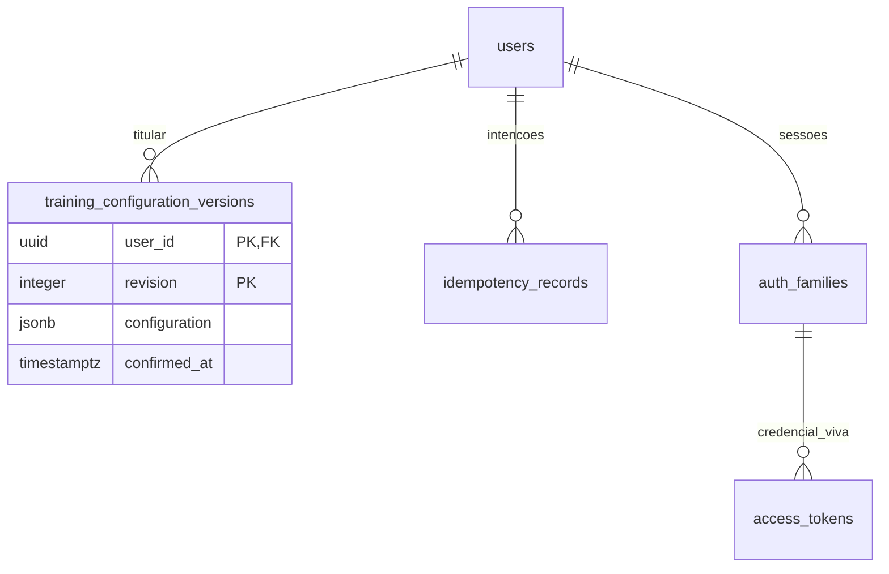
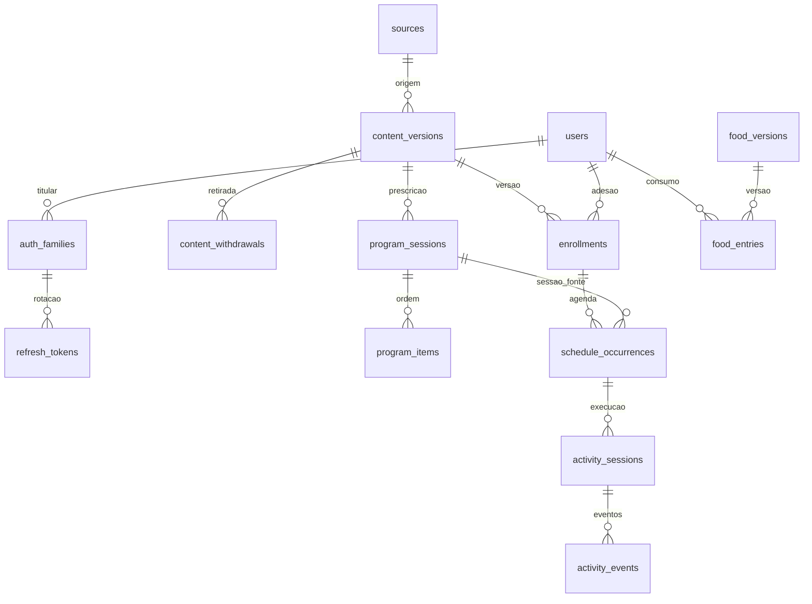
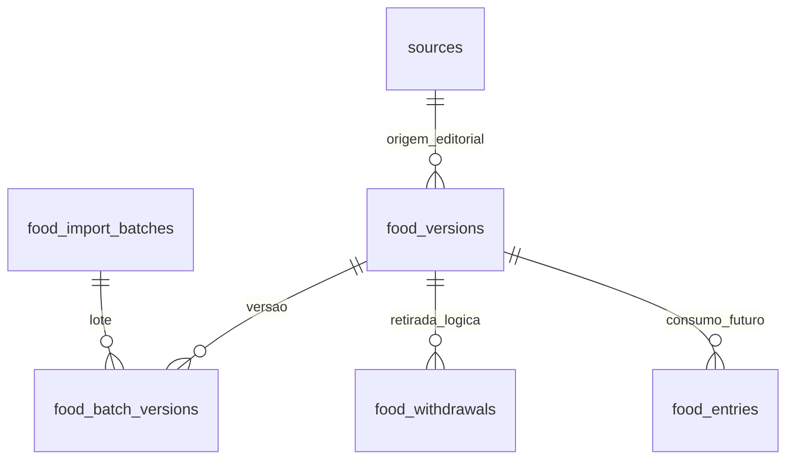
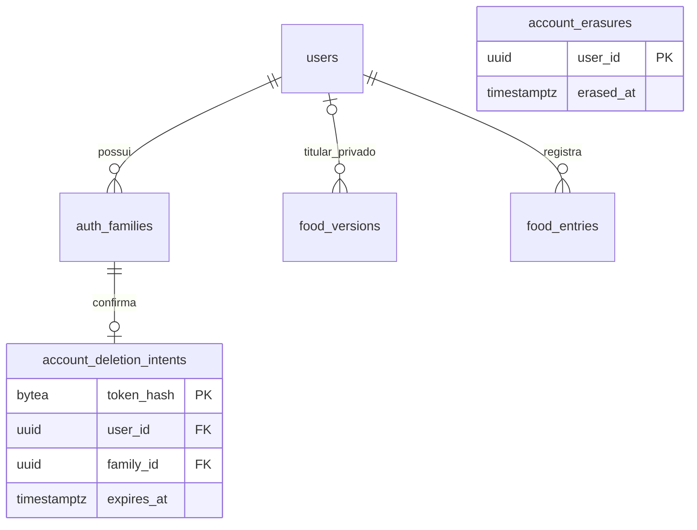

# Domínio e banco — modelo e implementação inicial

Migrations00001–00012 aplicadas ao banco isolado `trainforge_v1_dev` (27tabelas). A12 foi testada emdescartável e ativada comcheckpoint de schema e comparação das linhas reais; [recibo047](../execucao/v1/training-configuration-local-activation.json).9–11 foram autorizadas explicitamente pelo autor e testadas primeiro emdescartável. Comparação antes/depois preservou dados deusuário,consumo,sessões e alimentos. [Ativação](../execucao/v1/food-names-local-activation.json). O modelo abaixo descreve responsabilidades; esta implementação não habilita automaticamente seus casos de uso. Prisma/legado continuam separados. [Teste real de restauração](../execucao/v1/database-verification.json).

| Entidade proposta | Responsabilidade e relação |
|---|---|
| Identity / User / AuthSession | Provedor+issuer+sub identifica login; usuário é titular; sessão guarda hash/rotação/revogação por dispositivo |
| Source / Attribution / RightsRecord | Origem primária, autores/contribuições, evidência e permissões por ativo/versão; licença desconhecida é estado explícito |
| Movement / MovementVersion | Conceito e variante concreta com população, ambiente e equipamentos; não confundir gesto com programa |
| InstructionVersion / MediaAsset | Expressão instrucional e mídia separadas, idioma, autoria, revisão, direito de exibir/redistribuir e alternativa acessível |
| Program / ProgramVersion | Unidade editorial estável e versão imutável; pode ser programa integral ou coleção modular explicitamente identificada |
| ProgramSession / PrescriptionItem | Ordem e dose da versão, referência exata ao componente/instrução, progressão permitida e apoio exigido |
| Enrollment / ScheduleOccurrence | Adesão de um titular a uma versão, opções permitidas e ocorrência em data/fuso; não duplicar a prescrição por usuário |
| ActivitySession / ActivityEvent | Execução realmente iniciada e eventos confirmados: pausa, medida, conclusão parcial/completa; autor do registro separado do titular |
| IdempotencyRecord | Usuário+operação+chave, hash do request e resultado; reenvio igual recupera resposta, payload divergente é conflito |
| Food / FoodVersion / NutrientValue | Alimento/preparo e versão da fonte, base por100g/100ml, nutrientes com ausência distinta de zero |
| UserFood / UserFoodVersion (nome a validar na009) | Cadastro real informado pelo usuário, com titular e origem distintos do catálogo pesquisado; não publicar nem tratar como revisado por inferência |
| FoodEntry | Quantidade e unidade confirmadas, data/fuso, alimento/versão e fatores usados no cálculo; edição rastreável |
| CareRelationship (posterior) | Vínculo e autorização explícitos para pessoa assistida; não pressuposto pelo perfil “cuidador” |

## Configuração de treino implementada047

training_configuration_versions guarda apenas user_id/revision/configuration/confirmed_at. PK(user_id,revision) serve histórico e leitura do mais recente. Trigger rejeita UPDATE; runtime não tem DML direto. save_training_configuration revalida sessão, trava titular e confirma revisão/recursos, depois salva versão e idempotência atomicamente. A view training_configuration_resources é pública quanto ao conteúdo editorial, mas acessada pela rota autenticada; nenhuma posse ou prática é inferida.

Celular: respostas incompletas somente em memória; corpo/chave congelados enquanto a confirmação for incerta. Banco: apenas declaração completa e revisada, versões antigas, resultado idempotente24h. Não salvar paciente, peso, altura ou diagnóstico sem finalidade fundamentada. Preferências de idioma/tema continuam no dispositivo. Exclusão/restore integram o inventário privado e o ledger.

## Dose e unidades

Representar campos opcionais/tipados: sets, repetitions, holdSeconds, durationSeconds, distanceMeters, side, restSeconds, tempo, intensidade conforme a fonte e regra de progressão quando existir. A lista é proposta de modelagem, não autorização para preencher os campos de todo componente. `null` significa ausente/não demonstrado; zero representa valor real quando válido. Dose prescrita, tempo do timer e realizado pelo usuário são coisas diferentes.

Não transformar oito variantes ReViEEW em circuito novo ou transferir a eficácia de um programa a uma peça. N15 guarda onze componentes para cuidadores; ES2019-DOM-01 guarda cinco movimentos para idosos em casa, em pacote separado. Instrução, apoio, público e direitos continuam vinculados a cada versão.

## Integridade e tempo

O [piloto esclarecido](../execucao/v1/decisoes-piloto.md) exige busca em base alimentar ampla e opção de cadastrar alimento próprio. A modelagem deve distinguir origem editorial e informação do usuário, preservar versões usadas no consumo e representar nutrientes/porções desconhecidos sem inventar valores. Compartilhamento/moderação não foi decidido. Catálogo e cadastro próprio podem participar da busca autorizada da conta; essa consulta não deve expor cadastros de terceiros.

IDs estáveis opacos; foreign keys para versões; timestamps UTC e fuso IANA para interpretar datas da agenda. Data local não deve ser deduzida do relógio do servidor. Uma ocorrência não é “toda segunda-feira para sempre”. Estados e transições devem ter contrato explícito, incluindo planejado, iniciado, pausado, parcial, concluído, não feito e descanso.

Exemplos de invariantes a fechar/testar: chave idempotente única por titular/operação; no máximo uma execução aberta por ocorrência; ordem de item única por sessão editorial; identidade única por provedor/issuer/sub; token hash único e rotação consumida uma única vez. Não exigir uma única sessão de autenticação para toda a conta. Decidir política de múltiplas adesões sem copiar o índice antigo de “um plano ativo” automaticamente.

Toda query privada usa o titular autorizado. Histórico preserva versão editorial mesmo após retirada de publicação. Retirada pode impedir novas execuções; a política de exibição histórica respeitará direitos e retenção. Dados de saúde e registros de outra pessoa não são conteúdo público do catálogo.

## Migrations e recuperação

API Go será a única responsável pelo schema novo. Primeiro banco isolado; migrations pequenas forward, revisão SQL, testes concorrentes e backup restaurável. Se houver dados reais no legado, inventariar contagens/estrutura com autorização, mapear campos (incluindo `completeAt` → `completedAt`) e ensaiar importação sem sobrescrever o original. Não inventar que existem usuários/dados para migrar.

`V1-010` deve registrar versão PostgreSQL suportada, limites de pool, extensões justificadas e papéis runtime/migration separados. Backup só conta como validado depois de restaurado e conferido em base separada. Não usar `docker compose down -v` ou reset de volume para “corrigir” migration.

## Modelo físico aplicado na etapa02

`content_versions` guarda movimentos, instruções, mídia, programas e coleções separados por `kind`, payload original revisado e hash canônico. `source_published_version` continua nulo se a fonte não informar versão; o hash não se apresenta como versão publicada pelo autor. Direitos e atribuição permanecem no payload. `batch_content` liga cada versão ao lote/manifesto.

Sessão prescrita tem chave composta de programa+versão+session_key. Item aponta para essa sessão e para uma versão de movimento; ocorrência repete as chaves sob FKs que comprovam a adesão e a sessão daquela versão. `source_dose` ausente permanece null; validação tipada de cada dose/apoio será implementada antes da prática.

Invariantes SQL efetivamente ensaiadas no restore: rejeitar duas execuções abertas na mesma ocorrência, evento de outro titular, movimento usado como programa, conclusão sem datas finais e ocorrência sem sessão prescrita. Nenhuma fixture persistiu. As FKs não substituem ownership nas queries HTTP.

`food_versions` distingue fonte editorial e titular de cadastro próprio por CHECK exclusivo. Nutrientes preservam estado/ausência em JSON; bases e unidades são explícitas. Nenhum alimento foi importado nessa etapa. Suporte a outra pessoa assistida permanece posterior e exige vínculo/consentimento; os registros atuais só permitem o próprio titular.

Papéis separados: migrator é proprietário do banco novo; runtime tem CRUD apenas das tabelas privadas e leitura editorial, sem CREATE/UPDATE editorial ou superuser. Scripts de bootstrap usam owner apenas no cluster criado para o clone. [Runbook da etapa02](../execucao/v1/etapa-02-fechamento.md).

## Incremento alimentar00005 —22/10

6369food_versions reais importadas (3484Ciqual/2885CoFID),2identidadesconflitantes fora do lote e3basesdesconhecidas mantidas. ImportadorGo é único escritor editorial; runtime apenasSELECT. Idioma/versão pública e operações explícitos, batch/versões e retirada lógica em tabelas próprias. Valores/limites são decimais exatos emstrings e estados tipados; fatores/denominadoresFA separados, sem soma de métodos alternativos. FK de fonte da00002foireutilizada. Cadastro próprio e consumoHTTP continuam pendentes.

[Importação/reimportação e restauração novas verificadas](../execucao/v1/alimentacao-importacao.md); documentação da etapa02 acima permanece histórica, sem inventar que já havia alimentos naquela entrega.

## V1-013: ciclo privado e confirmação

Migration00007 adiciona account_deletion_intents (noncehash, titular/família, expiração) e account_erasures (UUID/data, semFKpara permitir apagar a conta). Inventário de tabelas/colunas privadas é conferido em exportação/purge. Foodentryguard rejeita alimento privado de outro titular. Runtime continua semDELETEeditorial; função de exclusão privada exige sessão/nonce válidos. [Detalhes](../execucao/v1/privacidade-013.md).

Registro de exclusões não contém nome/e-mail/token. Cópia histórica só pode ser promovida depois do gate de exclusões atuais; o CLI não faz promoção. Manutenção é manual e limitada; backups existentes não são apagados.

## Decisões Q3 — configuração e retomada planejadas

Em25/10, o autor exigiu configuração completa antes da busca/seleção de treino; trocas de exercícios compatíveis e dias/horários editáveis; retomada ou encerramento parcial. V1-047 especificará a configuração privada, seus campos justificados, validação/versão e vínculo com as escolhas015/044. Esta seção é planejamento, sem nova tabela, endpoint ou migration aplicada.

- Configuração concluída é requisito da jornada de treino, com titularidade e versão; não libera prática sem fonte/instrução/regra/direito apropriados. A consulta de referências conserva seu recorte.
- Preferências de agenda e tempo disponível não são dose autorizada; alteração de composição/adesão não reescreve versões e eventos históricos.
- Retomar preserva somente dados efetivamente registrados. Pausa, parcial e conclusão têm ações/estados distintos; nenhum tempo/repetição é inferido do período em que o app ficou fechado.
- Campos físicos do formulário legado não se tornam obrigatórios por existir no código antigo; a matriz finalidade/campo/regra/contrato será detalhada na047.

[Decisões completas e categorias de campos](../execucao/v1/decisoes-piloto.md) · [Trilha por área](../execucao/v1/trilha-implementacao.md).

## Decisões Q4 — fila e exclusão de foto planejadas

Q4 exige registro offline durável (026) e exclusão de foto com a refeição (042/045). Servidor mantém o estado confirmado; aparelho conserva operações pendentes privadas com titular estável, identidade idempotente e versões para reconciliação. O pending atual do formulário em memória não entrega essa persistência.

Banco, arquivo/miniatura e fila precisam de exclusão coordenada: cancelar criação/upload não enviados; impedir recriação após exclusão confirmada; retentar limpeza de arquivo com falha sem restabelecer acesso. Outro aparelho reconcilia cache ao conectar. Revisões textuais não justificam foto excluída acessível.

Esta é modelagem a implementar, sem nova migration/tabela/armazenamento aplicado. Formato, proteção em repouso, limites e ciclo de conta serão definidos/ensaiados antes do uso privado. [Decisões completas](../execucao/v1/decisoes-piloto.md).

## Decisões Q5 — nomes revisados e localidade planejados

V1-048 manterá traduções/aliases revisados separados do conteúdo original, vinculados à identidade e versão da fonte e ao idioma/localidade. Revisão, direitos e versão da tradução precisam ser rastreáveis; nome traduzido não muda preparo, base, nutrientes ou ID do alimento.

Hoje a API expõe nameOriginal/nameLocale e o cliente só compacta espaços em displayName; o importador original recusa namePt preenchido. Não alterar lote/hash original para simular tradução. Busca/cache deverão considerar idioma/versão e aliases revisados sem mesclar alimentos homônimos. O contrato novo ainda será implementado e gerado no Swagger, sem campos/tabelas novos nesta rodada.

Configuração047 seguirá etapas curtas por assunto e revisão final, com o mesmo contexto/versionamento privado do Q3. Localização da UI e idioma do conteúdo são dimensões distintas; fonte estrangeira não vira base regional brasileira pela tradução. [Decisões Q5](../execucao/v1/decisoes-piloto.md).

## Q6 — autorização administrativa planejada

049 modelará permissão master explícita e revogável vinculada a identidade autenticada estável. Uso próprio mantém autor/titular na mesma conta; exclusão excepcional precisa de recurso/titular exatos, confirmação e auditoria mínima. Isso não adiciona papel/tabela/migration ao runtime nesta rodada nem implica acesso irrestrito. Retirada editorial continua distinta da exclusão de registro privado.

## Nomes alimentares revisados — fundação048,26/10

A migration00009 adiciona duas tabelas editoriais separadas. Depois da validação emdescartável,9–11foram aplicadas àbase local comautorização;26tabelas e dados preservados. [Evidência](../execucao/v1/food-names-foundation-verification.json).

| Tabela | Guarda | Relação e permissão |
|---|---|---|
| food_name_versions | Nome e até16aliases de um idioma, hash próprio, payload revisado, autor/data, hashes das evidências de revisão/direitos, licença/atribuição e instante de publicação | FK exata para food_versions(food_id,version_sha); PK inclui idioma/hash do nome. Runtime somenteSELECT; versões imutáveis |
| food_name_withdrawals | Retirada da versão do nome, motivo e instante | FK para a versão exata do nome; retirada não pode ser apagada/alterada |

O original, a composição, os hashes importados e os consumos não são atualizados. Nomes particulares não entram nessa camada pública. O modeloGo eSQL rejeita identidades privadas, locale fora de pt-BR/pt-PT/en/es e publicação sem campos/evidências exigidos; validaçãoGo rejeita aindaJSONambíguo, campos extras, aliases duplicados e controles invisíveis. A persistência exige bytes de evidência com hashes iguais aos registrados e repete sem duplicar a mesma versão.

**Hash e booleano não comprovam autoria humana nem validade de licença.** A [ferramenta operacional](../conteudo/nomes-alimentares-revisados.md) confere os bytes e exige confirmação do pacote/revisor antes de escrever. A retirada guarda decisão e hash documental imutáveis no campo reason existente. A verificação humana e a retenção dos documentos continuam responsabilidade do operador; não há autenticação de revisores implementada. Não há endpoint público de publicação, nem publicação automática, tradução real ou tradução real importada na base entregue. Sem evidência humana apropriada, manter0nomes publicados.

LeituraGo0.6.0 agora escolhe a versão do nome antes de considerar retirada, sem reviver tradução anterior. Contrato aditivo de locale/revisão, busca por nome/alias mantendofoodId efoodVersion e cursor/ETag foram validados noSQLdescartável.00010adicionafood_name_catalogs:4linhas de metadados poridioma, revisãoBIGINTincrementada atomicamente por publicação/retirada, sem nomes semeados. Repetição idempotente não altera a revisão. Flutter agora integra apresentação/cache de consulta/409. Ferramenta operacional e cobertura read-only foram entregues sem nova migration. A cobertura atual é 0/6.369 em cada idioma. O ensaio Android de idiomas foi feito no APK19; falta a projeção de nomes no histórico/detalhe de consumo, sem atualizar snapshots, e a aplicação editorial quando houver pacote humano aprovado. [Contrato](contratos-v1.md). O modelo não implica abrangência global de alimentos nem aprovação clínica.

A00011não adiciona tabela nem reescreve linhas. Preserva o controle por conta/sessão dafunção privada e grava idioma do nome comound(não declarado). A projeção deixa de repetir a antiga suposição automática de português; os registros/snapshots antigos permanecem paraauditoria.

## Projeção de leitura048 — 27/10/2026

EntryFoodDisplay/NameCatalog são DTOs de leitura, não tabelas nem novo estado persistido. Histórico/detalhe localizados resolvem o nome pela identidade e versão consumida, sem alterar calculation, nutrientes ou nomes particulares. O SQL privado revalida a sessão e mantém ownership; após encerrar a transação, a projeção editorial usa snapshot repeatable-read e lote. Pool de uma conexão, retirada/revisão, conta alheia/revogada/excluída e replay de mutação passaram em banco descartável. Schema11/26tabelas e dados reais preservados; nenhuma migration nova. [Contrato](contratos-v1.md), [recibo](../execucao/v1/food-names-consumption-verification.json).
