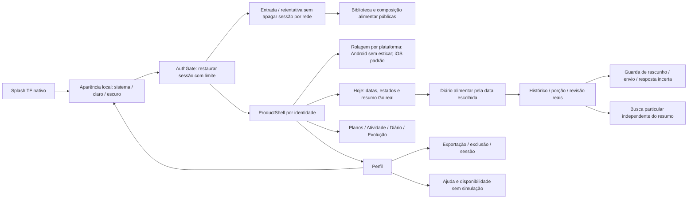
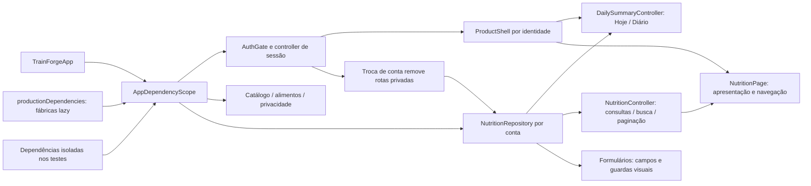
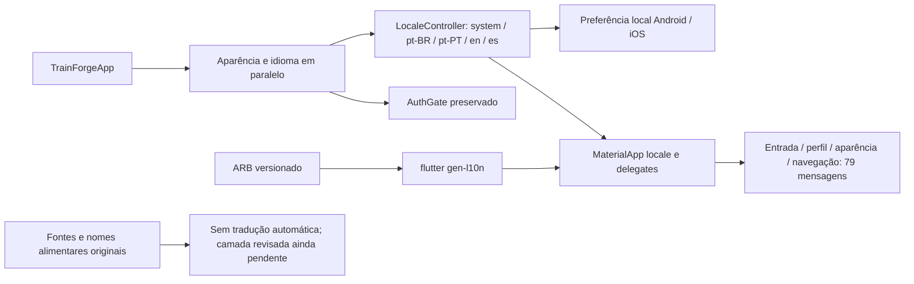
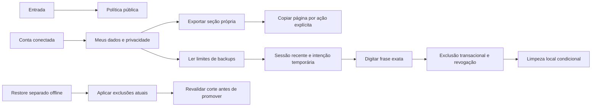

# Telas, chamadas e navegação

A [documentação dinâmica](README.md) tem mapas de telas, chamadas HTTP, banco e arquitetura proposta no próprio repositório, sem servidor de leitura. Referências de construtor/import são evidência estática; não demonstram clique bem-sucedido ou condição de navegação.

## Fluxo atual lido no Flutter

Checkpoint24/10: frontend07–12 nos fluxos disponíveis, Androiddebug0.3.0+13. Biblioteca/detalhe, composição/cadastro/histórico/subtotais/consumo, privacidade eajuda usam primitives atuais; proteção de rascunho/envio/resposta incerta e busca particular independente.101testesFlutter/analyze0issues. [Critérios e gates](../execucao/v1/frontend-fidelidade-figma.md). Configuração persistida, treino/atividade e demais funções sem contrato/conteúdo continuam indisponíveis; referênciasFigma faltantes e execução nativa iOS pendentes. Pontos01–06, identidade/temas/rolagem e dados reais preservados.

## Composição Flutter implementada em 25/10

TrainForgeApp recebe AppDependencies ou compõe as fábricas de produção uma vez na raiz. O escopo fica acima do Navigator, alcançando também as rotas abertas depois. As fábricas criam os serviços sob demanda; dados privados são vinculados à conta, sem singleton de estado do diário. [Verificação](../execucao/v1/frontend-composition-verification.json): rotas públicas/tema, reutilização do serviço e troca de identidade;103 testes aprovados/analyze sem issues. Segundo incremento:estado emNutritionController eAPP_ENV por ambiente,108testes/analyze0issues.021encerrada no seu recorte; [critérios](../execucao/v1/frontend-state-verification.json). Entrada/foco/validação dos formulários permanecem naUI, comrepository injetado.

### Configuração por ambiente

APP_ENV aceita development, staging ou production; emdebug o default édevelopment e emprofile/release éproduction. API_BASE_URL continua definido por dart-define, com o defaultlocal127.0.0.1:8082 preservado para desenvolvimento. HTTP só é permitido parahosts locais exatos emdevelopment/debug; staging/production eprofile/release exigemHTTPS. URL não aceita credenciais,query,fragmento,pathextra ouhostvazio. Nenhum endpoint externo foi criado; ambiente configurado não implica hospedagem. IDsOAuth permanecem públicos separados de segredos.

## Idioma e preferência local — V1-048 parcial

A raiz carrega idioma e aparência em paralelo antes de restaurar a sessão. LocaleScope mantém a preferência local; MaterialApp usa os recursos ARB tipados e delegates oficiais. A preferência não modifica a conta ou o banco. A resolução respeita pt-BR/pt-PT/en/es, usa o idioma do aparelho quando selecionado e cai para pt-BR quando nenhum idioma é suportado.

[Recibo048](../execucao/v1/frontend-localization-verification.json) separa infraestrutura e mensagens migradas do restante da interface. Helpers de datas/decimal estão testados, mas os demais fluxos/plurais ainda precisam migrar. A API continua sem locale/alias e sem novo endpoint; nomes revisados exigirão contrato aditivo, versão, revisão, direitos e testes próprios. Não enviar parâmetros que a API atual rejeita. iOS não executado nativamente.

## Privacidade implementada em23/10

Política pública sem login. Conta conectada abre exportação própria por seção e exclusão confirmada. Os controles privados e o aceite local comGoogle foram validados em23/10; os recibos históricos distinguem login, exportação e exclusão autorizada.

