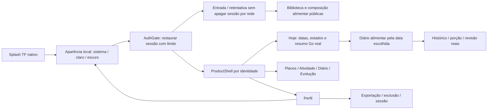
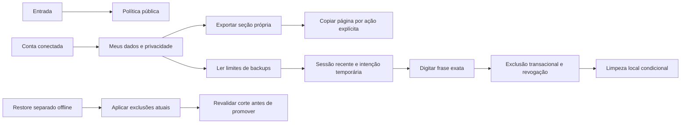

# Telas, chamadas e navegação

A [documentação dinâmica](README.md) tem mapas de telas, chamadas HTTP, banco e arquitetura proposta no próprio repositório, sem servidor de leitura. Referências de construtor/import são evidência estática; não demonstram clique bem-sucedido ou condição de navegação.

## Fluxo atual lido no Flutter

Checkpoint23/10: pontosfrontend01–06 concluídos noAndroiddebug0.2.0+11 conforme direção doautor (aberturaTF/dark derivado). Aparência local é lida antes deAuthGate; restauração limitada apresenta entrada/retentativa ouProductShell poridentidade. Hoje/Diário usam resumoGo real; calendário abre histórico por data. Cinco abas preservam estado/foco/voltar; perfil abre aparência/privacidade/sessão. AppShell legado continua fora da composição. Execução/adesão e demais funções semcontrato/conteúdo permanecem indisponíveis.

## Privacidade implementada em23/10

Política pública sem login. Conta conectada abre exportação própria por seção e exclusão confirmada. Os controles privados e o aceite local comGoogle foram validados em23/10; os recibos históricos distinguem login, exportação e exclusão autorizada.

