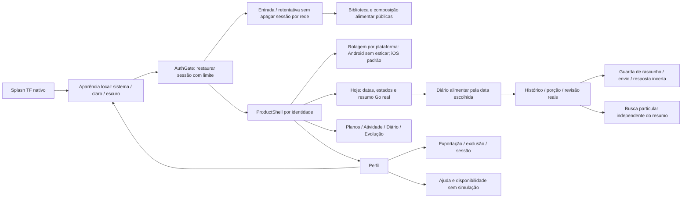
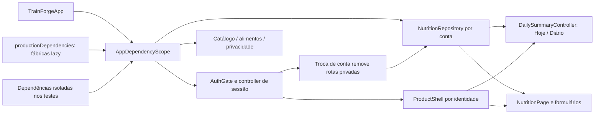
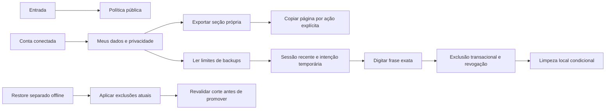

# Telas, chamadas e navegação

A [documentação dinâmica](README.md) tem mapas de telas, chamadas HTTP, banco e arquitetura proposta no próprio repositório, sem servidor de leitura. Referências de construtor/import são evidência estática; não demonstram clique bem-sucedido ou condição de navegação.

## Fluxo atual lido no Flutter

Checkpoint24/10: frontend07–12 nos fluxos disponíveis, Androiddebug0.3.0+13. Biblioteca/detalhe, composição/cadastro/histórico/subtotais/consumo, privacidade eajuda usam primitives atuais; proteção de rascunho/envio/resposta incerta e busca particular independente.101testesFlutter/analyze0issues. [Critérios e gates](../execucao/v1/frontend-fidelidade-figma.md). Configuração persistida, treino/atividade e demais funções sem contrato/conteúdo continuam indisponíveis; referênciasFigma faltantes e execução nativa iOS pendentes. Pontos01–06, identidade/temas/rolagem e dados reais preservados.

## Composição Flutter implementada em 25/10

TrainForgeApp recebe AppDependencies ou compõe as fábricas de produção uma vez na raiz. O escopo fica acima do Navigator, alcançando também as rotas abertas depois. As fábricas criam os serviços sob demanda; dados privados são vinculados à conta, sem singleton de estado do diário. [Verificação](../execucao/v1/frontend-composition-verification.json): rotas públicas/tema, reutilização do serviço e troca de identidade;103 testes aprovados/analyze sem issues. Estado/formulários alimentares e configuração por ambiente continuam em revisão na021.

## Privacidade implementada em23/10

Política pública sem login. Conta conectada abre exportação própria por seção e exclusão confirmada. Os controles privados e o aceite local comGoogle foram validados em23/10; os recibos históricos distinguem login, exportação e exclusão autorizada.

