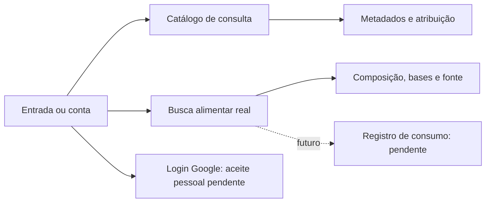

# Telas, chamadas e navegação

A [documentação dinâmica](README.md) tem mapas de telas, chamadas HTTP, banco e arquitetura proposta no próprio repositório, sem servidor de leitura. Referências de construtor/import são evidência estática; não demonstram clique bem-sucedido ou condição de navegação.

## Fluxo atual lido no Flutter

AuthGate restaura a sessãoGo e apresenta entrada ou conta. Ambas abrem CatalogPage e FoodPage sem depender de consentimento Google para consulta pública. Biblioteca abre detalhe de metadados; alimentos abre composição original/atribuição. AppShell/Hoje, contexto, adesão, execução e consumo permanecem estruturas legadas ou propostas e não são a jornada integrada desta build.

