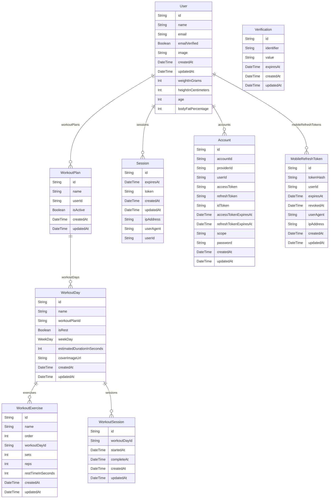

# Banco: referência e modelo proposto

> Gerado de código e registros versionados por `tools/gerar_documentacao.py`. Não editar este arquivo à mão. Revisão das entradas: `0e61188c19be9ed5`.

## Referência atual: schema Prisma externo

Relações são lidas do schema capturado. Este diagrama não comprova que migrations foram aplicadas. Cardinalidade representa o tipo declarado; regras de negócio e índices estão na fonte.

### User

[prisma/schema.prisma:12](https://github.com/richardcastrogois/bootcamp-treinos-api/blob/523f6d9609bef532958f14227b2b2e105d5f3bcf/prisma/schema.prisma#L12)

| Campo | Tipo | Relação |
| --- | --- | --- |
| id | `String` | não |
| workoutPlans | `WorkoutPlan[]` | sim |
| name | `String` | não |
| email | `String` | não |
| emailVerified | `Boolean` | não |
| image | `String?` | não |
| createdAt | `DateTime` | não |
| updatedAt | `DateTime` | não |
| sessions | `Session[]` | sim |
| accounts | `Account[]` | sim |
| mobileRefreshTokens | `MobileRefreshToken[]` | sim |
| weightInGrams | `Int?` | não |
| heightInCentimeters | `Int?` | não |
| age | `Int?` | não |
| bodyFatPercentage | `Int?` | não |

### WorkoutPlan

[prisma/schema.prisma:33](https://github.com/richardcastrogois/bootcamp-treinos-api/blob/523f6d9609bef532958f14227b2b2e105d5f3bcf/prisma/schema.prisma#L33)

| Campo | Tipo | Relação |
| --- | --- | --- |
| id | `String` | não |
| name | `String` | não |
| userId | `String` | não |
| user | `User` | sim |
| workoutDays | `WorkoutDay[]` | sim |
| isActive | `Boolean` | não |
| createdAt | `DateTime` | não |
| updatedAt | `DateTime` | não |

### WorkoutDay

[prisma/schema.prisma:56](https://github.com/richardcastrogois/bootcamp-treinos-api/blob/523f6d9609bef532958f14227b2b2e105d5f3bcf/prisma/schema.prisma#L56)

| Campo | Tipo | Relação |
| --- | --- | --- |
| id | `String` | não |
| name | `String` | não |
| workoutPlanId | `String` | não |
| workoutPlan | `WorkoutPlan` | sim |
| isRest | `Boolean` | não |
| weekDay | `WeekDay` | não |
| exercises | `WorkoutExercise[]` | sim |
| estimatedDurationInSeconds | `Int` | não |
| coverImageUrl | `String?` | não |
| createdAt | `DateTime` | não |
| updatedAt | `DateTime` | não |
| sessions | `WorkoutSession[]` | sim |

### WorkoutExercise

[prisma/schema.prisma:74](https://github.com/richardcastrogois/bootcamp-treinos-api/blob/523f6d9609bef532958f14227b2b2e105d5f3bcf/prisma/schema.prisma#L74)

| Campo | Tipo | Relação |
| --- | --- | --- |
| id | `String` | não |
| name | `String` | não |
| order | `Int` | não |
| workoutDayId | `String` | não |
| workoutDay | `WorkoutDay` | sim |
| sets | `Int` | não |
| reps | `Int` | não |
| restTimeInSeconds | `Int` | não |
| createdAt | `DateTime` | não |
| updatedAt | `DateTime` | não |

### WorkoutSession

[prisma/schema.prisma:90](https://github.com/richardcastrogois/bootcamp-treinos-api/blob/523f6d9609bef532958f14227b2b2e105d5f3bcf/prisma/schema.prisma#L90)

| Campo | Tipo | Relação |
| --- | --- | --- |
| id | `String` | não |
| workoutDayId | `String` | não |
| workoutDay | `WorkoutDay` | sim |
| startedAt | `DateTime` | não |
| completeAt | `DateTime?` | não |
| createdAt | `DateTime` | não |
| updatedAt | `DateTime` | não |

### MobileRefreshToken

[prisma/schema.prisma:103](https://github.com/richardcastrogois/bootcamp-treinos-api/blob/523f6d9609bef532958f14227b2b2e105d5f3bcf/prisma/schema.prisma#L103)

| Campo | Tipo | Relação |
| --- | --- | --- |
| id | `String` | não |
| tokenHash | `String` | não |
| userId | `String` | não |
| user | `User` | sim |
| expiresAt | `DateTime` | não |
| revokedAt | `DateTime?` | não |
| userAgent | `String?` | não |
| ipAddress | `String?` | não |
| createdAt | `DateTime` | não |
| updatedAt | `DateTime` | não |

### Session

[prisma/schema.prisma:121](https://github.com/richardcastrogois/bootcamp-treinos-api/blob/523f6d9609bef532958f14227b2b2e105d5f3bcf/prisma/schema.prisma#L121)

| Campo | Tipo | Relação |
| --- | --- | --- |
| id | `String` | não |
| expiresAt | `DateTime` | não |
| token | `String` | não |
| createdAt | `DateTime` | não |
| updatedAt | `DateTime` | não |
| ipAddress | `String?` | não |
| userAgent | `String?` | não |
| userId | `String` | não |
| user | `User` | sim |

### Account

[prisma/schema.prisma:137](https://github.com/richardcastrogois/bootcamp-treinos-api/blob/523f6d9609bef532958f14227b2b2e105d5f3bcf/prisma/schema.prisma#L137)

| Campo | Tipo | Relação |
| --- | --- | --- |
| id | `String` | não |
| accountId | `String` | não |
| providerId | `String` | não |
| userId | `String` | não |
| user | `User` | sim |
| accessToken | `String?` | não |
| refreshToken | `String?` | não |
| idToken | `String?` | não |
| accessTokenExpiresAt | `DateTime?` | não |
| refreshTokenExpiresAt | `DateTime?` | não |
| scope | `String?` | não |
| password | `String?` | não |
| createdAt | `DateTime` | não |
| updatedAt | `DateTime` | não |

### Verification

[prisma/schema.prisma:157](https://github.com/richardcastrogois/bootcamp-treinos-api/blob/523f6d9609bef532958f14227b2b2e105d5f3bcf/prisma/schema.prisma#L157)

| Campo | Tipo | Relação |
| --- | --- | --- |
| id | `String` | não |
| identifier | `String` | não |
| value | `String` | não |
| expiresAt | `DateTime` | não |
| createdAt | `DateTime` | não |
| updatedAt | `DateTime` | não |

## Go: tabelas declaradas em migrations versionadas

Declaração SQL não prova aplicação no banco; o resultado runtime está em database-verification.json. ALTERs, índices, tipos e FKs completos permanecem nos arquivos fonte.

| Tabela | Migration fonte |
| --- | --- |
| users | [services/api/migrations/00001_core.sql:4](../../../services/api/migrations/00001_core.sql) |
| auth_families | [services/api/migrations/00001_core.sql:14](../../../services/api/migrations/00001_core.sql) |
| refresh_tokens | [services/api/migrations/00001_core.sql:21](../../../services/api/migrations/00001_core.sql) |
| sources | [services/api/migrations/00001_core.sql:29](../../../services/api/migrations/00001_core.sql) |
| content_versions | [services/api/migrations/00001_core.sql:36](../../../services/api/migrations/00001_core.sql) |
| content_withdrawals | [services/api/migrations/00001_core.sql:52](../../../services/api/migrations/00001_core.sql) |
| import_batches | [services/api/migrations/00001_core.sql:60](../../../services/api/migrations/00001_core.sql) |
| batch_content | [services/api/migrations/00001_core.sql:67](../../../services/api/migrations/00001_core.sql) |
| program_items | [services/api/migrations/00001_core.sql:75](../../../services/api/migrations/00001_core.sql) |
| enrollments | [services/api/migrations/00001_core.sql:87](../../../services/api/migrations/00001_core.sql) |
| schedule_occurrences | [services/api/migrations/00001_core.sql:99](../../../services/api/migrations/00001_core.sql) |
| activity_sessions | [services/api/migrations/00001_core.sql:110](../../../services/api/migrations/00001_core.sql) |
| activity_events | [services/api/migrations/00001_core.sql:127](../../../services/api/migrations/00001_core.sql) |
| idempotency_records | [services/api/migrations/00001_core.sql:137](../../../services/api/migrations/00001_core.sql) |
| food_versions | [services/api/migrations/00001_core.sql:148](../../../services/api/migrations/00001_core.sql) |
| food_entries | [services/api/migrations/00001_core.sql:169](../../../services/api/migrations/00001_core.sql) |
| program_sessions | [services/api/migrations/00003_prescribed_sessions.sql:3](../../../services/api/migrations/00003_prescribed_sessions.sql) |
| access_tokens | [services/api/migrations/00004_access_tokens.sql:3](../../../services/api/migrations/00004_access_tokens.sql) |
| food_import_batches | [services/api/migrations/00005_food_catalog_import.sql:9](../../../services/api/migrations/00005_food_catalog_import.sql) |
| food_batch_versions | [services/api/migrations/00005_food_catalog_import.sql:17](../../../services/api/migrations/00005_food_catalog_import.sql) |
| food_withdrawals | [services/api/migrations/00005_food_catalog_import.sql:24](../../../services/api/migrations/00005_food_catalog_import.sql) |
| account_deletion_intents | [services/api/migrations/00007_privacy_lifecycle.sql:2](../../../services/api/migrations/00007_privacy_lifecycle.sql) |
| account_erasures | [services/api/migrations/00007_privacy_lifecycle.sql:12](../../../services/api/migrations/00007_privacy_lifecycle.sql) |
| food_name_versions | [services/api/migrations/00009_reviewed_food_names.sql:3](../../../services/api/migrations/00009_reviewed_food_names.sql) |
| food_name_withdrawals | [services/api/migrations/00009_reviewed_food_names.sql:28](../../../services/api/migrations/00009_reviewed_food_names.sql) |
| food_name_catalogs | [services/api/migrations/00010_food_name_catalog_revision.sql:4](../../../services/api/migrations/00010_food_name_catalog_revision.sql) |

## Proposto: responsabilidades do domínio novo

| Entidades propostas | Responsabilidade |
| --- | --- |
| Identity / User / AuthSession | Provedor+issuer+sub identifica login; usuário é titular; sessão guarda hash/rotação/revogação por dispositivo |
| Source / Attribution / RightsRecord | Origem primária, autores/contribuições, evidência e permissões por ativo/versão; licença desconhecida é estado explícito |
| Movement / MovementVersion | Conceito e variante concreta com população, ambiente e equipamentos; não confundir gesto com programa |
| InstructionVersion / MediaAsset | Expressão instrucional e mídia separadas, idioma, autoria, revisão, direito de exibir/redistribuir e alternativa acessível |
| Program / ProgramVersion | Unidade editorial estável e versão imutável; pode ser programa integral ou coleção modular explicitamente identificada |
| ProgramSession / PrescriptionItem | Ordem e dose da versão, referência exata ao componente/instrução, progressão permitida e apoio exigido |
| Enrollment / ScheduleOccurrence | Adesão de um titular a uma versão, opções permitidas e ocorrência em data/fuso; não duplicar a prescrição por usuário |
| ActivitySession / ActivityEvent | Execução realmente iniciada e eventos confirmados: pausa, medida, conclusão parcial/completa; autor do registro separado do titular |
| IdempotencyRecord | Usuário+operação+chave, hash do request e resultado; reenvio igual recupera resposta, payload divergente é conflito |
| Food / FoodVersion / NutrientValue | Alimento/preparo e versão da fonte, base por100g/100ml, nutrientes com ausência distinta de zero |
| FoodEntry | Quantidade e unidade confirmadas, data/fuso, alimento/versão e fatores usados no cálculo; edição rastreável |
| CareRelationship (posterior) | Vínculo e autorização explícitos para pessoa assistida; não pressuposto pelo perfil “cuidador” |
| DeletionIntent / AccountErasure | Desafio temporário por titular/família e registro mínimoUUID/data separado das contas para barrar reaparecimento em restore |

[Modelo lógico e invariantes](../dominio-e-banco.md) · [Voltar ao mapa](../README.md)
