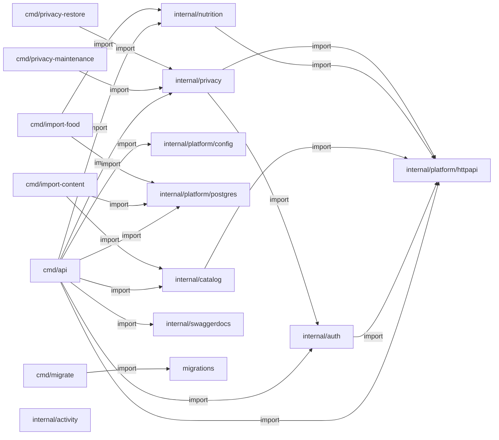

# Go e Swagger: evidência de código

> Gerado de código e registros versionados por `tools/gerar_documentacao.py`. Não editar este arquivo à mão. Revisão das entradas: `f6129c5b2721f765`.

Arquivos Go de aplicação encontrados: **37**. Registros net/http literais: **19**.

## Pacotes Go e imports atuais

Setas são imports estáticos; não são chamadas HTTP nem traces de execução.

## Anotações encontradas

| @Router | @Param | @Success / @Failure | Registro compatível detectado | Fonte |
| --- | --- | --- | --- | --- |
| `POST /api/v1/auth/google` | body body GoogleRequest true "Google ID token" | Success 200 {object} Session; Failure 400,401,413,415,426,429,503 {object} httpapi.Problem | sim | [services/api/internal/auth/handler.go:103](../../../services/api/internal/auth/handler.go) |
| `POST /api/v1/auth/refresh` | body body RefreshRequest true "Single-use refresh token" | Success 200 {object} Session; Failure 400,401,413,415,426,429,503 {object} httpapi.Problem | sim | [services/api/internal/auth/handler.go:129](../../../services/api/internal/auth/handler.go) |
| `POST /api/v1/auth/logout` | body body RefreshRequest true "Refresh token of the device" | Success 204; Failure 400,413,415,426,429,503 {object} httpapi.Problem | sim | [services/api/internal/auth/handler.go:154](../../../services/api/internal/auth/handler.go) |
| `GET /api/v1/me` |  | Success 200 {object} User; Failure 401,426,429,503 {object} httpapi.Problem | sim | [services/api/internal/auth/handler.go:178](../../../services/api/internal/auth/handler.go) |
| `GET /api/v1/catalog/programs` | mode query string false "consultation (default) or practice; unknown requirements never imply eligibility" Enums(consultation,practice); q query string false "Literal title substring, maximum 100 UTF-8 bytes"; environment query string false "Exact source environment; unknown values do not match"; population query string false "Exact source population"; modality query string false "Exact source modality"; equipment query string false "Exact source equipment name"; category query string false "Exact source category"; limit query int false "Page size" minimum(1) maximum(50) default(20); cursor query string false "Opaque cursor bound to the filters and page size" | Success 200 {object} CatalogPage; Success 304; Failure 400,503 {object} httpapi.Problem | sim | [services/api/internal/catalog/handler.go:101](../../../services/api/internal/catalog/handler.go) |
| `GET /api/v1/catalog/programs/{id}` | id path string true "Editorial asset ID"; versionId query string false "Exact SHA-256 version; latest by default"; mode query string false "consultation or practice" Enums(consultation,practice) | Success 200 {object} CatalogItem; Success 304; Failure 400,404,503 {object} httpapi.Problem | sim | [services/api/internal/catalog/handler.go:116](../../../services/api/internal/catalog/handler.go) |
| `GET /api/v1/catalog/movements` | mode query string false "consultation or practice" Enums(consultation,practice); q query string false "Literal title substring"; environment query string false "Exact source environment"; population query string false "Exact source population"; modality query string false "Exact source modality"; equipment query string false "Exact source equipment name"; category query string false "Exact source category"; limit query int false "Page size" minimum(1) maximum(50) default(20); cursor query string false "Opaque cursor bound to filters" | Success 200 {object} CatalogPage; Success 304; Failure 400,503 {object} httpapi.Problem | sim | [services/api/internal/catalog/handler.go:137](../../../services/api/internal/catalog/handler.go) |
| `GET /api/v1/catalog/movements/{id}` | id path string true "Editorial movement ID"; versionId query string false "Exact SHA-256 version"; mode query string false "consultation or practice" Enums(consultation,practice) | Success 200 {object} CatalogItem; Success 304; Failure 400,404,503 {object} httpapi.Problem | sim | [services/api/internal/catalog/handler.go:152](../../../services/api/internal/catalog/handler.go) |
| `GET /api/v1/catalog/filters` |  | Success 200 {object} CatalogFacets; Success 304; Failure 400,503 {object} httpapi.Problem | sim | [services/api/internal/catalog/handler.go:164](../../../services/api/internal/catalog/handler.go) |
| `GET /api/v1/foods` | q query string false "Literal original-name substring with collapsed whitespace; maximum 100 UTF-8 bytes"; sourceId query string false "Exact reviewed source ID"; limit query int false "Page size" minimum(1) maximum(50) default(20); cursor query string false "Opaque cursor bound to search, source and page size" | Success 200 {object} FoodPage; Success 304; Failure 400,503 {object} httpapi.Problem | sim | [services/api/internal/nutrition/handler.go:64](../../../services/api/internal/nutrition/handler.go) |
| `GET /api/v1/foods/{id}` | id path string true "Source-derived food ID"; versionId query string false "Exact SHA-256 version; latest by default" | Success 200 {object} FoodDetail; Success 304; Failure 400,404,503 {object} httpapi.Problem | sim | [services/api/internal/nutrition/handler.go:93](../../../services/api/internal/nutrition/handler.go) |
| `GET /api/v1/foods/filters` |  | Success 200 {object} FoodFacets; Success 304; Failure 400,503 {object} httpapi.Problem | sim | [services/api/internal/nutrition/handler.go:125](../../../services/api/internal/nutrition/handler.go) |
| `GET /api/v1/health/live` |  | Success 200 {object} Status | sim | [services/api/internal/platform/httpapi/server.go:42](../../../services/api/internal/platform/httpapi/server.go) |
| `GET /api/v1/health/ready` |  | Success 200 {object} Status; Failure 503 {object} Problem | sim | [services/api/internal/platform/httpapi/server.go:53](../../../services/api/internal/platform/httpapi/server.go) |
| `GET /api/v1/privacy` |  | Success 200 {object} Policy; Failure 400 {object} httpapi.Problem | sim | [services/api/internal/privacy/handler.go:160](../../../services/api/internal/privacy/handler.go) |
| `GET /api/v1/me/export` | section query string false "Owned data section" Enums(account,sessions,enrollments,occurrences,activitySessions,activityEvents,foods,foodEntries); limit query int false "Maximum page size" minimum(1) maximum(50) default(20); cursor query string false "Opaque cursor bound to user, section and limit" | Success 200 {object} ExportPage; Failure 400,401,426,429,503 {object} httpapi.Problem | sim | [services/api/internal/privacy/handler.go:179](../../../services/api/internal/privacy/handler.go) |
| `POST /api/v1/me/deletion-intent` | body body IntentRequest true "Explicit account deletion confirmation" | Success 200 {object} Intent; Failure 400,401,409,413,415,426,429,503 {object} httpapi.Problem | sim | [services/api/internal/privacy/handler.go:212](../../../services/api/internal/privacy/handler.go) |
| `DELETE /api/v1/me` | body body DeleteRequest true "Confirmation and challenge of this account/session" | Success 200 {object} Erased; Failure 400,401,409,413,415,426,429,503 {object} httpapi.Problem | sim | [services/api/internal/privacy/handler.go:238](../../../services/api/internal/privacy/handler.go) |

## Registros HTTP encontrados

| Rota | Fonte |
| --- | --- |
| `POST /api/v1/auth/google` | [services/api/internal/auth/handler.go:27](../../../services/api/internal/auth/handler.go) |
| `POST /api/v1/auth/refresh` | [services/api/internal/auth/handler.go:28](../../../services/api/internal/auth/handler.go) |
| `POST /api/v1/auth/logout` | [services/api/internal/auth/handler.go:29](../../../services/api/internal/auth/handler.go) |
| `GET /api/v1/me` | [services/api/internal/auth/handler.go:30](../../../services/api/internal/auth/handler.go) |
| `GET /api/v1/catalog/filters` | [services/api/internal/catalog/handler.go:16](../../../services/api/internal/catalog/handler.go) |
| `GET /api/v1/catalog/programs` | [services/api/internal/catalog/handler.go:17](../../../services/api/internal/catalog/handler.go) |
| `GET /api/v1/catalog/programs/{id}` | [services/api/internal/catalog/handler.go:18](../../../services/api/internal/catalog/handler.go) |
| `GET /api/v1/catalog/movements` | [services/api/internal/catalog/handler.go:19](../../../services/api/internal/catalog/handler.go) |
| `GET /api/v1/catalog/movements/{id}` | [services/api/internal/catalog/handler.go:20](../../../services/api/internal/catalog/handler.go) |
| `GET /api/v1/foods/filters` | [services/api/internal/nutrition/handler.go:17](../../../services/api/internal/nutrition/handler.go) |
| `GET /api/v1/foods/{id}` | [services/api/internal/nutrition/handler.go:18](../../../services/api/internal/nutrition/handler.go) |
| `GET /api/v1/foods` | [services/api/internal/nutrition/handler.go:19](../../../services/api/internal/nutrition/handler.go) |
| `GET /api/v1/health/live` | [services/api/internal/platform/httpapi/server.go:76](../../../services/api/internal/platform/httpapi/server.go) |
| `GET /api/v1/health/ready` | [services/api/internal/platform/httpapi/server.go:77](../../../services/api/internal/platform/httpapi/server.go) |
| `GET /docs/` | [services/api/internal/platform/httpapi/server.go:79](../../../services/api/internal/platform/httpapi/server.go) |
| `GET /api/v1/privacy` | [services/api/internal/privacy/handler.go:28](../../../services/api/internal/privacy/handler.go) |
| `GET /api/v1/me/export` | [services/api/internal/privacy/handler.go:29](../../../services/api/internal/privacy/handler.go) |
| `POST /api/v1/me/deletion-intent` | [services/api/internal/privacy/handler.go:30](../../../services/api/internal/privacy/handler.go) |
| `DELETE /api/v1/me` | [services/api/internal/privacy/handler.go:31](../../../services/api/internal/privacy/handler.go) |

## Operações da especificação gerada

| Rota | operationId | Envia: parâmetros/body | Recebe: status e schemas | Fonte |
| --- | --- | --- | --- | --- |
| `POST /api/v1/auth/google` | não detectado | [{"description": "Google ID token", "name": "body", "in": "body", "required": true, "schema": {"$ref": "#/definitions/auth.GoogleRequest"}}] | {"200": {"description": "OK", "schema": {"$ref": "#/definitions/auth.Session"}}, "400": {"description": "Bad Request", "schema": {"$ref": "#/definitions/httpapi.Problem"}}, "401": {"description": "Unauthorized", "schema": {"$ref": "#/definitions/httpapi.Problem"}}, "413": {"description": "Request Entity Too Large", "schema": {"$ref": "#/definitions/httpapi.Problem"}}, "415": {"description": "Unsupported Media Type", "schema": {"$ref": "#/definitions/httpapi.Problem"}}, "426": {"description": "Upgrade Required", "schema": {"$ref": "#/definitions/httpapi.Problem"}}, "429": {"description": "Too Many Requests", "schema": {"$ref": "#/definitions/httpapi.Problem"}}, "503": {"description": "Service Unavailable", "schema": {"$ref": "#/definitions/httpapi.Problem"}}} | [contracts/generated/swagger-v1.json:1](../../../contracts/generated/swagger-v1.json) |
| `POST /api/v1/auth/logout` | não detectado | [{"description": "Refresh token of the device", "name": "body", "in": "body", "required": true, "schema": {"$ref": "#/definitions/auth.RefreshRequest"}}] | {"204": {"description": "No Content"}, "400": {"description": "Bad Request", "schema": {"$ref": "#/definitions/httpapi.Problem"}}, "413": {"description": "Request Entity Too Large", "schema": {"$ref": "#/definitions/httpapi.Problem"}}, "415": {"description": "Unsupported Media Type", "schema": {"$ref": "#/definitions/httpapi.Problem"}}, "426": {"description": "Upgrade Required", "schema": {"$ref": "#/definitions/httpapi.Problem"}}, "429": {"description": "Too Many Requests", "schema": {"$ref": "#/definitions/httpapi.Problem"}}, "503": {"description": "Service Unavailable", "schema": {"$ref": "#/definitions/httpapi.Problem"}}} | [contracts/generated/swagger-v1.json:1](../../../contracts/generated/swagger-v1.json) |
| `POST /api/v1/auth/refresh` | não detectado | [{"description": "Single-use refresh token", "name": "body", "in": "body", "required": true, "schema": {"$ref": "#/definitions/auth.RefreshRequest"}}] | {"200": {"description": "OK", "schema": {"$ref": "#/definitions/auth.Session"}}, "400": {"description": "Bad Request", "schema": {"$ref": "#/definitions/httpapi.Problem"}}, "401": {"description": "Unauthorized", "schema": {"$ref": "#/definitions/httpapi.Problem"}}, "413": {"description": "Request Entity Too Large", "schema": {"$ref": "#/definitions/httpapi.Problem"}}, "415": {"description": "Unsupported Media Type", "schema": {"$ref": "#/definitions/httpapi.Problem"}}, "426": {"description": "Upgrade Required", "schema": {"$ref": "#/definitions/httpapi.Problem"}}, "429": {"description": "Too Many Requests", "schema": {"$ref": "#/definitions/httpapi.Problem"}}, "503": {"description": "Service Unavailable", "schema": {"$ref": "#/definitions/httpapi.Problem"}}} | [contracts/generated/swagger-v1.json:1](../../../contracts/generated/swagger-v1.json) |
| `GET /api/v1/catalog/filters` | não detectado | [] | {"200": {"description": "OK", "schema": {"$ref": "#/definitions/catalog.CatalogFacets"}}, "304": {"description": "Not Modified"}, "400": {"description": "Bad Request", "schema": {"$ref": "#/definitions/httpapi.Problem"}}, "503": {"description": "Service Unavailable", "schema": {"$ref": "#/definitions/httpapi.Problem"}}} | [contracts/generated/swagger-v1.json:1](../../../contracts/generated/swagger-v1.json) |
| `GET /api/v1/catalog/movements` | não detectado | [{"enum": ["consultation", "practice"], "type": "string", "description": "consultation or practice", "name": "mode", "in": "query"}, {"type": "string", "description": "Literal title substring", "name": "q", "in": "query"}, {"type": "string", "description": "Exact source environment", "name": "environment", "in": "query"}, {"type": "string", "description": "Exact source population", "name": "population", "in": "query"}, {"type": "string", "description": "Exact source modality", "name": "modality", "in": "query"}, {"type": "string", "description": "Exact source equipment name", "name": "equipment", "in": "query"}, {"type": "string", "description": "Exact source category", "name": "category", "in": "query"}, {"maximum": 50, "minimum": 1, "type": "integer", "default": 20, "description": "Page size", "name": "limit", "in": "query"}, {"type": "string", "description": "Opaque cursor bound to filters", "name": "cursor", "in": "query"}] | {"200": {"description": "OK", "schema": {"$ref": "#/definitions/catalog.CatalogPage"}}, "304": {"description": "Not Modified"}, "400": {"description": "Bad Request", "schema": {"$ref": "#/definitions/httpapi.Problem"}}, "503": {"description": "Service Unavailable", "schema": {"$ref": "#/definitions/httpapi.Problem"}}} | [contracts/generated/swagger-v1.json:1](../../../contracts/generated/swagger-v1.json) |
| `GET /api/v1/catalog/movements/{id}` | não detectado | [{"type": "string", "description": "Editorial movement ID", "name": "id", "in": "path", "required": true}, {"type": "string", "description": "Exact SHA-256 version", "name": "versionId", "in": "query"}, {"enum": ["consultation", "practice"], "type": "string", "description": "consultation or practice", "name": "mode", "in": "query"}] | {"200": {"description": "OK", "schema": {"$ref": "#/definitions/catalog.CatalogItem"}}, "304": {"description": "Not Modified"}, "400": {"description": "Bad Request", "schema": {"$ref": "#/definitions/httpapi.Problem"}}, "404": {"description": "Not Found", "schema": {"$ref": "#/definitions/httpapi.Problem"}}, "503": {"description": "Service Unavailable", "schema": {"$ref": "#/definitions/httpapi.Problem"}}} | [contracts/generated/swagger-v1.json:1](../../../contracts/generated/swagger-v1.json) |
| `GET /api/v1/catalog/programs` | não detectado | [{"enum": ["consultation", "practice"], "type": "string", "description": "consultation (default) or practice; unknown requirements never imply eligibility", "name": "mode", "in": "query"}, {"type": "string", "description": "Literal title substring, maximum 100 UTF-8 bytes", "name": "q", "in": "query"}, {"type": "string", "description": "Exact source environment; unknown values do not match", "name": "environment", "in": "query"}, {"type": "string", "description": "Exact source population", "name": "population", "in": "query"}, {"type": "string", "description": "Exact source modality", "name": "modality", "in": "query"}, {"type": "string", "description": "Exact source equipment name", "name": "equipment", "in": "query"}, {"type": "string", "description": "Exact source category", "name": "category", "in": "query"}, {"maximum": 50, "minimum": 1, "type": "integer", "default": 20, "description": "Page size", "name": "limit", "in": "query"}, {"type": "string", "description": "Opaque cursor bound to the filters and page size", "name": "cursor", "in": "query"}] | {"200": {"description": "OK", "schema": {"$ref": "#/definitions/catalog.CatalogPage"}}, "304": {"description": "Not Modified"}, "400": {"description": "Bad Request", "schema": {"$ref": "#/definitions/httpapi.Problem"}}, "503": {"description": "Service Unavailable", "schema": {"$ref": "#/definitions/httpapi.Problem"}}} | [contracts/generated/swagger-v1.json:1](../../../contracts/generated/swagger-v1.json) |
| `GET /api/v1/catalog/programs/{id}` | não detectado | [{"type": "string", "description": "Editorial asset ID", "name": "id", "in": "path", "required": true}, {"type": "string", "description": "Exact SHA-256 version; latest by default", "name": "versionId", "in": "query"}, {"enum": ["consultation", "practice"], "type": "string", "description": "consultation or practice", "name": "mode", "in": "query"}] | {"200": {"description": "OK", "schema": {"$ref": "#/definitions/catalog.CatalogItem"}}, "304": {"description": "Not Modified"}, "400": {"description": "Bad Request", "schema": {"$ref": "#/definitions/httpapi.Problem"}}, "404": {"description": "Not Found", "schema": {"$ref": "#/definitions/httpapi.Problem"}}, "503": {"description": "Service Unavailable", "schema": {"$ref": "#/definitions/httpapi.Problem"}}} | [contracts/generated/swagger-v1.json:1](../../../contracts/generated/swagger-v1.json) |
| `GET /api/v1/foods` | não detectado | [{"type": "string", "description": "Literal original-name substring with collapsed whitespace; maximum 100 UTF-8 bytes", "name": "q", "in": "query"}, {"type": "string", "description": "Exact reviewed source ID", "name": "sourceId", "in": "query"}, {"maximum": 50, "minimum": 1, "type": "integer", "default": 20, "description": "Page size", "name": "limit", "in": "query"}, {"type": "string", "description": "Opaque cursor bound to search, source and page size", "name": "cursor", "in": "query"}] | {"200": {"description": "OK", "schema": {"$ref": "#/definitions/nutrition.FoodPage"}}, "304": {"description": "Not Modified"}, "400": {"description": "Bad Request", "schema": {"$ref": "#/definitions/httpapi.Problem"}}, "503": {"description": "Service Unavailable", "schema": {"$ref": "#/definitions/httpapi.Problem"}}} | [contracts/generated/swagger-v1.json:1](../../../contracts/generated/swagger-v1.json) |
| `GET /api/v1/foods/filters` | não detectado | [] | {"200": {"description": "OK", "schema": {"$ref": "#/definitions/nutrition.FoodFacets"}}, "304": {"description": "Not Modified"}, "400": {"description": "Bad Request", "schema": {"$ref": "#/definitions/httpapi.Problem"}}, "503": {"description": "Service Unavailable", "schema": {"$ref": "#/definitions/httpapi.Problem"}}} | [contracts/generated/swagger-v1.json:1](../../../contracts/generated/swagger-v1.json) |
| `GET /api/v1/foods/{id}` | não detectado | [{"type": "string", "description": "Source-derived food ID", "name": "id", "in": "path", "required": true}, {"type": "string", "description": "Exact SHA-256 version; latest by default", "name": "versionId", "in": "query"}] | {"200": {"description": "OK", "schema": {"$ref": "#/definitions/nutrition.FoodDetail"}}, "304": {"description": "Not Modified"}, "400": {"description": "Bad Request", "schema": {"$ref": "#/definitions/httpapi.Problem"}}, "404": {"description": "Not Found", "schema": {"$ref": "#/definitions/httpapi.Problem"}}, "503": {"description": "Service Unavailable", "schema": {"$ref": "#/definitions/httpapi.Problem"}}} | [contracts/generated/swagger-v1.json:1](../../../contracts/generated/swagger-v1.json) |
| `GET /api/v1/health/live` | não detectado | [] | {"200": {"description": "OK", "schema": {"$ref": "#/definitions/httpapi.Status"}}} | [contracts/generated/swagger-v1.json:1](../../../contracts/generated/swagger-v1.json) |
| `GET /api/v1/health/ready` | não detectado | [] | {"200": {"description": "OK", "schema": {"$ref": "#/definitions/httpapi.Status"}}, "503": {"description": "Service Unavailable", "schema": {"$ref": "#/definitions/httpapi.Problem"}}} | [contracts/generated/swagger-v1.json:1](../../../contracts/generated/swagger-v1.json) |
| `GET /api/v1/me` | não detectado | [] | {"200": {"description": "OK", "schema": {"$ref": "#/definitions/auth.User"}}, "401": {"description": "Unauthorized", "schema": {"$ref": "#/definitions/httpapi.Problem"}}, "426": {"description": "Upgrade Required", "schema": {"$ref": "#/definitions/httpapi.Problem"}}, "429": {"description": "Too Many Requests", "schema": {"$ref": "#/definitions/httpapi.Problem"}}, "503": {"description": "Service Unavailable", "schema": {"$ref": "#/definitions/httpapi.Problem"}}} | [contracts/generated/swagger-v1.json:1](../../../contracts/generated/swagger-v1.json) |
| `DELETE /api/v1/me` | não detectado | [{"description": "Confirmation and challenge of this account/session", "name": "body", "in": "body", "required": true, "schema": {"$ref": "#/definitions/privacy.DeleteRequest"}}] | {"200": {"description": "OK", "schema": {"$ref": "#/definitions/privacy.Erased"}}, "400": {"description": "Bad Request", "schema": {"$ref": "#/definitions/httpapi.Problem"}}, "401": {"description": "Unauthorized", "schema": {"$ref": "#/definitions/httpapi.Problem"}}, "409": {"description": "Conflict", "schema": {"$ref": "#/definitions/httpapi.Problem"}}, "413": {"description": "Request Entity Too Large", "schema": {"$ref": "#/definitions/httpapi.Problem"}}, "415": {"description": "Unsupported Media Type", "schema": {"$ref": "#/definitions/httpapi.Problem"}}, "426": {"description": "Upgrade Required", "schema": {"$ref": "#/definitions/httpapi.Problem"}}, "429": {"description": "Too Many Requests", "schema": {"$ref": "#/definitions/httpapi.Problem"}}, "503": {"description": "Service Unavailable", "schema": {"$ref": "#/definitions/httpapi.Problem"}}} | [contracts/generated/swagger-v1.json:1](../../../contracts/generated/swagger-v1.json) |
| `POST /api/v1/me/deletion-intent` | não detectado | [{"description": "Explicit account deletion confirmation", "name": "body", "in": "body", "required": true, "schema": {"$ref": "#/definitions/privacy.IntentRequest"}}] | {"200": {"description": "OK", "schema": {"$ref": "#/definitions/privacy.Intent"}}, "400": {"description": "Bad Request", "schema": {"$ref": "#/definitions/httpapi.Problem"}}, "401": {"description": "Unauthorized", "schema": {"$ref": "#/definitions/httpapi.Problem"}}, "409": {"description": "Conflict", "schema": {"$ref": "#/definitions/httpapi.Problem"}}, "413": {"description": "Request Entity Too Large", "schema": {"$ref": "#/definitions/httpapi.Problem"}}, "415": {"description": "Unsupported Media Type", "schema": {"$ref": "#/definitions/httpapi.Problem"}}, "426": {"description": "Upgrade Required", "schema": {"$ref": "#/definitions/httpapi.Problem"}}, "429": {"description": "Too Many Requests", "schema": {"$ref": "#/definitions/httpapi.Problem"}}, "503": {"description": "Service Unavailable", "schema": {"$ref": "#/definitions/httpapi.Problem"}}} | [contracts/generated/swagger-v1.json:1](../../../contracts/generated/swagger-v1.json) |
| `GET /api/v1/me/export` | não detectado | [{"enum": ["account", "sessions", "enrollments", "occurrences", "activitySessions", "activityEvents", "foods", "foodEntries"], "type": "string", "description": "Owned data section", "name": "section", "in": "query"}, {"maximum": 50, "minimum": 1, "type": "integer", "default": 20, "description": "Maximum page size", "name": "limit", "in": "query"}, {"type": "string", "description": "Opaque cursor bound to user, section and limit", "name": "cursor", "in": "query"}] | {"200": {"description": "OK", "schema": {"$ref": "#/definitions/privacy.ExportPage"}}, "400": {"description": "Bad Request", "schema": {"$ref": "#/definitions/httpapi.Problem"}}, "401": {"description": "Unauthorized", "schema": {"$ref": "#/definitions/httpapi.Problem"}}, "426": {"description": "Upgrade Required", "schema": {"$ref": "#/definitions/httpapi.Problem"}}, "429": {"description": "Too Many Requests", "schema": {"$ref": "#/definitions/httpapi.Problem"}}, "503": {"description": "Service Unavailable", "schema": {"$ref": "#/definitions/httpapi.Problem"}}} | [contracts/generated/swagger-v1.json:1](../../../contracts/generated/swagger-v1.json) |
| `GET /api/v1/privacy` | não detectado | [] | {"200": {"description": "OK", "schema": {"$ref": "#/definitions/privacy.Policy"}}, "400": {"description": "Bad Request", "schema": {"$ref": "#/definitions/httpapi.Problem"}}} | [contracts/generated/swagger-v1.json:1](../../../contracts/generated/swagger-v1.json) |

Anotação, registro de rota e operação na especificação são evidências distintas. A CI do serviço compara os derivados e testa handlers. Novas rotas continuam exigindo teste de resposta/autorização. O extrator documental não executa Go nem substitui o gerador Swaggo.

[Decisão e rotina Swagger](../swagger-go.md) · [Voltar ao mapa](../README.md)
