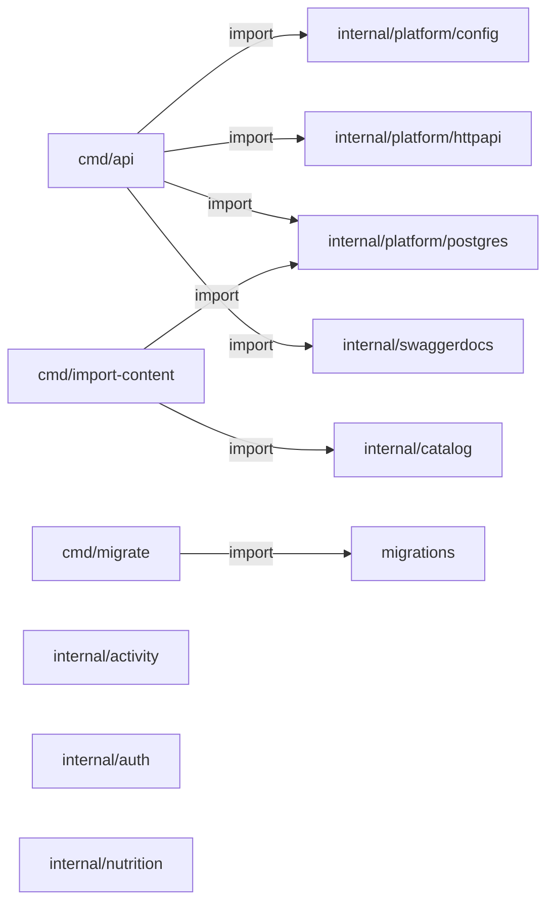

# Go e Swagger: evidência de código

> Gerado de código e registros versionados por `tools/gerar_documentacao.py`. Não editar este arquivo à mão. Revisão das entradas: `3751dfdb25d00de3`.

Arquivos Go de aplicação encontrados: **12**. Registros net/http literais: **3**.

## Pacotes Go e imports atuais

Setas são imports estáticos; não são chamadas HTTP nem traces de execução.

## Anotações encontradas

| @Router | @Param | @Success / @Failure | Registro compatível detectado | Fonte |
| --- | --- | --- | --- | --- |
| `GET /api/v1/health/live` |  | Success 200 {object} Status | sim | [services/api/internal/platform/httpapi/server.go:42](../../../services/api/internal/platform/httpapi/server.go) |
| `GET /api/v1/health/ready` |  | Success 200 {object} Status; Failure 503 {object} Problem | sim | [services/api/internal/platform/httpapi/server.go:53](../../../services/api/internal/platform/httpapi/server.go) |

## Registros HTTP encontrados

| Rota | Fonte |
| --- | --- |
| `GET /api/v1/health/live` | [services/api/internal/platform/httpapi/server.go:67](../../../services/api/internal/platform/httpapi/server.go) |
| `GET /api/v1/health/ready` | [services/api/internal/platform/httpapi/server.go:68](../../../services/api/internal/platform/httpapi/server.go) |
| `GET /docs/` | [services/api/internal/platform/httpapi/server.go:70](../../../services/api/internal/platform/httpapi/server.go) |

## Operações da especificação gerada

| Rota | operationId | Envia: parâmetros/body | Recebe: status e schemas | Fonte |
| --- | --- | --- | --- | --- |
| `GET /api/v1/health/live` | não detectado | [] | {"200": {"description": "OK", "schema": {"$ref": "#/definitions/httpapi.Status"}}} | [contracts/generated/swagger-v1.json:1](../../../contracts/generated/swagger-v1.json) |
| `GET /api/v1/health/ready` | não detectado | [] | {"200": {"description": "OK", "schema": {"$ref": "#/definitions/httpapi.Status"}}, "503": {"description": "Service Unavailable", "schema": {"$ref": "#/definitions/httpapi.Problem"}}} | [contracts/generated/swagger-v1.json:1](../../../contracts/generated/swagger-v1.json) |

Anotação, registro de rota e operação na especificação são evidências distintas. A CI do serviço compara os derivados e testa handlers. Novas rotas continuam exigindo teste de resposta/autorização. O extrator documental não executa Go nem substitui o gerador Swaggo.

[Decisão e rotina Swagger](../swagger-go.md) · [Voltar ao mapa](../README.md)
