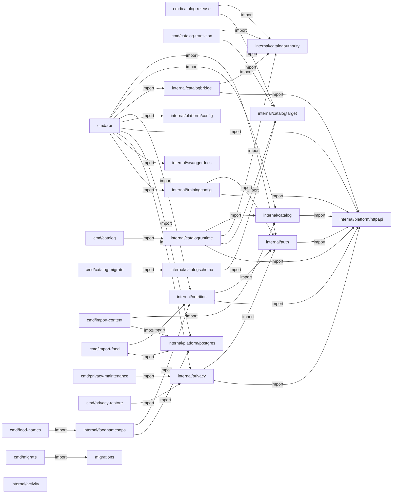

# Go e Swagger: evidência de código

> Gerado de código e registros versionados por `tools/gerar_documentacao.py`. Não editar este arquivo à mão. Revisão das entradas: `30cb6bce4e426458`.

Arquivos Go de aplicação encontrados: **76**. Registros net/http literais: **36**.

## Pacotes Go e imports atuais

Setas são imports estáticos; não são chamadas HTTP nem traces de execução.

## Anotações encontradas

| @Router | @Param | @Success / @Failure | Registro compatível detectado | Fonte |
| --- | --- | --- | --- | --- |
| `POST /api/v1/auth/google` | body body GoogleRequest true "Google ID token" | Success 200 {object} Session; Failure 400,401,413,415,426,429,503 {object} httpapi.Problem | sim | [services/api/internal/auth/handler.go:103](../../../services/api/internal/auth/handler.go) |
| `POST /api/v1/auth/refresh` | body body RefreshRequest true "Single-use refresh token" | Success 200 {object} Session; Failure 400,401,413,415,426,429,503 {object} httpapi.Problem | sim | [services/api/internal/auth/handler.go:129](../../../services/api/internal/auth/handler.go) |
| `POST /api/v1/auth/logout` | body body RefreshRequest true "Refresh token of the device" | Success 204; Failure 400,413,415,426,429,503 {object} httpapi.Problem | sim | [services/api/internal/auth/handler.go:154](../../../services/api/internal/auth/handler.go) |
| `GET /api/v1/me` |  | Success 200 {object} User; Failure 401,426,429,503 {object} httpapi.Problem | sim | [services/api/internal/auth/handler.go:178](../../../services/api/internal/auth/handler.go) |
| `GET /api/v1/catalog/programs` | mode query string false "consultation (default) or practice; unknown requirements never imply eligibility" Enums(consultation,practice); q query string false "Literal title substring, maximum 100 UTF-8 bytes"; environment query string false "Exact source environment; unknown values do not match"; population query string false "Exact source population"; modality query string false "Exact source modality"; equipment query string false "Exact source equipment name"; category query string false "Exact source category"; limit query int false "Page size" minimum(1) maximum(50) default(20); cursor query string false "Opaque cursor bound to the filters and page size" | Success 200 {object} CatalogPage; Success 304; Failure 400,503 {object} httpapi.Problem | sim | [services/api/internal/catalog/handler.go:101](../../../services/api/internal/catalog/handler.go) |
| `GET /api/v1/catalog/programs/{id}` | id path string true "Editorial asset ID"; versionId query string false "Exact SHA-256 version; latest by default"; mode query string false "consultation or practice" Enums(consultation,practice) | Success 200 {object} CatalogItem; Success 304; Failure 400,404,503 {object} httpapi.Problem | sim | [services/api/internal/catalog/handler.go:116](../../../services/api/internal/catalog/handler.go) |
| `GET /api/v1/catalog/movements` | mode query string false "consultation or practice" Enums(consultation,practice); q query string false "Literal title substring"; environment query string false "Exact source environment"; population query string false "Exact source population"; modality query string false "Exact source modality"; equipment query string false "Exact source equipment name"; category query string false "Exact source category"; limit query int false "Page size" minimum(1) maximum(50) default(20); cursor query string false "Opaque cursor bound to filters" | Success 200 {object} CatalogPage; Success 304; Failure 400,503 {object} httpapi.Problem | sim | [services/api/internal/catalog/handler.go:137](../../../services/api/internal/catalog/handler.go) |
| `GET /api/v1/catalog/movements/{id}` | id path string true "Editorial movement ID"; versionId query string false "Exact SHA-256 version"; mode query string false "consultation or practice" Enums(consultation,practice) | Success 200 {object} CatalogItem; Success 304; Failure 400,404,503 {object} httpapi.Problem | sim | [services/api/internal/catalog/handler.go:152](../../../services/api/internal/catalog/handler.go) |
| `GET /api/v1/catalog/filters` |  | Success 200 {object} CatalogFacets; Success 304; Failure 400,503 {object} httpapi.Problem | sim | [services/api/internal/catalog/handler.go:164](../../../services/api/internal/catalog/handler.go) |
| `POST /api/v1/me/foods` | Idempotency-Key header string true "UUID, stable across retries; 24-hour retention"; body body OwnFoodInput true "Private declaration, nullable basis and nutrient values" | Success 201 {object} FoodDetail; Failure 400,401,409,413,415,429,503 {object} httpapi.Problem | sim | [services/api/internal/nutrition/entries_handler.go:223](../../../services/api/internal/nutrition/entries_handler.go) |
| `POST /api/v1/me/food-entries` | Idempotency-Key header string true "UUID stable across retries"; body body EntryInput true "Exact food version, quantity, unit, preparation, time, zone and measured/estimated evidence; revision zero" | Success 201 {object} Entry; Failure 400,401,404,409,413,415,429,503 {object} httpapi.Problem | sim | [services/api/internal/nutrition/entries_handler.go:238](../../../services/api/internal/nutrition/entries_handler.go) |
| `PATCH /api/v1/me/food-entries/{id}` | id path string true "Entry UUID"; Idempotency-Key header string true "UUID stable across retries"; body body EntryInput true "Complete replacement; same food version and current revision; maximum 100 corrections" | Success 200 {object} Entry; Failure 400,401,404,409,413,415,429,503 {object} httpapi.Problem | sim | [services/api/internal/nutrition/entries_handler.go:254](../../../services/api/internal/nutrition/entries_handler.go) |
| `DELETE /api/v1/me/food-entries/{id}` | id path string true "Entry UUID"; Idempotency-Key header string true "UUID stable across retries"; body body EntryInput true "Current revision; other fields omitted" | Success 200 {object} Entry; Failure 400,401,404,409,413,415,429,503 {object} httpapi.Problem | sim | [services/api/internal/nutrition/entries_handler.go:270](../../../services/api/internal/nutrition/entries_handler.go) |
| `GET /api/v1/me/foods` | q query string false "Literal name, maximum 100 characters"; limit query int false "1..20; default 10"; cursor query string false "Account and filter-bound cursor" | Success 200 {object} NutritionPage; Failure 400,401,429,503 {object} httpapi.Problem | sim | [services/api/internal/nutrition/entries_handler.go:394](../../../services/api/internal/nutrition/entries_handler.go) |
| `GET /api/v1/me/food-entries` | locale query string false "pt-BR, pt-PT, en or es; display metadata only"; namesVersion query string false "Optional catalog revision; changed revision returns 409 food_name_catalog_changed"; date query string true "YYYY-MM-DD"; timezone query string true "IANA name, UTC or fixed offset such as -03:00"; limit query int false "1..20; default 10"; cursor query string false "Account and filter-bound cursor" | Success 200 {object} NutritionPage; Failure 400,401,409,429,503 {object} httpapi.Problem | sim | [services/api/internal/nutrition/entries_handler.go:427](../../../services/api/internal/nutrition/entries_handler.go) |
| `GET /api/v1/me/food-summary` | date query string true "YYYY-MM-DD"; timezone query string true "IANA name, UTC or fixed offset" | Success 200 {object} NutritionTotals; Failure 400,401,429,503 {object} httpapi.Problem | sim | [services/api/internal/nutrition/entries_handler.go:476](../../../services/api/internal/nutrition/entries_handler.go) |
| `GET /api/v1/me/food-entries/{id}` | id path string true "Entry UUID; other owners and deleted records return 404"; locale query string false "pt-BR, pt-PT, en or es; display metadata only" | Success 200 {object} Entry; Failure 400,401,404,409,429,503 {object} httpapi.Problem | sim | [services/api/internal/nutrition/entries_names.go:110](../../../services/api/internal/nutrition/entries_names.go) |
| `GET /api/v1/foods` | q query string false "Literal name substring with collapsed whitespace; reviewed names/aliases require locale; maximum 100 UTF-8 bytes"; locale query string false "Optional reviewed-name locale; original fallback. Requires name catalog migrations." Enums(pt-BR,pt-PT,en,es); namesVersion query string false "Optional locale revision from nameCatalog; changed revision returns409. Cursor retains it automatically."; sourceId query string false "Exact reviewed source ID"; limit query int false "Page size" minimum(1) maximum(50) default(20); cursor query string false "Opaque cursor bound to search, source, page size, locale and name revision" | Success 200 {object} FoodPage; Success 304; Failure 400,409,503 {object} httpapi.Problem | sim | [services/api/internal/nutrition/handler.go:69](../../../services/api/internal/nutrition/handler.go) |
| `GET /api/v1/foods/{id}` | id path string true "Source-derived food ID"; versionId query string false "Exact SHA-256 source version; latest by default"; locale query string false "Optional reviewed-name locale; missing/withdrawn translation keeps original." Enums(pt-BR,pt-PT,en,es) | Success 200 {object} FoodDetail; Success 304; Failure 400,404,503 {object} httpapi.Problem | sim | [services/api/internal/nutrition/handler.go:99](../../../services/api/internal/nutrition/handler.go) |
| `GET /api/v1/foods/filters` |  | Success 200 {object} FoodFacets; Success 304; Failure 400,503 {object} httpapi.Problem | sim | [services/api/internal/nutrition/handler.go:131](../../../services/api/internal/nutrition/handler.go) |
| `POST /api/v1/me/meals` | Idempotency-Key header string true "UUID stable across retries; 24-hour retention"; body body NewMealCommand true "reviewed=true; quantities/versions/times per item; max64KiB; microsecond timestamp precision" | Success 201 {object} ConfirmedMeal; Failure 400,401,404,409,413,415,429,503 {object} httpapi.Problem | sim | [services/api/internal/nutrition/meals_handler.go:64](../../../services/api/internal/nutrition/meals_handler.go) |
| `GET /api/v1/me/meal-diary` | date query string true "YYYY-MM-DD"; timezone query string true "UTC, IANA or offset; no server timezone default"; locale query string false "pt-BR,pt-PT,en,es; optional reviewed display names" | Success 200 {object} MealDayResponse; Failure 400,401,409,429,503 {object} httpapi.Problem | sim | [services/api/internal/nutrition/meals_handler.go:89](../../../services/api/internal/nutrition/meals_handler.go) |
| `GET /api/v1/me/meals/{id}` | id path string true "Meal UUID; another owner returns404"; locale query string false "pt-BR,pt-PT,en,es; display only" | Success 200 {object} ConfirmedMeal; Failure 400,401,404,409,429,503 {object} httpapi.Problem | sim | [services/api/internal/nutrition/meals_handler.go:127](../../../services/api/internal/nutrition/meals_handler.go) |
| `PATCH /api/v1/me/meals/{id}` | id path string true "Meal UUID"; Idempotency-Key header string true "Stable retry UUID"; body body EditMealCommand true "Expected grouping revision and reviewed=true" | Success 200 {object} ConfirmedMeal; Failure 400,401,404,409,413,415,429,503 {object} httpapi.Problem | sim | [services/api/internal/nutrition/meals_handler.go:164](../../../services/api/internal/nutrition/meals_handler.go) |
| `DELETE /api/v1/me/meals/{id}` | id path string true "Meal UUID"; Idempotency-Key header string true "Stable retry UUID"; body body DeleteMealCommand true "Expected grouping revision and reviewed=true" | Success 200 {object} ConfirmedMeal; Failure 400,401,404,409,413,415,429,503 {object} httpapi.Problem | sim | [services/api/internal/nutrition/meals_handler.go:190](../../../services/api/internal/nutrition/meals_handler.go) |
| `GET /api/v1/health/live` |  | Success 200 {object} Status | sim | [services/api/internal/platform/httpapi/server.go:47](../../../services/api/internal/platform/httpapi/server.go) |
| `GET /api/v1/health/ready` |  | Success 200 {object} Status; Failure 503 {object} Problem | sim | [services/api/internal/platform/httpapi/server.go:58](../../../services/api/internal/platform/httpapi/server.go) |
| `GET /api/v1/privacy` |  | Success 200 {object} Policy; Failure 400 {object} httpapi.Problem | sim | [services/api/internal/privacy/handler.go:160](../../../services/api/internal/privacy/handler.go) |
| `GET /api/v1/me/export` | section query string false "Owned data section" Enums(account,sessions,enrollments,occurrences,activitySessions,activityEvents,foods,foodEntries,trainingConfigurations,meals,mealItems,mealVersions); limit query int false "Maximum page size" minimum(1) maximum(50) default(20); cursor query string false "Opaque cursor bound to user, section and limit" | Success 200 {object} ExportPage; Failure 400,401,426,429,503 {object} httpapi.Problem | sim | [services/api/internal/privacy/handler.go:179](../../../services/api/internal/privacy/handler.go) |
| `POST /api/v1/me/deletion-intent` | body body IntentRequest true "Explicit account deletion confirmation" | Success 200 {object} Intent; Failure 400,401,409,413,415,426,429,503 {object} httpapi.Problem | sim | [services/api/internal/privacy/handler.go:212](../../../services/api/internal/privacy/handler.go) |
| `DELETE /api/v1/me` | body body DeleteRequest true "Confirmation and challenge of this account/session" | Success 200 {object} Erased; Failure 400,401,409,413,415,426,429,503 {object} httpapi.Problem | sim | [services/api/internal/privacy/handler.go:238](../../../services/api/internal/privacy/handler.go) |
| `GET /api/v1/me/training-configuration` |  | Success 200 {object} Current; Failure 400,401,409,429,503 {object} httpapi.Problem | sim | [services/api/internal/trainingconfig/handler.go:159](../../../services/api/internal/trainingconfig/handler.go) |
| `PUT /api/v1/me/training-configuration` | Idempotency-Key header string true "UUID stable across retries;24-hour retention"; body body SaveCommand true "Complete declaration,reviewed=true and expected revision; no owner field" | Success 200 {object} Current; Failure 400,401,409,413,415,429,503 {object} httpapi.Problem | sim | [services/api/internal/trainingconfig/handler.go:187](../../../services/api/internal/trainingconfig/handler.go) |
| `GET /api/v1/me/training-configuration/resources` | q query string false "Literal original equipment name; maximum100characters"; limit query int false "1..20; default20"; cursor query string false "Account/query/limit-bound cursor" | Success 200 {object} ResourcePage; Failure 400,401,409,429,503 {object} httpapi.Problem | sim | [services/api/internal/trainingconfig/handler.go:280](../../../services/api/internal/trainingconfig/handler.go) |

## Registros HTTP encontrados

| Rota | Fonte |
| --- | --- |
| `POST /api/v1/auth/google` | [services/api/internal/auth/handler.go:27](../../../services/api/internal/auth/handler.go) |
| `POST /api/v1/auth/refresh` | [services/api/internal/auth/handler.go:28](../../../services/api/internal/auth/handler.go) |
| `POST /api/v1/auth/logout` | [services/api/internal/auth/handler.go:29](../../../services/api/internal/auth/handler.go) |
| `GET /api/v1/me` | [services/api/internal/auth/handler.go:30](../../../services/api/internal/auth/handler.go) |
| `GET /api/v1/catalog/filters` | [services/api/internal/catalog/handler.go:16](../../../services/api/internal/catalog/handler.go) |
| `GET /api/v1/catalog/programs` | [services/api/internal/catalog/handler.go:17](../../../services/api/internal/catalog/handler.go) |
| `GET /api/v1/catalog/programs/{id}` | [services/api/internal/catalog/handler.go:18](../../../services/api/internal/catalog/handler.go) |
| `GET /api/v1/catalog/movements` | [services/api/internal/catalog/handler.go:19](../../../services/api/internal/catalog/handler.go) |
| `GET /api/v1/catalog/movements/{id}` | [services/api/internal/catalog/handler.go:20](../../../services/api/internal/catalog/handler.go) |
| `GET /internal/catalog/revision` | [services/api/internal/catalogruntime/runtime.go:88](../../../services/api/internal/catalogruntime/runtime.go) |
| `POST /api/v1/me/foods` | [services/api/internal/nutrition/entries_handler.go:30](../../../services/api/internal/nutrition/entries_handler.go) |
| `GET /api/v1/me/foods` | [services/api/internal/nutrition/entries_handler.go:31](../../../services/api/internal/nutrition/entries_handler.go) |
| `POST /api/v1/me/food-entries` | [services/api/internal/nutrition/entries_handler.go:32](../../../services/api/internal/nutrition/entries_handler.go) |
| `GET /api/v1/me/food-entries` | [services/api/internal/nutrition/entries_handler.go:33](../../../services/api/internal/nutrition/entries_handler.go) |
| `GET /api/v1/me/food-entries/{id}` | [services/api/internal/nutrition/entries_handler.go:34](../../../services/api/internal/nutrition/entries_handler.go) |
| `PATCH /api/v1/me/food-entries/{id}` | [services/api/internal/nutrition/entries_handler.go:35](../../../services/api/internal/nutrition/entries_handler.go) |
| `DELETE /api/v1/me/food-entries/{id}` | [services/api/internal/nutrition/entries_handler.go:36](../../../services/api/internal/nutrition/entries_handler.go) |
| `GET /api/v1/me/food-summary` | [services/api/internal/nutrition/entries_handler.go:37](../../../services/api/internal/nutrition/entries_handler.go) |
| `POST /api/v1/me/meals` | [services/api/internal/nutrition/entries_handler.go:38](../../../services/api/internal/nutrition/entries_handler.go) |
| `GET /api/v1/me/meal-diary` | [services/api/internal/nutrition/entries_handler.go:39](../../../services/api/internal/nutrition/entries_handler.go) |
| `GET /api/v1/me/meals/{id}` | [services/api/internal/nutrition/entries_handler.go:40](../../../services/api/internal/nutrition/entries_handler.go) |
| `PATCH /api/v1/me/meals/{id}` | [services/api/internal/nutrition/entries_handler.go:41](../../../services/api/internal/nutrition/entries_handler.go) |
| `DELETE /api/v1/me/meals/{id}` | [services/api/internal/nutrition/entries_handler.go:42](../../../services/api/internal/nutrition/entries_handler.go) |
| `GET /api/v1/foods/filters` | [services/api/internal/nutrition/handler.go:17](../../../services/api/internal/nutrition/handler.go) |
| `GET /api/v1/foods/{id}` | [services/api/internal/nutrition/handler.go:18](../../../services/api/internal/nutrition/handler.go) |
| `GET /api/v1/foods` | [services/api/internal/nutrition/handler.go:19](../../../services/api/internal/nutrition/handler.go) |
| `GET /api/v1/health/live` | [services/api/internal/platform/httpapi/server.go:81](../../../services/api/internal/platform/httpapi/server.go) |
| `GET /api/v1/health/ready` | [services/api/internal/platform/httpapi/server.go:82](../../../services/api/internal/platform/httpapi/server.go) |
| `GET /docs/` | [services/api/internal/platform/httpapi/server.go:84](../../../services/api/internal/platform/httpapi/server.go) |
| `GET /api/v1/privacy` | [services/api/internal/privacy/handler.go:28](../../../services/api/internal/privacy/handler.go) |
| `GET /api/v1/me/export` | [services/api/internal/privacy/handler.go:29](../../../services/api/internal/privacy/handler.go) |
| `POST /api/v1/me/deletion-intent` | [services/api/internal/privacy/handler.go:30](../../../services/api/internal/privacy/handler.go) |
| `DELETE /api/v1/me` | [services/api/internal/privacy/handler.go:31](../../../services/api/internal/privacy/handler.go) |
| `GET /api/v1/me/training-configuration` | [services/api/internal/trainingconfig/handler.go:40](../../../services/api/internal/trainingconfig/handler.go) |
| `PUT /api/v1/me/training-configuration` | [services/api/internal/trainingconfig/handler.go:41](../../../services/api/internal/trainingconfig/handler.go) |
| `GET /api/v1/me/training-configuration/resources` | [services/api/internal/trainingconfig/handler.go:42](../../../services/api/internal/trainingconfig/handler.go) |

## Operações da especificação gerada

| Rota | operationId | Envia: parâmetros/body | Recebe: status e schemas | Fonte |
| --- | --- | --- | --- | --- |
| `GET /api/v1/catalog/filters` | não detectado | [] | {"200": {"description": "OK", "schema": {"$ref": "#/definitions/catalog.CatalogFacets"}}, "304": {"description": "Not Modified"}, "400": {"description": "Bad Request", "schema": {"$ref": "#/definitions/httpapi.Problem"}}, "503": {"description": "Service Unavailable", "schema": {"$ref": "#/definitions/httpapi.Problem"}}} | [contracts/generated/catalog-m1.swagger.json:1](../../../contracts/generated/catalog-m1.swagger.json) |
| `GET /api/v1/catalog/movements` | não detectado | [{"enum": ["consultation", "practice"], "type": "string", "description": "consultation or practice", "name": "mode", "in": "query"}, {"type": "string", "description": "Literal title substring", "name": "q", "in": "query"}, {"type": "string", "description": "Exact source environment", "name": "environment", "in": "query"}, {"type": "string", "description": "Exact source population", "name": "population", "in": "query"}, {"type": "string", "description": "Exact source modality", "name": "modality", "in": "query"}, {"type": "string", "description": "Exact source equipment name", "name": "equipment", "in": "query"}, {"type": "string", "description": "Exact source category", "name": "category", "in": "query"}, {"maximum": 50, "minimum": 1, "type": "integer", "default": 20, "description": "Page size", "name": "limit", "in": "query"}, {"type": "string", "description": "Opaque cursor bound to filters", "name": "cursor", "in": "query"}] | {"200": {"description": "OK", "schema": {"$ref": "#/definitions/catalog.CatalogPage"}}, "304": {"description": "Not Modified"}, "400": {"description": "Bad Request", "schema": {"$ref": "#/definitions/httpapi.Problem"}}, "503": {"description": "Service Unavailable", "schema": {"$ref": "#/definitions/httpapi.Problem"}}} | [contracts/generated/catalog-m1.swagger.json:1](../../../contracts/generated/catalog-m1.swagger.json) |
| `GET /api/v1/catalog/movements/{id}` | não detectado | [{"type": "string", "description": "Editorial movement ID", "name": "id", "in": "path", "required": true}, {"type": "string", "description": "Exact SHA-256 version", "name": "versionId", "in": "query"}, {"enum": ["consultation", "practice"], "type": "string", "description": "consultation or practice", "name": "mode", "in": "query"}] | {"200": {"description": "OK", "schema": {"$ref": "#/definitions/catalog.CatalogItem"}}, "304": {"description": "Not Modified"}, "400": {"description": "Bad Request", "schema": {"$ref": "#/definitions/httpapi.Problem"}}, "404": {"description": "Not Found", "schema": {"$ref": "#/definitions/httpapi.Problem"}}, "503": {"description": "Service Unavailable", "schema": {"$ref": "#/definitions/httpapi.Problem"}}} | [contracts/generated/catalog-m1.swagger.json:1](../../../contracts/generated/catalog-m1.swagger.json) |
| `GET /api/v1/catalog/programs` | não detectado | [{"enum": ["consultation", "practice"], "type": "string", "description": "consultation (default) or practice; unknown requirements never imply eligibility", "name": "mode", "in": "query"}, {"type": "string", "description": "Literal title substring, maximum 100 UTF-8 bytes", "name": "q", "in": "query"}, {"type": "string", "description": "Exact source environment; unknown values do not match", "name": "environment", "in": "query"}, {"type": "string", "description": "Exact source population", "name": "population", "in": "query"}, {"type": "string", "description": "Exact source modality", "name": "modality", "in": "query"}, {"type": "string", "description": "Exact source equipment name", "name": "equipment", "in": "query"}, {"type": "string", "description": "Exact source category", "name": "category", "in": "query"}, {"maximum": 50, "minimum": 1, "type": "integer", "default": 20, "description": "Page size", "name": "limit", "in": "query"}, {"type": "string", "description": "Opaque cursor bound to the filters and page size", "name": "cursor", "in": "query"}] | {"200": {"description": "OK", "schema": {"$ref": "#/definitions/catalog.CatalogPage"}}, "304": {"description": "Not Modified"}, "400": {"description": "Bad Request", "schema": {"$ref": "#/definitions/httpapi.Problem"}}, "503": {"description": "Service Unavailable", "schema": {"$ref": "#/definitions/httpapi.Problem"}}} | [contracts/generated/catalog-m1.swagger.json:1](../../../contracts/generated/catalog-m1.swagger.json) |
| `GET /api/v1/catalog/programs/{id}` | não detectado | [{"type": "string", "description": "Editorial asset ID", "name": "id", "in": "path", "required": true}, {"type": "string", "description": "Exact SHA-256 version; latest by default", "name": "versionId", "in": "query"}, {"enum": ["consultation", "practice"], "type": "string", "description": "consultation or practice", "name": "mode", "in": "query"}] | {"200": {"description": "OK", "schema": {"$ref": "#/definitions/catalog.CatalogItem"}}, "304": {"description": "Not Modified"}, "400": {"description": "Bad Request", "schema": {"$ref": "#/definitions/httpapi.Problem"}}, "404": {"description": "Not Found", "schema": {"$ref": "#/definitions/httpapi.Problem"}}, "503": {"description": "Service Unavailable", "schema": {"$ref": "#/definitions/httpapi.Problem"}}} | [contracts/generated/catalog-m1.swagger.json:1](../../../contracts/generated/catalog-m1.swagger.json) |
| `GET /api/v1/health/live` | não detectado | [] | {"200": {"description": "OK", "schema": {"$ref": "#/definitions/httpapi.Status"}}} | [contracts/generated/catalog-m1.swagger.json:1](../../../contracts/generated/catalog-m1.swagger.json) |
| `GET /api/v1/health/ready` | não detectado | [] | {"200": {"description": "OK", "schema": {"$ref": "#/definitions/httpapi.Status"}}, "503": {"description": "Service Unavailable", "schema": {"$ref": "#/definitions/httpapi.Problem"}}} | [contracts/generated/catalog-m1.swagger.json:1](../../../contracts/generated/catalog-m1.swagger.json) |
| `POST /api/v1/auth/google` | não detectado | [{"description": "Google ID token", "name": "body", "in": "body", "required": true, "schema": {"$ref": "#/definitions/auth.GoogleRequest"}}] | {"200": {"description": "OK", "schema": {"$ref": "#/definitions/auth.Session"}}, "400": {"description": "Bad Request", "schema": {"$ref": "#/definitions/httpapi.Problem"}}, "401": {"description": "Unauthorized", "schema": {"$ref": "#/definitions/httpapi.Problem"}}, "413": {"description": "Request Entity Too Large", "schema": {"$ref": "#/definitions/httpapi.Problem"}}, "415": {"description": "Unsupported Media Type", "schema": {"$ref": "#/definitions/httpapi.Problem"}}, "426": {"description": "Upgrade Required", "schema": {"$ref": "#/definitions/httpapi.Problem"}}, "429": {"description": "Too Many Requests", "schema": {"$ref": "#/definitions/httpapi.Problem"}}, "503": {"description": "Service Unavailable", "schema": {"$ref": "#/definitions/httpapi.Problem"}}} | [contracts/generated/swagger-v1.json:1](../../../contracts/generated/swagger-v1.json) |
| `POST /api/v1/auth/logout` | não detectado | [{"description": "Refresh token of the device", "name": "body", "in": "body", "required": true, "schema": {"$ref": "#/definitions/auth.RefreshRequest"}}] | {"204": {"description": "No Content"}, "400": {"description": "Bad Request", "schema": {"$ref": "#/definitions/httpapi.Problem"}}, "413": {"description": "Request Entity Too Large", "schema": {"$ref": "#/definitions/httpapi.Problem"}}, "415": {"description": "Unsupported Media Type", "schema": {"$ref": "#/definitions/httpapi.Problem"}}, "426": {"description": "Upgrade Required", "schema": {"$ref": "#/definitions/httpapi.Problem"}}, "429": {"description": "Too Many Requests", "schema": {"$ref": "#/definitions/httpapi.Problem"}}, "503": {"description": "Service Unavailable", "schema": {"$ref": "#/definitions/httpapi.Problem"}}} | [contracts/generated/swagger-v1.json:1](../../../contracts/generated/swagger-v1.json) |
| `POST /api/v1/auth/refresh` | não detectado | [{"description": "Single-use refresh token", "name": "body", "in": "body", "required": true, "schema": {"$ref": "#/definitions/auth.RefreshRequest"}}] | {"200": {"description": "OK", "schema": {"$ref": "#/definitions/auth.Session"}}, "400": {"description": "Bad Request", "schema": {"$ref": "#/definitions/httpapi.Problem"}}, "401": {"description": "Unauthorized", "schema": {"$ref": "#/definitions/httpapi.Problem"}}, "413": {"description": "Request Entity Too Large", "schema": {"$ref": "#/definitions/httpapi.Problem"}}, "415": {"description": "Unsupported Media Type", "schema": {"$ref": "#/definitions/httpapi.Problem"}}, "426": {"description": "Upgrade Required", "schema": {"$ref": "#/definitions/httpapi.Problem"}}, "429": {"description": "Too Many Requests", "schema": {"$ref": "#/definitions/httpapi.Problem"}}, "503": {"description": "Service Unavailable", "schema": {"$ref": "#/definitions/httpapi.Problem"}}} | [contracts/generated/swagger-v1.json:1](../../../contracts/generated/swagger-v1.json) |
| `GET /api/v1/catalog/filters` | não detectado | [] | {"200": {"description": "OK", "schema": {"$ref": "#/definitions/catalog.CatalogFacets"}}, "304": {"description": "Not Modified"}, "400": {"description": "Bad Request", "schema": {"$ref": "#/definitions/httpapi.Problem"}}, "503": {"description": "Service Unavailable", "schema": {"$ref": "#/definitions/httpapi.Problem"}}} | [contracts/generated/swagger-v1.json:1](../../../contracts/generated/swagger-v1.json) |
| `GET /api/v1/catalog/movements` | não detectado | [{"enum": ["consultation", "practice"], "type": "string", "description": "consultation or practice", "name": "mode", "in": "query"}, {"type": "string", "description": "Literal title substring", "name": "q", "in": "query"}, {"type": "string", "description": "Exact source environment", "name": "environment", "in": "query"}, {"type": "string", "description": "Exact source population", "name": "population", "in": "query"}, {"type": "string", "description": "Exact source modality", "name": "modality", "in": "query"}, {"type": "string", "description": "Exact source equipment name", "name": "equipment", "in": "query"}, {"type": "string", "description": "Exact source category", "name": "category", "in": "query"}, {"maximum": 50, "minimum": 1, "type": "integer", "default": 20, "description": "Page size", "name": "limit", "in": "query"}, {"type": "string", "description": "Opaque cursor bound to filters", "name": "cursor", "in": "query"}] | {"200": {"description": "OK", "schema": {"$ref": "#/definitions/catalog.CatalogPage"}}, "304": {"description": "Not Modified"}, "400": {"description": "Bad Request", "schema": {"$ref": "#/definitions/httpapi.Problem"}}, "503": {"description": "Service Unavailable", "schema": {"$ref": "#/definitions/httpapi.Problem"}}} | [contracts/generated/swagger-v1.json:1](../../../contracts/generated/swagger-v1.json) |
| `GET /api/v1/catalog/movements/{id}` | não detectado | [{"type": "string", "description": "Editorial movement ID", "name": "id", "in": "path", "required": true}, {"type": "string", "description": "Exact SHA-256 version", "name": "versionId", "in": "query"}, {"enum": ["consultation", "practice"], "type": "string", "description": "consultation or practice", "name": "mode", "in": "query"}] | {"200": {"description": "OK", "schema": {"$ref": "#/definitions/catalog.CatalogItem"}}, "304": {"description": "Not Modified"}, "400": {"description": "Bad Request", "schema": {"$ref": "#/definitions/httpapi.Problem"}}, "404": {"description": "Not Found", "schema": {"$ref": "#/definitions/httpapi.Problem"}}, "503": {"description": "Service Unavailable", "schema": {"$ref": "#/definitions/httpapi.Problem"}}} | [contracts/generated/swagger-v1.json:1](../../../contracts/generated/swagger-v1.json) |
| `GET /api/v1/catalog/programs` | não detectado | [{"enum": ["consultation", "practice"], "type": "string", "description": "consultation (default) or practice; unknown requirements never imply eligibility", "name": "mode", "in": "query"}, {"type": "string", "description": "Literal title substring, maximum 100 UTF-8 bytes", "name": "q", "in": "query"}, {"type": "string", "description": "Exact source environment; unknown values do not match", "name": "environment", "in": "query"}, {"type": "string", "description": "Exact source population", "name": "population", "in": "query"}, {"type": "string", "description": "Exact source modality", "name": "modality", "in": "query"}, {"type": "string", "description": "Exact source equipment name", "name": "equipment", "in": "query"}, {"type": "string", "description": "Exact source category", "name": "category", "in": "query"}, {"maximum": 50, "minimum": 1, "type": "integer", "default": 20, "description": "Page size", "name": "limit", "in": "query"}, {"type": "string", "description": "Opaque cursor bound to the filters and page size", "name": "cursor", "in": "query"}] | {"200": {"description": "OK", "schema": {"$ref": "#/definitions/catalog.CatalogPage"}}, "304": {"description": "Not Modified"}, "400": {"description": "Bad Request", "schema": {"$ref": "#/definitions/httpapi.Problem"}}, "503": {"description": "Service Unavailable", "schema": {"$ref": "#/definitions/httpapi.Problem"}}} | [contracts/generated/swagger-v1.json:1](../../../contracts/generated/swagger-v1.json) |
| `GET /api/v1/catalog/programs/{id}` | não detectado | [{"type": "string", "description": "Editorial asset ID", "name": "id", "in": "path", "required": true}, {"type": "string", "description": "Exact SHA-256 version; latest by default", "name": "versionId", "in": "query"}, {"enum": ["consultation", "practice"], "type": "string", "description": "consultation or practice", "name": "mode", "in": "query"}] | {"200": {"description": "OK", "schema": {"$ref": "#/definitions/catalog.CatalogItem"}}, "304": {"description": "Not Modified"}, "400": {"description": "Bad Request", "schema": {"$ref": "#/definitions/httpapi.Problem"}}, "404": {"description": "Not Found", "schema": {"$ref": "#/definitions/httpapi.Problem"}}, "503": {"description": "Service Unavailable", "schema": {"$ref": "#/definitions/httpapi.Problem"}}} | [contracts/generated/swagger-v1.json:1](../../../contracts/generated/swagger-v1.json) |
| `GET /api/v1/foods` | não detectado | [{"type": "string", "description": "Literal name substring with collapsed whitespace; reviewed names/aliases require locale; maximum 100 UTF-8 bytes", "name": "q", "in": "query"}, {"enum": ["pt-BR", "pt-PT", "en", "es"], "type": "string", "description": "Optional reviewed-name locale; original fallback. Requires name catalog migrations.", "name": "locale", "in": "query"}, {"type": "string", "description": "Optional locale revision from nameCatalog; changed revision returns409. Cursor retains it automatically.", "name": "namesVersion", "in": "query"}, {"type": "string", "description": "Exact reviewed source ID", "name": "sourceId", "in": "query"}, {"maximum": 50, "minimum": 1, "type": "integer", "default": 20, "description": "Page size", "name": "limit", "in": "query"}, {"type": "string", "description": "Opaque cursor bound to search, source, page size, locale and name revision", "name": "cursor", "in": "query"}] | {"200": {"description": "OK", "schema": {"$ref": "#/definitions/nutrition.FoodPage"}}, "304": {"description": "Not Modified"}, "400": {"description": "Bad Request", "schema": {"$ref": "#/definitions/httpapi.Problem"}}, "409": {"description": "Conflict", "schema": {"$ref": "#/definitions/httpapi.Problem"}}, "503": {"description": "Service Unavailable", "schema": {"$ref": "#/definitions/httpapi.Problem"}}} | [contracts/generated/swagger-v1.json:1](../../../contracts/generated/swagger-v1.json) |
| `GET /api/v1/foods/filters` | não detectado | [] | {"200": {"description": "OK", "schema": {"$ref": "#/definitions/nutrition.FoodFacets"}}, "304": {"description": "Not Modified"}, "400": {"description": "Bad Request", "schema": {"$ref": "#/definitions/httpapi.Problem"}}, "503": {"description": "Service Unavailable", "schema": {"$ref": "#/definitions/httpapi.Problem"}}} | [contracts/generated/swagger-v1.json:1](../../../contracts/generated/swagger-v1.json) |
| `GET /api/v1/foods/{id}` | não detectado | [{"type": "string", "description": "Source-derived food ID", "name": "id", "in": "path", "required": true}, {"type": "string", "description": "Exact SHA-256 source version; latest by default", "name": "versionId", "in": "query"}, {"enum": ["pt-BR", "pt-PT", "en", "es"], "type": "string", "description": "Optional reviewed-name locale; missing/withdrawn translation keeps original.", "name": "locale", "in": "query"}] | {"200": {"description": "OK", "schema": {"$ref": "#/definitions/nutrition.FoodDetail"}}, "304": {"description": "Not Modified"}, "400": {"description": "Bad Request", "schema": {"$ref": "#/definitions/httpapi.Problem"}}, "404": {"description": "Not Found", "schema": {"$ref": "#/definitions/httpapi.Problem"}}, "503": {"description": "Service Unavailable", "schema": {"$ref": "#/definitions/httpapi.Problem"}}} | [contracts/generated/swagger-v1.json:1](../../../contracts/generated/swagger-v1.json) |
| `GET /api/v1/health/live` | não detectado | [] | {"200": {"description": "OK", "schema": {"$ref": "#/definitions/httpapi.Status"}}} | [contracts/generated/swagger-v1.json:1](../../../contracts/generated/swagger-v1.json) |
| `GET /api/v1/health/ready` | não detectado | [] | {"200": {"description": "OK", "schema": {"$ref": "#/definitions/httpapi.Status"}}, "503": {"description": "Service Unavailable", "schema": {"$ref": "#/definitions/httpapi.Problem"}}} | [contracts/generated/swagger-v1.json:1](../../../contracts/generated/swagger-v1.json) |
| `GET /api/v1/me` | não detectado | [] | {"200": {"description": "OK", "schema": {"$ref": "#/definitions/auth.User"}}, "401": {"description": "Unauthorized", "schema": {"$ref": "#/definitions/httpapi.Problem"}}, "426": {"description": "Upgrade Required", "schema": {"$ref": "#/definitions/httpapi.Problem"}}, "429": {"description": "Too Many Requests", "schema": {"$ref": "#/definitions/httpapi.Problem"}}, "503": {"description": "Service Unavailable", "schema": {"$ref": "#/definitions/httpapi.Problem"}}} | [contracts/generated/swagger-v1.json:1](../../../contracts/generated/swagger-v1.json) |
| `DELETE /api/v1/me` | não detectado | [{"description": "Confirmation and challenge of this account/session", "name": "body", "in": "body", "required": true, "schema": {"$ref": "#/definitions/privacy.DeleteRequest"}}] | {"200": {"description": "OK", "schema": {"$ref": "#/definitions/privacy.Erased"}}, "400": {"description": "Bad Request", "schema": {"$ref": "#/definitions/httpapi.Problem"}}, "401": {"description": "Unauthorized", "schema": {"$ref": "#/definitions/httpapi.Problem"}}, "409": {"description": "Conflict", "schema": {"$ref": "#/definitions/httpapi.Problem"}}, "413": {"description": "Request Entity Too Large", "schema": {"$ref": "#/definitions/httpapi.Problem"}}, "415": {"description": "Unsupported Media Type", "schema": {"$ref": "#/definitions/httpapi.Problem"}}, "426": {"description": "Upgrade Required", "schema": {"$ref": "#/definitions/httpapi.Problem"}}, "429": {"description": "Too Many Requests", "schema": {"$ref": "#/definitions/httpapi.Problem"}}, "503": {"description": "Service Unavailable", "schema": {"$ref": "#/definitions/httpapi.Problem"}}} | [contracts/generated/swagger-v1.json:1](../../../contracts/generated/swagger-v1.json) |
| `POST /api/v1/me/deletion-intent` | não detectado | [{"description": "Explicit account deletion confirmation", "name": "body", "in": "body", "required": true, "schema": {"$ref": "#/definitions/privacy.IntentRequest"}}] | {"200": {"description": "OK", "schema": {"$ref": "#/definitions/privacy.Intent"}}, "400": {"description": "Bad Request", "schema": {"$ref": "#/definitions/httpapi.Problem"}}, "401": {"description": "Unauthorized", "schema": {"$ref": "#/definitions/httpapi.Problem"}}, "409": {"description": "Conflict", "schema": {"$ref": "#/definitions/httpapi.Problem"}}, "413": {"description": "Request Entity Too Large", "schema": {"$ref": "#/definitions/httpapi.Problem"}}, "415": {"description": "Unsupported Media Type", "schema": {"$ref": "#/definitions/httpapi.Problem"}}, "426": {"description": "Upgrade Required", "schema": {"$ref": "#/definitions/httpapi.Problem"}}, "429": {"description": "Too Many Requests", "schema": {"$ref": "#/definitions/httpapi.Problem"}}, "503": {"description": "Service Unavailable", "schema": {"$ref": "#/definitions/httpapi.Problem"}}} | [contracts/generated/swagger-v1.json:1](../../../contracts/generated/swagger-v1.json) |
| `GET /api/v1/me/export` | não detectado | [{"enum": ["account", "sessions", "enrollments", "occurrences", "activitySessions", "activityEvents", "foods", "foodEntries", "trainingConfigurations", "meals", "mealItems", "mealVersions"], "type": "string", "description": "Owned data section", "name": "section", "in": "query"}, {"maximum": 50, "minimum": 1, "type": "integer", "default": 20, "description": "Maximum page size", "name": "limit", "in": "query"}, {"type": "string", "description": "Opaque cursor bound to user, section and limit", "name": "cursor", "in": "query"}] | {"200": {"description": "OK", "schema": {"$ref": "#/definitions/privacy.ExportPage"}}, "400": {"description": "Bad Request", "schema": {"$ref": "#/definitions/httpapi.Problem"}}, "401": {"description": "Unauthorized", "schema": {"$ref": "#/definitions/httpapi.Problem"}}, "426": {"description": "Upgrade Required", "schema": {"$ref": "#/definitions/httpapi.Problem"}}, "429": {"description": "Too Many Requests", "schema": {"$ref": "#/definitions/httpapi.Problem"}}, "503": {"description": "Service Unavailable", "schema": {"$ref": "#/definitions/httpapi.Problem"}}} | [contracts/generated/swagger-v1.json:1](../../../contracts/generated/swagger-v1.json) |
| `GET /api/v1/me/food-entries` | não detectado | [{"type": "string", "description": "pt-BR, pt-PT, en or es; display metadata only", "name": "locale", "in": "query"}, {"type": "string", "description": "Optional catalog revision; changed revision returns 409 food_name_catalog_changed", "name": "namesVersion", "in": "query"}, {"type": "string", "description": "YYYY-MM-DD", "name": "date", "in": "query", "required": true}, {"type": "string", "description": "IANA name, UTC or fixed offset such as -03:00", "name": "timezone", "in": "query", "required": true}, {"type": "integer", "description": "1..20; default 10", "name": "limit", "in": "query"}, {"type": "string", "description": "Account and filter-bound cursor", "name": "cursor", "in": "query"}] | {"200": {"description": "OK", "schema": {"$ref": "#/definitions/nutrition.NutritionPage"}}, "400": {"description": "Bad Request", "schema": {"$ref": "#/definitions/httpapi.Problem"}}, "401": {"description": "Unauthorized", "schema": {"$ref": "#/definitions/httpapi.Problem"}}, "409": {"description": "Conflict", "schema": {"$ref": "#/definitions/httpapi.Problem"}}, "429": {"description": "Too Many Requests", "schema": {"$ref": "#/definitions/httpapi.Problem"}}, "503": {"description": "Service Unavailable", "schema": {"$ref": "#/definitions/httpapi.Problem"}}} | [contracts/generated/swagger-v1.json:1](../../../contracts/generated/swagger-v1.json) |
| `POST /api/v1/me/food-entries` | não detectado | [{"type": "string", "description": "UUID stable across retries", "name": "Idempotency-Key", "in": "header", "required": true}, {"description": "Exact food version, quantity, unit, preparation, time, zone and measured/estimated evidence; revision zero", "name": "body", "in": "body", "required": true, "schema": {"$ref": "#/definitions/nutrition.EntryInput"}}] | {"201": {"description": "Created", "schema": {"$ref": "#/definitions/nutrition.Entry"}}, "400": {"description": "Bad Request", "schema": {"$ref": "#/definitions/httpapi.Problem"}}, "401": {"description": "Unauthorized", "schema": {"$ref": "#/definitions/httpapi.Problem"}}, "404": {"description": "Not Found", "schema": {"$ref": "#/definitions/httpapi.Problem"}}, "409": {"description": "Conflict", "schema": {"$ref": "#/definitions/httpapi.Problem"}}, "413": {"description": "Request Entity Too Large", "schema": {"$ref": "#/definitions/httpapi.Problem"}}, "415": {"description": "Unsupported Media Type", "schema": {"$ref": "#/definitions/httpapi.Problem"}}, "429": {"description": "Too Many Requests", "schema": {"$ref": "#/definitions/httpapi.Problem"}}, "503": {"description": "Service Unavailable", "schema": {"$ref": "#/definitions/httpapi.Problem"}}} | [contracts/generated/swagger-v1.json:1](../../../contracts/generated/swagger-v1.json) |
| `GET /api/v1/me/food-entries/{id}` | não detectado | [{"type": "string", "description": "Entry UUID; other owners and deleted records return 404", "name": "id", "in": "path", "required": true}, {"type": "string", "description": "pt-BR, pt-PT, en or es; display metadata only", "name": "locale", "in": "query"}] | {"200": {"description": "OK", "schema": {"$ref": "#/definitions/nutrition.Entry"}}, "400": {"description": "Bad Request", "schema": {"$ref": "#/definitions/httpapi.Problem"}}, "401": {"description": "Unauthorized", "schema": {"$ref": "#/definitions/httpapi.Problem"}}, "404": {"description": "Not Found", "schema": {"$ref": "#/definitions/httpapi.Problem"}}, "409": {"description": "Conflict", "schema": {"$ref": "#/definitions/httpapi.Problem"}}, "429": {"description": "Too Many Requests", "schema": {"$ref": "#/definitions/httpapi.Problem"}}, "503": {"description": "Service Unavailable", "schema": {"$ref": "#/definitions/httpapi.Problem"}}} | [contracts/generated/swagger-v1.json:1](../../../contracts/generated/swagger-v1.json) |
| `DELETE /api/v1/me/food-entries/{id}` | não detectado | [{"type": "string", "description": "Entry UUID", "name": "id", "in": "path", "required": true}, {"type": "string", "description": "UUID stable across retries", "name": "Idempotency-Key", "in": "header", "required": true}, {"description": "Current revision; other fields omitted", "name": "body", "in": "body", "required": true, "schema": {"$ref": "#/definitions/nutrition.EntryInput"}}] | {"200": {"description": "OK", "schema": {"$ref": "#/definitions/nutrition.Entry"}}, "400": {"description": "Bad Request", "schema": {"$ref": "#/definitions/httpapi.Problem"}}, "401": {"description": "Unauthorized", "schema": {"$ref": "#/definitions/httpapi.Problem"}}, "404": {"description": "Not Found", "schema": {"$ref": "#/definitions/httpapi.Problem"}}, "409": {"description": "Conflict", "schema": {"$ref": "#/definitions/httpapi.Problem"}}, "413": {"description": "Request Entity Too Large", "schema": {"$ref": "#/definitions/httpapi.Problem"}}, "415": {"description": "Unsupported Media Type", "schema": {"$ref": "#/definitions/httpapi.Problem"}}, "429": {"description": "Too Many Requests", "schema": {"$ref": "#/definitions/httpapi.Problem"}}, "503": {"description": "Service Unavailable", "schema": {"$ref": "#/definitions/httpapi.Problem"}}} | [contracts/generated/swagger-v1.json:1](../../../contracts/generated/swagger-v1.json) |
| `PATCH /api/v1/me/food-entries/{id}` | não detectado | [{"type": "string", "description": "Entry UUID", "name": "id", "in": "path", "required": true}, {"type": "string", "description": "UUID stable across retries", "name": "Idempotency-Key", "in": "header", "required": true}, {"description": "Complete replacement; same food version and current revision; maximum 100 corrections", "name": "body", "in": "body", "required": true, "schema": {"$ref": "#/definitions/nutrition.EntryInput"}}] | {"200": {"description": "OK", "schema": {"$ref": "#/definitions/nutrition.Entry"}}, "400": {"description": "Bad Request", "schema": {"$ref": "#/definitions/httpapi.Problem"}}, "401": {"description": "Unauthorized", "schema": {"$ref": "#/definitions/httpapi.Problem"}}, "404": {"description": "Not Found", "schema": {"$ref": "#/definitions/httpapi.Problem"}}, "409": {"description": "Conflict", "schema": {"$ref": "#/definitions/httpapi.Problem"}}, "413": {"description": "Request Entity Too Large", "schema": {"$ref": "#/definitions/httpapi.Problem"}}, "415": {"description": "Unsupported Media Type", "schema": {"$ref": "#/definitions/httpapi.Problem"}}, "429": {"description": "Too Many Requests", "schema": {"$ref": "#/definitions/httpapi.Problem"}}, "503": {"description": "Service Unavailable", "schema": {"$ref": "#/definitions/httpapi.Problem"}}} | [contracts/generated/swagger-v1.json:1](../../../contracts/generated/swagger-v1.json) |
| `GET /api/v1/me/food-summary` | não detectado | [{"type": "string", "description": "YYYY-MM-DD", "name": "date", "in": "query", "required": true}, {"type": "string", "description": "IANA name, UTC or fixed offset", "name": "timezone", "in": "query", "required": true}] | {"200": {"description": "OK", "schema": {"$ref": "#/definitions/nutrition.NutritionTotals"}}, "400": {"description": "Bad Request", "schema": {"$ref": "#/definitions/httpapi.Problem"}}, "401": {"description": "Unauthorized", "schema": {"$ref": "#/definitions/httpapi.Problem"}}, "429": {"description": "Too Many Requests", "schema": {"$ref": "#/definitions/httpapi.Problem"}}, "503": {"description": "Service Unavailable", "schema": {"$ref": "#/definitions/httpapi.Problem"}}} | [contracts/generated/swagger-v1.json:1](../../../contracts/generated/swagger-v1.json) |
| `GET /api/v1/me/foods` | não detectado | [{"type": "string", "description": "Literal name, maximum 100 characters", "name": "q", "in": "query"}, {"type": "integer", "description": "1..20; default 10", "name": "limit", "in": "query"}, {"type": "string", "description": "Account and filter-bound cursor", "name": "cursor", "in": "query"}] | {"200": {"description": "OK", "schema": {"$ref": "#/definitions/nutrition.NutritionPage"}}, "400": {"description": "Bad Request", "schema": {"$ref": "#/definitions/httpapi.Problem"}}, "401": {"description": "Unauthorized", "schema": {"$ref": "#/definitions/httpapi.Problem"}}, "429": {"description": "Too Many Requests", "schema": {"$ref": "#/definitions/httpapi.Problem"}}, "503": {"description": "Service Unavailable", "schema": {"$ref": "#/definitions/httpapi.Problem"}}} | [contracts/generated/swagger-v1.json:1](../../../contracts/generated/swagger-v1.json) |
| `POST /api/v1/me/foods` | não detectado | [{"type": "string", "description": "UUID, stable across retries; 24-hour retention", "name": "Idempotency-Key", "in": "header", "required": true}, {"description": "Private declaration, nullable basis and nutrient values", "name": "body", "in": "body", "required": true, "schema": {"$ref": "#/definitions/nutrition.OwnFoodInput"}}] | {"201": {"description": "Created", "schema": {"$ref": "#/definitions/nutrition.FoodDetail"}}, "400": {"description": "Bad Request", "schema": {"$ref": "#/definitions/httpapi.Problem"}}, "401": {"description": "Unauthorized", "schema": {"$ref": "#/definitions/httpapi.Problem"}}, "409": {"description": "Conflict", "schema": {"$ref": "#/definitions/httpapi.Problem"}}, "413": {"description": "Request Entity Too Large", "schema": {"$ref": "#/definitions/httpapi.Problem"}}, "415": {"description": "Unsupported Media Type", "schema": {"$ref": "#/definitions/httpapi.Problem"}}, "429": {"description": "Too Many Requests", "schema": {"$ref": "#/definitions/httpapi.Problem"}}, "503": {"description": "Service Unavailable", "schema": {"$ref": "#/definitions/httpapi.Problem"}}} | [contracts/generated/swagger-v1.json:1](../../../contracts/generated/swagger-v1.json) |
| `GET /api/v1/me/meal-diary` | não detectado | [{"type": "string", "description": "YYYY-MM-DD", "name": "date", "in": "query", "required": true}, {"type": "string", "description": "UTC, IANA or offset; no server timezone default", "name": "timezone", "in": "query", "required": true}, {"type": "string", "description": "pt-BR,pt-PT,en,es; optional reviewed display names", "name": "locale", "in": "query"}] | {"200": {"description": "OK", "schema": {"$ref": "#/definitions/nutrition.MealDayResponse"}}, "400": {"description": "Bad Request", "schema": {"$ref": "#/definitions/httpapi.Problem"}}, "401": {"description": "Unauthorized", "schema": {"$ref": "#/definitions/httpapi.Problem"}}, "409": {"description": "Conflict", "schema": {"$ref": "#/definitions/httpapi.Problem"}}, "429": {"description": "Too Many Requests", "schema": {"$ref": "#/definitions/httpapi.Problem"}}, "503": {"description": "Service Unavailable", "schema": {"$ref": "#/definitions/httpapi.Problem"}}} | [contracts/generated/swagger-v1.json:1](../../../contracts/generated/swagger-v1.json) |
| `POST /api/v1/me/meals` | não detectado | [{"type": "string", "description": "UUID stable across retries; 24-hour retention", "name": "Idempotency-Key", "in": "header", "required": true}, {"description": "reviewed=true; quantities/versions/times per item; max64KiB; microsecond timestamp precision", "name": "body", "in": "body", "required": true, "schema": {"$ref": "#/definitions/nutrition.NewMealCommand"}}] | {"201": {"description": "Created", "schema": {"$ref": "#/definitions/nutrition.ConfirmedMeal"}}, "400": {"description": "Bad Request", "schema": {"$ref": "#/definitions/httpapi.Problem"}}, "401": {"description": "Unauthorized", "schema": {"$ref": "#/definitions/httpapi.Problem"}}, "404": {"description": "Not Found", "schema": {"$ref": "#/definitions/httpapi.Problem"}}, "409": {"description": "Conflict", "schema": {"$ref": "#/definitions/httpapi.Problem"}}, "413": {"description": "Request Entity Too Large", "schema": {"$ref": "#/definitions/httpapi.Problem"}}, "415": {"description": "Unsupported Media Type", "schema": {"$ref": "#/definitions/httpapi.Problem"}}, "429": {"description": "Too Many Requests", "schema": {"$ref": "#/definitions/httpapi.Problem"}}, "503": {"description": "Service Unavailable", "schema": {"$ref": "#/definitions/httpapi.Problem"}}} | [contracts/generated/swagger-v1.json:1](../../../contracts/generated/swagger-v1.json) |
| `GET /api/v1/me/meals/{id}` | não detectado | [{"type": "string", "description": "Meal UUID; another owner returns404", "name": "id", "in": "path", "required": true}, {"type": "string", "description": "pt-BR,pt-PT,en,es; display only", "name": "locale", "in": "query"}] | {"200": {"description": "OK", "schema": {"$ref": "#/definitions/nutrition.ConfirmedMeal"}}, "400": {"description": "Bad Request", "schema": {"$ref": "#/definitions/httpapi.Problem"}}, "401": {"description": "Unauthorized", "schema": {"$ref": "#/definitions/httpapi.Problem"}}, "404": {"description": "Not Found", "schema": {"$ref": "#/definitions/httpapi.Problem"}}, "409": {"description": "Conflict", "schema": {"$ref": "#/definitions/httpapi.Problem"}}, "429": {"description": "Too Many Requests", "schema": {"$ref": "#/definitions/httpapi.Problem"}}, "503": {"description": "Service Unavailable", "schema": {"$ref": "#/definitions/httpapi.Problem"}}} | [contracts/generated/swagger-v1.json:1](../../../contracts/generated/swagger-v1.json) |
| `DELETE /api/v1/me/meals/{id}` | não detectado | [{"type": "string", "description": "Meal UUID", "name": "id", "in": "path", "required": true}, {"type": "string", "description": "Stable retry UUID", "name": "Idempotency-Key", "in": "header", "required": true}, {"description": "Expected grouping revision and reviewed=true", "name": "body", "in": "body", "required": true, "schema": {"$ref": "#/definitions/nutrition.DeleteMealCommand"}}] | {"200": {"description": "OK", "schema": {"$ref": "#/definitions/nutrition.ConfirmedMeal"}}, "400": {"description": "Bad Request", "schema": {"$ref": "#/definitions/httpapi.Problem"}}, "401": {"description": "Unauthorized", "schema": {"$ref": "#/definitions/httpapi.Problem"}}, "404": {"description": "Not Found", "schema": {"$ref": "#/definitions/httpapi.Problem"}}, "409": {"description": "Conflict", "schema": {"$ref": "#/definitions/httpapi.Problem"}}, "413": {"description": "Request Entity Too Large", "schema": {"$ref": "#/definitions/httpapi.Problem"}}, "415": {"description": "Unsupported Media Type", "schema": {"$ref": "#/definitions/httpapi.Problem"}}, "429": {"description": "Too Many Requests", "schema": {"$ref": "#/definitions/httpapi.Problem"}}, "503": {"description": "Service Unavailable", "schema": {"$ref": "#/definitions/httpapi.Problem"}}} | [contracts/generated/swagger-v1.json:1](../../../contracts/generated/swagger-v1.json) |
| `PATCH /api/v1/me/meals/{id}` | não detectado | [{"type": "string", "description": "Meal UUID", "name": "id", "in": "path", "required": true}, {"type": "string", "description": "Stable retry UUID", "name": "Idempotency-Key", "in": "header", "required": true}, {"description": "Expected grouping revision and reviewed=true", "name": "body", "in": "body", "required": true, "schema": {"$ref": "#/definitions/nutrition.EditMealCommand"}}] | {"200": {"description": "OK", "schema": {"$ref": "#/definitions/nutrition.ConfirmedMeal"}}, "400": {"description": "Bad Request", "schema": {"$ref": "#/definitions/httpapi.Problem"}}, "401": {"description": "Unauthorized", "schema": {"$ref": "#/definitions/httpapi.Problem"}}, "404": {"description": "Not Found", "schema": {"$ref": "#/definitions/httpapi.Problem"}}, "409": {"description": "Conflict", "schema": {"$ref": "#/definitions/httpapi.Problem"}}, "413": {"description": "Request Entity Too Large", "schema": {"$ref": "#/definitions/httpapi.Problem"}}, "415": {"description": "Unsupported Media Type", "schema": {"$ref": "#/definitions/httpapi.Problem"}}, "429": {"description": "Too Many Requests", "schema": {"$ref": "#/definitions/httpapi.Problem"}}, "503": {"description": "Service Unavailable", "schema": {"$ref": "#/definitions/httpapi.Problem"}}} | [contracts/generated/swagger-v1.json:1](../../../contracts/generated/swagger-v1.json) |
| `GET /api/v1/me/training-configuration` | não detectado | [] | {"200": {"description": "OK", "schema": {"$ref": "#/definitions/trainingconfig.Current"}}, "400": {"description": "Bad Request", "schema": {"$ref": "#/definitions/httpapi.Problem"}}, "401": {"description": "Unauthorized", "schema": {"$ref": "#/definitions/httpapi.Problem"}}, "409": {"description": "Conflict", "schema": {"$ref": "#/definitions/httpapi.Problem"}}, "429": {"description": "Too Many Requests", "schema": {"$ref": "#/definitions/httpapi.Problem"}}, "503": {"description": "Service Unavailable", "schema": {"$ref": "#/definitions/httpapi.Problem"}}} | [contracts/generated/swagger-v1.json:1](../../../contracts/generated/swagger-v1.json) |
| `PUT /api/v1/me/training-configuration` | não detectado | [{"type": "string", "description": "UUID stable across retries;24-hour retention", "name": "Idempotency-Key", "in": "header", "required": true}, {"description": "Complete declaration,reviewed=true and expected revision; no owner field", "name": "body", "in": "body", "required": true, "schema": {"$ref": "#/definitions/trainingconfig.SaveCommand"}}] | {"200": {"description": "OK", "schema": {"$ref": "#/definitions/trainingconfig.Current"}}, "400": {"description": "Bad Request", "schema": {"$ref": "#/definitions/httpapi.Problem"}}, "401": {"description": "Unauthorized", "schema": {"$ref": "#/definitions/httpapi.Problem"}}, "409": {"description": "Conflict", "schema": {"$ref": "#/definitions/httpapi.Problem"}}, "413": {"description": "Request Entity Too Large", "schema": {"$ref": "#/definitions/httpapi.Problem"}}, "415": {"description": "Unsupported Media Type", "schema": {"$ref": "#/definitions/httpapi.Problem"}}, "429": {"description": "Too Many Requests", "schema": {"$ref": "#/definitions/httpapi.Problem"}}, "503": {"description": "Service Unavailable", "schema": {"$ref": "#/definitions/httpapi.Problem"}}} | [contracts/generated/swagger-v1.json:1](../../../contracts/generated/swagger-v1.json) |
| `GET /api/v1/me/training-configuration/resources` | não detectado | [{"type": "string", "description": "Literal original equipment name; maximum100characters", "name": "q", "in": "query"}, {"type": "integer", "description": "1..20; default20", "name": "limit", "in": "query"}, {"type": "string", "description": "Account/query/limit-bound cursor", "name": "cursor", "in": "query"}] | {"200": {"description": "OK", "schema": {"$ref": "#/definitions/trainingconfig.ResourcePage"}}, "400": {"description": "Bad Request", "schema": {"$ref": "#/definitions/httpapi.Problem"}}, "401": {"description": "Unauthorized", "schema": {"$ref": "#/definitions/httpapi.Problem"}}, "409": {"description": "Conflict", "schema": {"$ref": "#/definitions/httpapi.Problem"}}, "429": {"description": "Too Many Requests", "schema": {"$ref": "#/definitions/httpapi.Problem"}}, "503": {"description": "Service Unavailable", "schema": {"$ref": "#/definitions/httpapi.Problem"}}} | [contracts/generated/swagger-v1.json:1](../../../contracts/generated/swagger-v1.json) |
| `GET /api/v1/privacy` | não detectado | [] | {"200": {"description": "OK", "schema": {"$ref": "#/definitions/privacy.Policy"}}, "400": {"description": "Bad Request", "schema": {"$ref": "#/definitions/httpapi.Problem"}}} | [contracts/generated/swagger-v1.json:1](../../../contracts/generated/swagger-v1.json) |

Anotação, registro de rota e operação na especificação são evidências distintas. A CI do serviço compara os derivados e testa handlers. Novas rotas continuam exigindo teste de resposta/autorização. O extrator documental não executa Go nem substitui o gerador Swaggo.

[Decisão e rotina Swagger](../swagger-go.md) · [Voltar ao mapa](../README.md)
