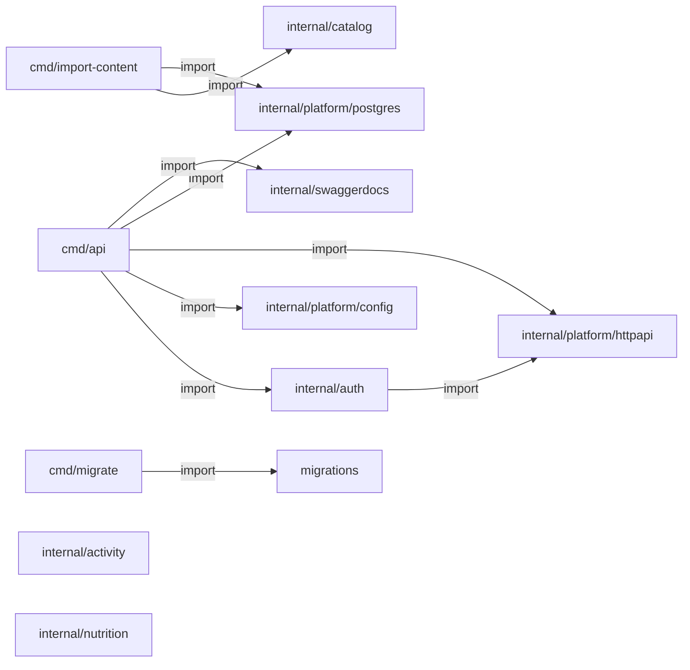

# Go e Swagger: evidência de código

> Gerado de código e registros versionados por `tools/gerar_documentacao.py`. Não editar este arquivo à mão. Revisão das entradas: `9147d3cd1695ebc5`.

Arquivos Go de aplicação encontrados: **16**. Registros net/http literais: **7**.

## Pacotes Go e imports atuais

Setas são imports estáticos; não são chamadas HTTP nem traces de execução.

## Anotações encontradas

| @Router | @Param | @Success / @Failure | Registro compatível detectado | Fonte |
| --- | --- | --- | --- | --- |
| `POST /api/v1/auth/google` | body body GoogleRequest true "Google ID token" | Success 200 {object} Session; Failure 400,401,413,415,426,429,503 {object} httpapi.Problem | sim | [services/api/internal/auth/handler.go:131](../../../services/api/internal/auth/handler.go) |
| `POST /api/v1/auth/refresh` | body body RefreshRequest true "Single-use refresh token" | Success 200 {object} Session; Failure 400,401,413,415,426,429,503 {object} httpapi.Problem | sim | [services/api/internal/auth/handler.go:157](../../../services/api/internal/auth/handler.go) |
| `POST /api/v1/auth/logout` | body body RefreshRequest true "Refresh token of the device" | Success 204; Failure 400,413,415,426,429,503 {object} httpapi.Problem | sim | [services/api/internal/auth/handler.go:182](../../../services/api/internal/auth/handler.go) |
| `GET /api/v1/me` |  | Success 200 {object} User; Failure 401,426,429,503 {object} httpapi.Problem | sim | [services/api/internal/auth/handler.go:206](../../../services/api/internal/auth/handler.go) |
| `GET /api/v1/health/live` |  | Success 200 {object} Status | sim | [services/api/internal/platform/httpapi/server.go:42](../../../services/api/internal/platform/httpapi/server.go) |
| `GET /api/v1/health/ready` |  | Success 200 {object} Status; Failure 503 {object} Problem | sim | [services/api/internal/platform/httpapi/server.go:53](../../../services/api/internal/platform/httpapi/server.go) |

## Registros HTTP encontrados

| Rota | Fonte |
| --- | --- |
| `POST /api/v1/auth/google` | [services/api/internal/auth/handler.go:34](../../../services/api/internal/auth/handler.go) |
| `POST /api/v1/auth/refresh` | [services/api/internal/auth/handler.go:35](../../../services/api/internal/auth/handler.go) |
| `POST /api/v1/auth/logout` | [services/api/internal/auth/handler.go:36](../../../services/api/internal/auth/handler.go) |
| `GET /api/v1/me` | [services/api/internal/auth/handler.go:37](../../../services/api/internal/auth/handler.go) |
| `GET /api/v1/health/live` | [services/api/internal/platform/httpapi/server.go:70](../../../services/api/internal/platform/httpapi/server.go) |
| `GET /api/v1/health/ready` | [services/api/internal/platform/httpapi/server.go:71](../../../services/api/internal/platform/httpapi/server.go) |
| `GET /docs/` | [services/api/internal/platform/httpapi/server.go:73](../../../services/api/internal/platform/httpapi/server.go) |

## Operações da especificação gerada

| Rota | operationId | Envia: parâmetros/body | Recebe: status e schemas | Fonte |
| --- | --- | --- | --- | --- |
| `POST /api/v1/auth/google` | não detectado | [{"description": "Google ID token", "name": "body", "in": "body", "required": true, "schema": {"$ref": "#/definitions/auth.GoogleRequest"}}] | {"200": {"description": "OK", "schema": {"$ref": "#/definitions/auth.Session"}}, "400": {"description": "Bad Request", "schema": {"$ref": "#/definitions/httpapi.Problem"}}, "401": {"description": "Unauthorized", "schema": {"$ref": "#/definitions/httpapi.Problem"}}, "413": {"description": "Request Entity Too Large", "schema": {"$ref": "#/definitions/httpapi.Problem"}}, "415": {"description": "Unsupported Media Type", "schema": {"$ref": "#/definitions/httpapi.Problem"}}, "426": {"description": "Upgrade Required", "schema": {"$ref": "#/definitions/httpapi.Problem"}}, "429": {"description": "Too Many Requests", "schema": {"$ref": "#/definitions/httpapi.Problem"}}, "503": {"description": "Service Unavailable", "schema": {"$ref": "#/definitions/httpapi.Problem"}}} | [contracts/generated/swagger-v1.json:1](../../../contracts/generated/swagger-v1.json) |
| `POST /api/v1/auth/logout` | não detectado | [{"description": "Refresh token of the device", "name": "body", "in": "body", "required": true, "schema": {"$ref": "#/definitions/auth.RefreshRequest"}}] | {"204": {"description": "No Content"}, "400": {"description": "Bad Request", "schema": {"$ref": "#/definitions/httpapi.Problem"}}, "413": {"description": "Request Entity Too Large", "schema": {"$ref": "#/definitions/httpapi.Problem"}}, "415": {"description": "Unsupported Media Type", "schema": {"$ref": "#/definitions/httpapi.Problem"}}, "426": {"description": "Upgrade Required", "schema": {"$ref": "#/definitions/httpapi.Problem"}}, "429": {"description": "Too Many Requests", "schema": {"$ref": "#/definitions/httpapi.Problem"}}, "503": {"description": "Service Unavailable", "schema": {"$ref": "#/definitions/httpapi.Problem"}}} | [contracts/generated/swagger-v1.json:1](../../../contracts/generated/swagger-v1.json) |
| `POST /api/v1/auth/refresh` | não detectado | [{"description": "Single-use refresh token", "name": "body", "in": "body", "required": true, "schema": {"$ref": "#/definitions/auth.RefreshRequest"}}] | {"200": {"description": "OK", "schema": {"$ref": "#/definitions/auth.Session"}}, "400": {"description": "Bad Request", "schema": {"$ref": "#/definitions/httpapi.Problem"}}, "401": {"description": "Unauthorized", "schema": {"$ref": "#/definitions/httpapi.Problem"}}, "413": {"description": "Request Entity Too Large", "schema": {"$ref": "#/definitions/httpapi.Problem"}}, "415": {"description": "Unsupported Media Type", "schema": {"$ref": "#/definitions/httpapi.Problem"}}, "426": {"description": "Upgrade Required", "schema": {"$ref": "#/definitions/httpapi.Problem"}}, "429": {"description": "Too Many Requests", "schema": {"$ref": "#/definitions/httpapi.Problem"}}, "503": {"description": "Service Unavailable", "schema": {"$ref": "#/definitions/httpapi.Problem"}}} | [contracts/generated/swagger-v1.json:1](../../../contracts/generated/swagger-v1.json) |
| `GET /api/v1/health/live` | não detectado | [] | {"200": {"description": "OK", "schema": {"$ref": "#/definitions/httpapi.Status"}}} | [contracts/generated/swagger-v1.json:1](../../../contracts/generated/swagger-v1.json) |
| `GET /api/v1/health/ready` | não detectado | [] | {"200": {"description": "OK", "schema": {"$ref": "#/definitions/httpapi.Status"}}, "503": {"description": "Service Unavailable", "schema": {"$ref": "#/definitions/httpapi.Problem"}}} | [contracts/generated/swagger-v1.json:1](../../../contracts/generated/swagger-v1.json) |
| `GET /api/v1/me` | não detectado | [] | {"200": {"description": "OK", "schema": {"$ref": "#/definitions/auth.User"}}, "401": {"description": "Unauthorized", "schema": {"$ref": "#/definitions/httpapi.Problem"}}, "426": {"description": "Upgrade Required", "schema": {"$ref": "#/definitions/httpapi.Problem"}}, "429": {"description": "Too Many Requests", "schema": {"$ref": "#/definitions/httpapi.Problem"}}, "503": {"description": "Service Unavailable", "schema": {"$ref": "#/definitions/httpapi.Problem"}}} | [contracts/generated/swagger-v1.json:1](../../../contracts/generated/swagger-v1.json) |

Anotação, registro de rota e operação na especificação são evidências distintas. A CI do serviço compara os derivados e testa handlers. Novas rotas continuam exigindo teste de resposta/autorização. O extrator documental não executa Go nem substitui o gerador Swaggo.

[Decisão e rotina Swagger](../swagger-go.md) · [Voltar ao mapa](../README.md)
