# Progresso e dependências

> Gerado de código e registros versionados por `tools/gerar_documentacao.py`. Não editar este arquivo à mão. Revisão das entradas: `02f82d50940a80dc`.

**18/49 histórias concluídas**, em 12 épicos. Próxima história: **V1-047**. Status vem do backlog revisado, não da existência de arquivo ou de um desenho.

| Épico | Objetivo | Histórias | Concluídas |
| --- | --- | --- | --- |
| EP01 | Recorte verificável e governança | 3 | 3 |
| EP02 | Conteúdo, autoria e direitos | 3 | 3 |
| EP03 | Fundação Go, contratos e banco | 4 | 4 |
| EP04 | Identidade, privacidade e acesso | 4 | 3 |
| EP05 | Biblioteca humana e API de catálogo | 5 | 1 |
| EP06 | Atividade e alimentação registradas de verdade | 7 | 2 |
| EP07 | Flutter e experiência da V1 | 8 | 2 |
| EP08 | Segurança, desempenho e observabilidade | 3 | 0 |
| EP09 | Infraestrutura, CI e implantação | 3 | 0 |
| EP10 | APK e primeiro teste acompanhado | 4 | 0 |
| EP11 | iOS e distribuição nas lojas | 2 | 0 |
| EP12 | Visão integral após o primeiro piloto | 3 | 0 |

## Dependências por história

### EP01 — Recorte verificável e governança

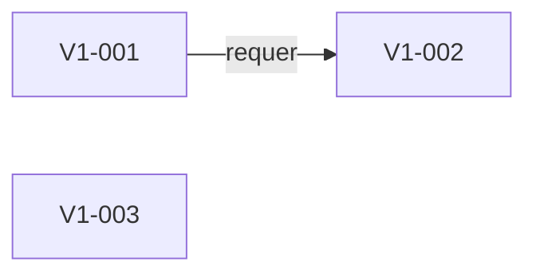

| História | Status | Entrega | Depende de |
| --- | --- | --- | --- |
| V1-001 | done | Mapear conteúdo e cenários do APK de avaliação | nenhuma |
| V1-002 | done | Aceitar a decisão Go e definir a fronteira de migração | V1-001 |
| V1-003 | done | Manter documentação arquitetural dinâmica no repositório | nenhuma |
### EP02 — Conteúdo, autoria e direitos

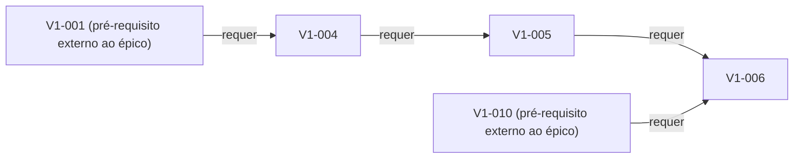

| História | Status | Entrega | Depende de |
| --- | --- | --- | --- |
| V1-004 | done | Criar contrato editorial dos quatro tipos de conteúdo | V1-001 |
| V1-005 | done | Revisar o lote real para o uso do piloto | V1-004 |
| V1-006 | done | Importar conteúdo de forma idempotente e auditável | V1-005, V1-010 |
### EP03 — Fundação Go, contratos e banco

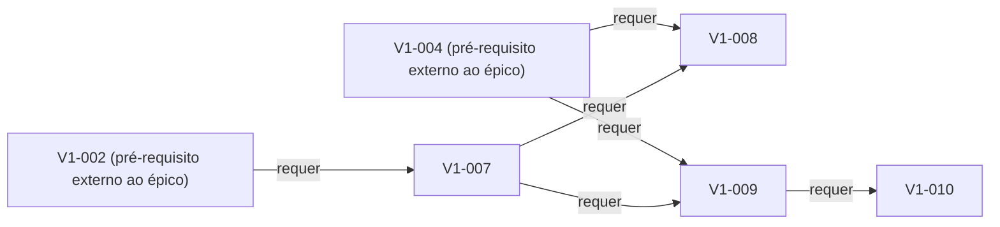

| História | Status | Entrega | Depende de |
| --- | --- | --- | --- |
| V1-007 | done | Criar o esqueleto do monólito modular Go | V1-002 |
| V1-008 | done | Gerar Swagger dos comentários e DTOs Go antes do cliente | V1-004, V1-007 |
| V1-009 | done | Modelar conteúdo versionado, adesão e ocorrências | V1-004, V1-007 |
| V1-010 | done | Criar migrations e testar backup/restauração | V1-009 |
### EP04 — Identidade, privacidade e acesso

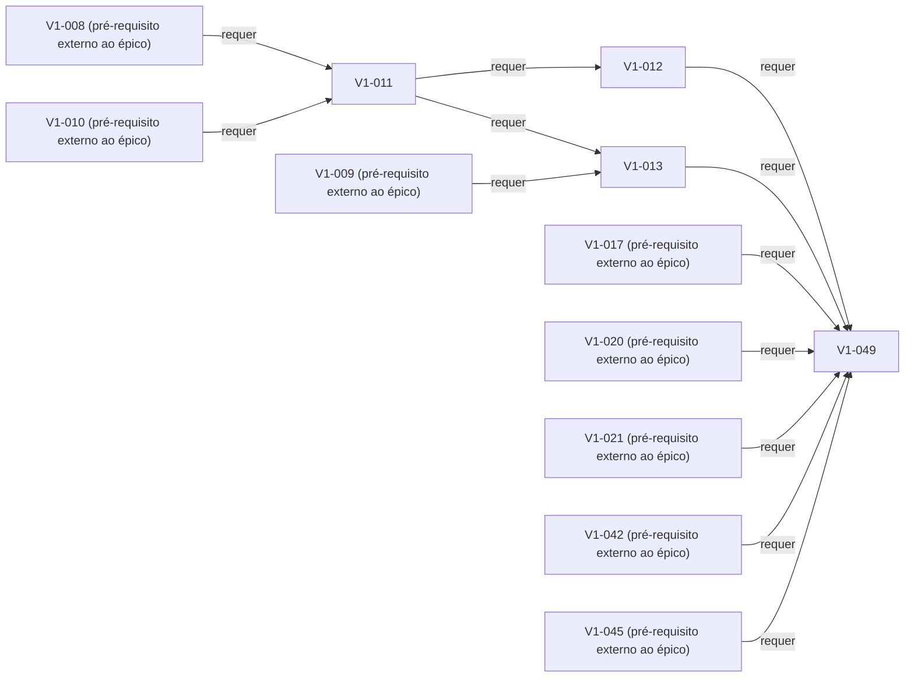

| História | Status | Entrega | Depende de |
| --- | --- | --- | --- |
| V1-011 | done | Autenticar Google no novo serviço | V1-008, V1-010 |
| V1-012 | done | Rotacionar e revogar refresh tokens | V1-011 |
| V1-013 | done | Aplicar autorização, limites e ciclo dos dados | V1-011, V1-009 |
| V1-049 | todo | Autorizar exclusão própria e exceção master auditada | V1-012, V1-013, V1-017, V1-020, V1-021, V1-042, V1-045 |
### EP05 — Biblioteca humana e API de catálogo

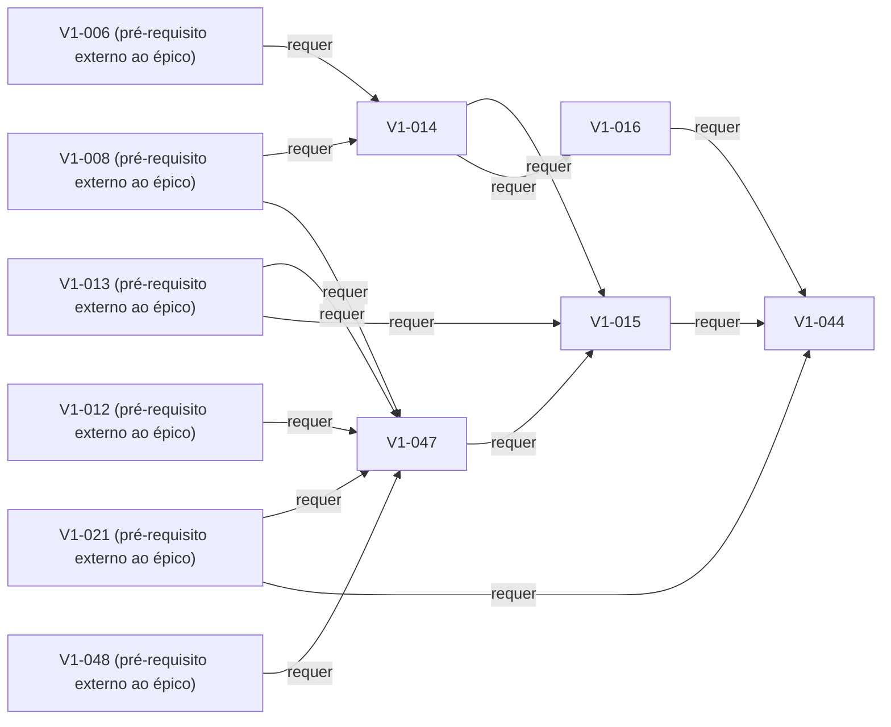

| História | Status | Entrega | Depende de |
| --- | --- | --- | --- |
| V1-014 | done | Servir catálogo, versão e requisitos de uso | V1-006, V1-008 |
| V1-047 | doing | Persistir configuração completa antes da seleção de treino | V1-008, V1-012, V1-013, V1-021, V1-048 |
| V1-015 | todo | Criar adesão sem geração de treino | V1-014, V1-013, V1-047 |
| V1-016 | todo | Expor instrução acessível e mídia com direitos | V1-014 |
| V1-044 | todo | Compor treino com regras humanas revisadas | V1-015, V1-016, V1-021 |
### EP06 — Atividade e alimentação registradas de verdade

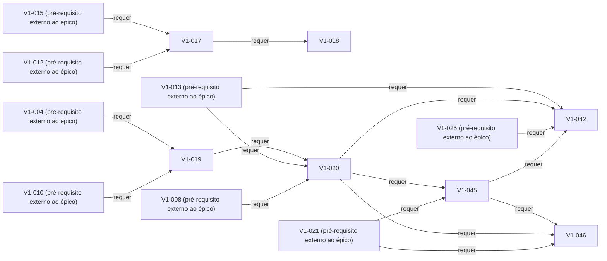

| História | Status | Entrega | Depende de |
| --- | --- | --- | --- |
| V1-017 | todo | Executar ocorrências idempotentes de atividade | V1-015, V1-012 |
| V1-018 | todo | Consultar histórico e resumo com origem das métricas | V1-017 |
| V1-019 | done | Validar e importar o lote alimentar | V1-004, V1-010 |
| V1-020 | done | Pesquisar e cadastrar alimento próprio e registrar consumo | V1-019, V1-013, V1-008 |
| V1-042 | todo | Reconhecer alimentos por foto com revisão e quantidade informada | V1-013, V1-020, V1-025, V1-045 |
| V1-045 | todo | Organizar registros por refeição e por alimento | V1-020, V1-021 |
| V1-046 | todo | Entregar histórico visual, análise nutricional e dicas revisadas | V1-045, V1-020, V1-021 |
### EP07 — Flutter e experiência da V1

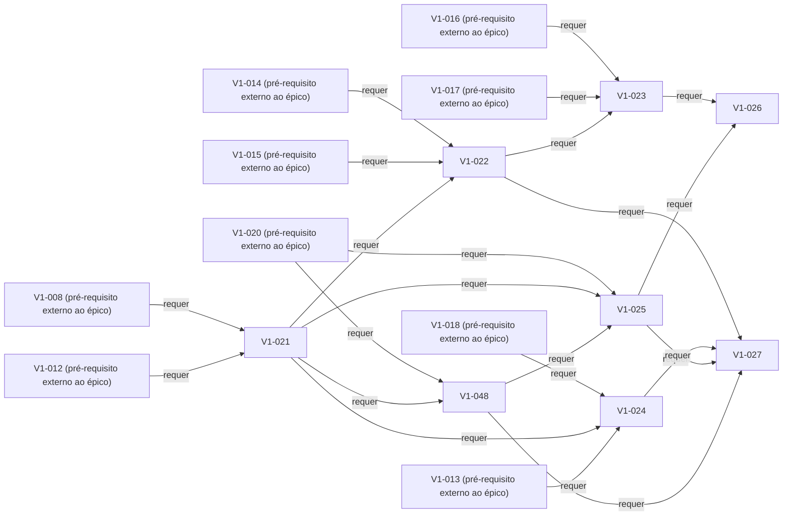

| História | Status | Entrega | Depende de |
| --- | --- | --- | --- |
| V1-021 | done | Organizar configuração, composição e estado | V1-008, V1-012 |
| V1-022 | todo | Implementar entrada e biblioteca com conteúdo real | V1-014, V1-015, V1-021 |
| V1-023 | todo | Implementar sessão e recuperação de interrupção | V1-016, V1-017, V1-022 |
| V1-024 | todo | Implementar Hoje, histórico e perfil | V1-018, V1-021, V1-013 |
| V1-025 | todo | Implementar busca, cadastro próprio e registro alimentar no Flutter | V1-020, V1-021, V1-048 |
| V1-026 | todo | Tratar offline e sincronização sem fingir sucesso | V1-023, V1-025 |
| V1-048 | done | Localizar interface e nomes alimentares com revisão | V1-020, V1-021 |
| V1-027 | todo | Validar acessibilidade e paridade de contratos Android/iOS | V1-022, V1-024, V1-025, V1-048 |
### EP08 — Segurança, desempenho e observabilidade

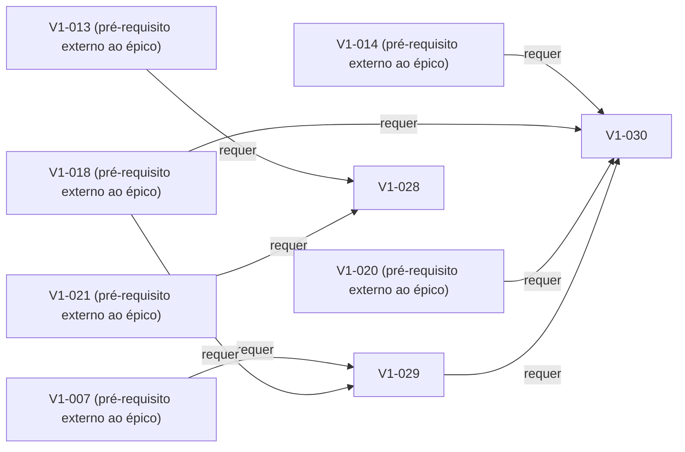

| História | Status | Entrega | Depende de |
| --- | --- | --- | --- |
| V1-028 | todo | Auditar dependências, segredos e superfície de ataque | V1-013, V1-021 |
| V1-029 | todo | Instrumentar requisições, consultas e falhas | V1-007, V1-018 |
| V1-030 | todo | Medir consultas e carga representativa | V1-014, V1-018, V1-020, V1-029 |
### EP09 — Infraestrutura, CI e implantação

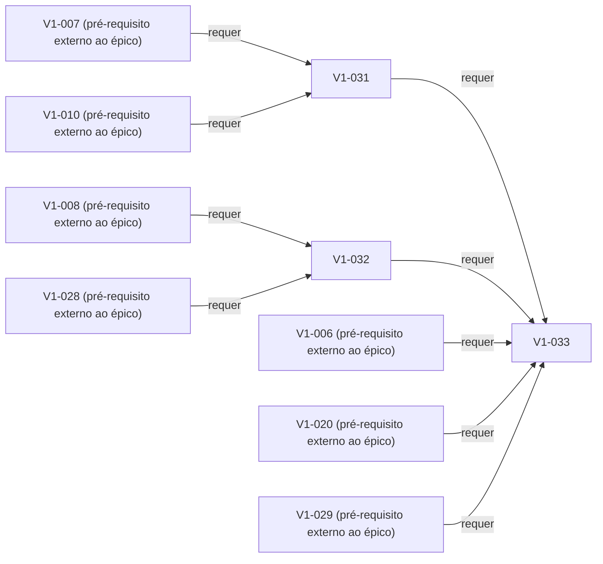

| História | Status | Entrega | Depende de |
| --- | --- | --- | --- |
| V1-031 | todo | Escolher hospedagem e orçamento do piloto | V1-007, V1-010 |
| V1-032 | todo | Construir pipeline e artefatos reproduzíveis | V1-008, V1-028 |
| V1-033 | todo | Implantar staging e conferir restauração | V1-031, V1-032, V1-006, V1-020, V1-029 |
### EP10 — APK e primeiro teste acompanhado

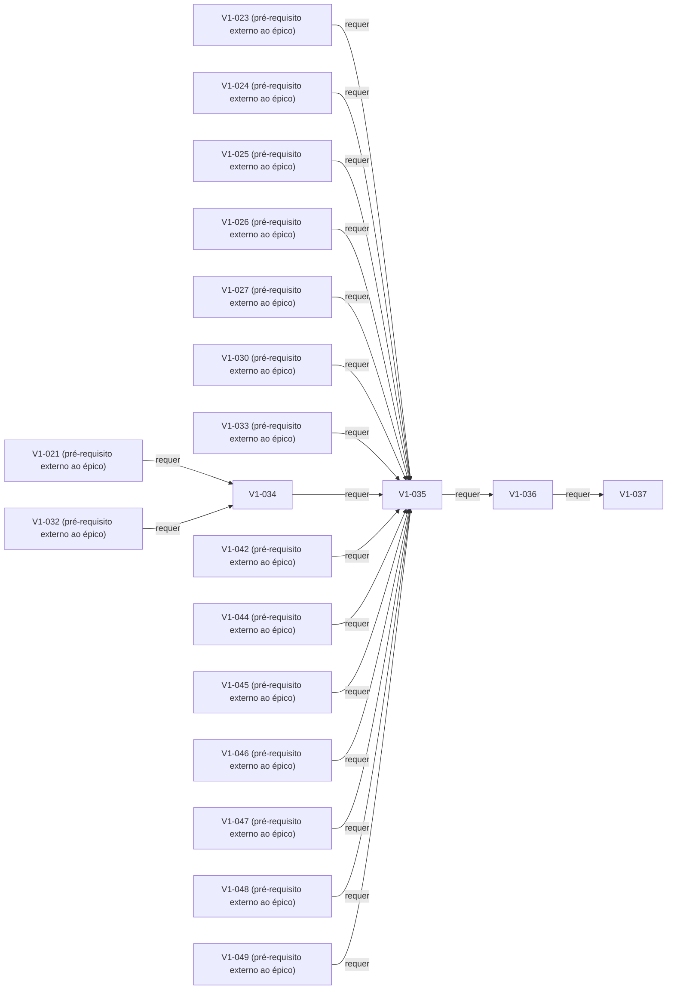

| História | Status | Entrega | Depende de |
| --- | --- | --- | --- |
| V1-034 | todo | Preparar identidade e assinatura Android | V1-021, V1-032 |
| V1-035 | todo | Validar a jornada completa da V1 | V1-023, V1-024, V1-025, V1-026, V1-027, V1-030, V1-033, V1-034, V1-042, V1-044, V1-045, V1-046, V1-047, V1-048, V1-049 |
| V1-036 | todo | Gerar e disponibilizar APK à esposa | V1-035 |
| V1-037 | todo | Encerrar piloto e priorizar correções | V1-036 |
### EP11 — iOS e distribuição nas lojas

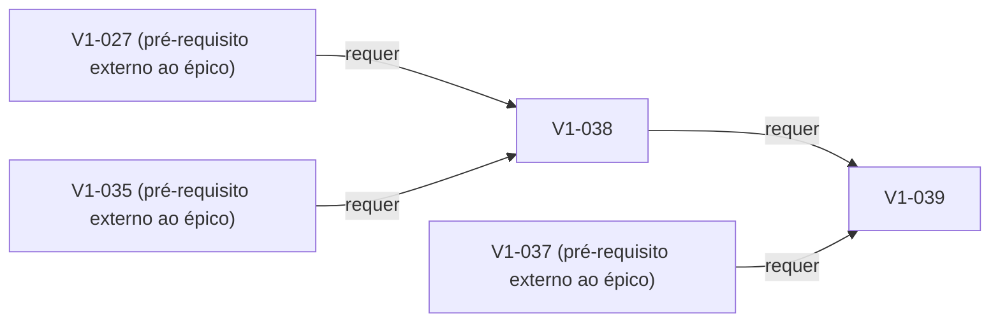

| História | Status | Entrega | Depende de |
| --- | --- | --- | --- |
| V1-038 | todo | Compilar e testar no ecossistema iOS | V1-027, V1-035 |
| V1-039 | todo | Preparar TestFlight, Play e políticas de publicação | V1-038, V1-037 |
### EP12 — Visão integral após o primeiro piloto

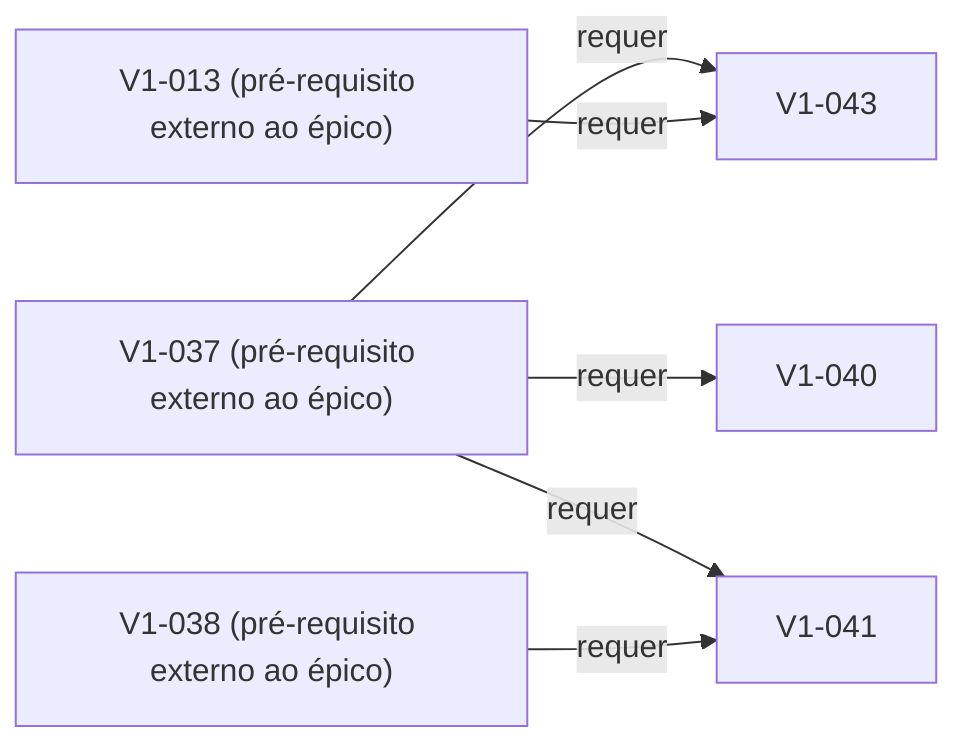

| História | Status | Entrega | Depende de |
| --- | --- | --- | --- |
| V1-040 | todo | Ampliar modalidades, programas e personalização humana | V1-037 |
| V1-041 | todo | Adicionar sensores, GPS e integrações | V1-037, V1-038 |
| V1-043 | todo | Desenvolver acompanhamento e alimentação avançados | V1-037, V1-013 |

[Backlog completo: aceite, tarefas, subtarefas e testes](../../execucao/v1/backlog.md) · [Voltar ao mapa](../README.md)
