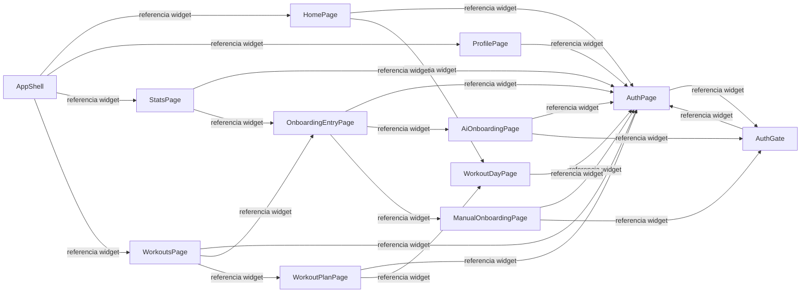
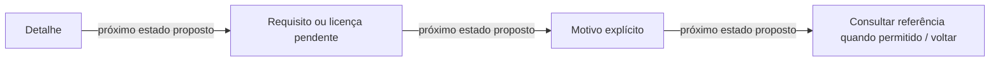

# Telas e fluxos

> Gerado de código e registros versionados por `tools/gerar_documentacao.py`. Não editar este arquivo à mão. Revisão das entradas: `9147d3cd1695ebc5`.

## Atual: referências entre widgets

Construtor referenciado é evidência estática. Condições, botão voltar, clique e transição real não foram executados pelo gerador.

| Tela/widget | Localização |
| --- | --- |
| AuthPage | [lib/features/auth/presentation/pages/auth_page.dart:6](../../../lib/features/auth/presentation/pages/auth_page.dart) |
| HomePage | [lib/features/home/presentation/pages/home_page.dart:10](../../../lib/features/home/presentation/pages/home_page.dart) |
| AiOnboardingPage | [lib/features/onboarding/presentation/pages/ai_onboarding_page.dart:10](../../../lib/features/onboarding/presentation/pages/ai_onboarding_page.dart) |
| ManualOnboardingPage | [lib/features/onboarding/presentation/pages/manual_onboarding_page.dart:10](../../../lib/features/onboarding/presentation/pages/manual_onboarding_page.dart) |
| OnboardingEntryPage | [lib/features/onboarding/presentation/pages/onboarding_entry_page.dart:9](../../../lib/features/onboarding/presentation/pages/onboarding_entry_page.dart) |
| ProfilePage | [lib/features/profile/presentation/pages/profile_page.dart:9](../../../lib/features/profile/presentation/pages/profile_page.dart) |
| StatsPage | [lib/features/stats/presentation/pages/stats_page.dart:10](../../../lib/features/stats/presentation/pages/stats_page.dart) |
| WorkoutDayPage | [lib/features/workouts/presentation/pages/workout_day_page.dart:9](../../../lib/features/workouts/presentation/pages/workout_day_page.dart) |
| WorkoutPlanPage | [lib/features/workouts/presentation/pages/workout_plan_page.dart:10](../../../lib/features/workouts/presentation/pages/workout_plan_page.dart) |
| WorkoutsPage | [lib/features/workouts/presentation/pages/workouts_page.dart:11](../../../lib/features/workouts/presentation/pages/workouts_page.dart) |
| AppShell | [lib/shared/widgets/app_shell.dart:9](../../../lib/shared/widgets/app_shell.dart) |
| AuthGate | [lib/shared/widgets/auth_gate.dart:6](../../../lib/shared/widgets/auth_gate.dart) |

## Chamadas usadas por cada feature

| Feature | Literais HTTP |
| --- | --- |
| auth | `POST /api/v1/auth/google`; `GET /api/v1/me`; `POST /api/v1/auth/logout` |
| bootstrap | `GET /mobile/bootstrap` |
| home | `GET /mobile/home/$date` |
| onboarding | `POST /mobile/onboarding/manual-plan`; `POST /mobile/onboarding/ai-plan` |
| profile | `GET /mobile/profile`; `PUT /mobile/profile/train-data` |
| stats | `GET /mobile/stats` |
| workouts | `GET /mobile/workout-plans`; `GET /mobile/workout-plans/$workoutPlanId`; `GET /mobile/workout-plans/$workoutPlanId/days/$workoutDayId`; `POST /mobile/workout-plans/$workoutPlanId/days/$workoutDayId/sessions`; `PATCH /mobile/workout-plans/$workoutPlanId/days/$workoutDayId/sessions/$sessionId` |

## Planejado: jornadas da V1

### Jornada principal planejada

```mermaid
flowchart LR
    node0["Entrar"]
    node1["Contexto mínimo"]
    node2["Biblioteca humana"]
    node3["Detalhe + origem + requisitos"]
    node4["Selecionar versão"]
    node5["Sessão / consulta permitida"]
    node6["Registrar realizado"]
    node7["Hoje / histórico"]
    node0 -->|"próximo estado proposto"| node1
    node1 -->|"próximo estado proposto"| node2
    node2 -->|"próximo estado proposto"| node3
    node3 -->|"próximo estado proposto"| node4
    node4 -->|"próximo estado proposto"| node5
    node5 -->|"próximo estado proposto"| node6
    node6 -->|"próximo estado proposto"| node7
```

### Alimentação planejada

```mermaid
flowchart LR
    node0["Hoje"]
    node1["Alimentação"]
    node2["Buscar fonte real"]
    node3["Confirmar preparo e quantidade"]
    node4["Registrar consumo"]
    node5["Consultar / editar histórico"]
    node0 -->|"próximo estado proposto"| node1
    node1 -->|"próximo estado proposto"| node2
    node2 -->|"próximo estado proposto"| node3
    node3 -->|"próximo estado proposto"| node4
    node4 -->|"próximo estado proposto"| node5
```

### Conteúdo sem cobertura

[Voltar ao mapa](../README.md) · [Responsabilidade de cada tela](../fluxos.md)
