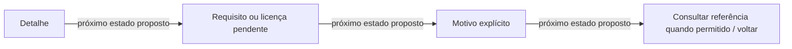

# Telas e fluxos

> Gerado de código e registros versionados por `tools/gerar_documentacao.py`. Não editar este arquivo à mão. Revisão das entradas: `c10b9ae4574f25eb`.

## Atual: referências entre widgets

Construtor referenciado é evidência estática. Condições, botão voltar, clique e transição real não foram executados pelo gerador.

```mermaid
flowchart LR
    node0["LanguagePage"]
    node1["AppearancePage"]
    node2["ActivityPage"]
    node3["AuthPage"]
    node4["CatalogDetailPage"]
    node5["CatalogPage"]
    node6["FoodDetailPage"]
    node7["FoodPage"]
    node8["TodayPage"]
    node9["EntryDetailPage"]
    node10["MealDetailPage"]
    node11["MealDiaryPage"]
    node12["MealDraftPage"]
    node13["MealMetadataPage"]
    node14["EntryFormPage"]
    node15["OwnFoodFormPage"]
    node16["NutritionPage"]
    node17["OwnFoodPickerPage"]
    node18["PrivacyPage"]
    node19["TrainingConfigurationPage"]
    node20["AccountPage"]
    node21["AuthGate"]
    node22["ContentSourcesPage"]
    node23["EvaluationGuidePage"]
    node24["ProductShell"]
    node25["StartupPage"]
    node3 -->|"referencia widget"| node0
    node3 -->|"referencia widget"| node1
    node3 -->|"referencia widget"| node5
    node3 -->|"referencia widget"| node7
    node3 -->|"referencia widget"| node18
    node3 -->|"referencia widget"| node21
    node5 -->|"referencia widget"| node4
    node7 -->|"referencia widget"| node6
    node9 -->|"referencia widget"| node14
    node10 -->|"referencia widget"| node9
    node10 -->|"referencia widget"| node13
    node11 -->|"referencia widget"| node9
    node11 -->|"referencia widget"| node10
    node11 -->|"referencia widget"| node12
    node12 -->|"referencia widget"| node7
    node12 -->|"referencia widget"| node14
    node12 -->|"referencia widget"| node17
    node14 -->|"referencia widget"| node15
    node15 -->|"referencia widget"| node14
    node16 -->|"referencia widget"| node7
    node16 -->|"referencia widget"| node9
    node16 -->|"referencia widget"| node11
    node16 -->|"referencia widget"| node14
    node16 -->|"referencia widget"| node15
    node17 -->|"referencia widget"| node7
    node18 -->|"referencia widget"| node22
    node20 -->|"referencia widget"| node0
    node20 -->|"referencia widget"| node1
    node20 -->|"referencia widget"| node18
    node20 -->|"referencia widget"| node22
    node21 -->|"referencia widget"| node3
    node21 -->|"referencia widget"| node24
    node21 -->|"referencia widget"| node25
    node22 -->|"referencia widget"| node5
    node22 -->|"referencia widget"| node7
    node22 -->|"referencia widget"| node16
    node23 -->|"referencia widget"| node5
    node23 -->|"referencia widget"| node7
    node24 -->|"referencia widget"| node2
    node24 -->|"referencia widget"| node5
    node24 -->|"referencia widget"| node16
    node24 -->|"referencia widget"| node20
```

| Tela/widget | Localização |
| --- | --- |
| LanguagePage | [lib/core/l10n/language_page.dart:6](../../../lib/core/l10n/language_page.dart) |
| AppearancePage | [lib/core/theme/appearance_page.dart:7](../../../lib/core/theme/appearance_page.dart) |
| ActivityPage | [lib/features/activity/presentation/activity_page.dart:12](../../../lib/features/activity/presentation/activity_page.dart) |
| AuthPage | [lib/features/auth/presentation/pages/auth_page.dart:16](../../../lib/features/auth/presentation/pages/auth_page.dart) |
| CatalogDetailPage | [lib/features/catalog/presentation/catalog_detail_page.dart:65](../../../lib/features/catalog/presentation/catalog_detail_page.dart) |
| CatalogPage | [lib/features/catalog/presentation/catalog_page.dart:15](../../../lib/features/catalog/presentation/catalog_page.dart) |
| FoodDetailPage | [lib/features/food_reference/presentation/food_detail_page.dart:10](../../../lib/features/food_reference/presentation/food_detail_page.dart) |
| FoodPage | [lib/features/food_reference/presentation/food_page.dart:14](../../../lib/features/food_reference/presentation/food_page.dart) |
| TodayPage | [lib/features/home/presentation/pages/today_page.dart:10](../../../lib/features/home/presentation/pages/today_page.dart) |
| EntryDetailPage | [lib/features/nutrition/presentation/entry_detail_page.dart:14](../../../lib/features/nutrition/presentation/entry_detail_page.dart) |
| MealDetailPage | [lib/features/nutrition/presentation/meal_detail_page.dart:16](../../../lib/features/nutrition/presentation/meal_detail_page.dart) |
| MealDiaryPage | [lib/features/nutrition/presentation/meal_diary_page.dart:16](../../../lib/features/nutrition/presentation/meal_diary_page.dart) |
| MealDraftPage | [lib/features/nutrition/presentation/meal_draft_page.dart:15](../../../lib/features/nutrition/presentation/meal_draft_page.dart) |
| MealMetadataPage | [lib/features/nutrition/presentation/meal_metadata_page.dart:10](../../../lib/features/nutrition/presentation/meal_metadata_page.dart) |
| EntryFormPage | [lib/features/nutrition/presentation/nutrition_forms.dart:38](../../../lib/features/nutrition/presentation/nutrition_forms.dart) |
| OwnFoodFormPage | [lib/features/nutrition/presentation/nutrition_forms.dart:428](../../../lib/features/nutrition/presentation/nutrition_forms.dart) |
| NutritionPage | [lib/features/nutrition/presentation/nutrition_page.dart:19](../../../lib/features/nutrition/presentation/nutrition_page.dart) |
| OwnFoodPickerPage | [lib/features/nutrition/presentation/own_food_picker_page.dart:14](../../../lib/features/nutrition/presentation/own_food_picker_page.dart) |
| PrivacyPage | [lib/features/privacy/presentation/privacy_page.dart:11](../../../lib/features/privacy/presentation/privacy_page.dart) |
| TrainingConfigurationPage | [lib/features/training_configuration/presentation/training_configuration_page.dart:35](../../../lib/features/training_configuration/presentation/training_configuration_page.dart) |
| AccountPage | [lib/shared/widgets/account_page.dart:15](../../../lib/shared/widgets/account_page.dart) |
| AuthGate | [lib/shared/widgets/auth_gate.dart:11](../../../lib/shared/widgets/auth_gate.dart) |
| ContentSourcesPage | [lib/shared/widgets/content_sources_page.dart:9](../../../lib/shared/widgets/content_sources_page.dart) |
| EvaluationGuidePage | [lib/shared/widgets/evaluation_guide_page.dart:11](../../../lib/shared/widgets/evaluation_guide_page.dart) |
| ProductShell | [lib/shared/widgets/product_shell.dart:23](../../../lib/shared/widgets/product_shell.dart) |
| StartupPage | [lib/shared/widgets/startup_page.dart:6](../../../lib/shared/widgets/startup_page.dart) |

## Chamadas usadas por cada feature

| Feature | Literais HTTP |
| --- | --- |
| activity | `GET /api/v1/me/activity`; `GET /api/v1/me/activity-sessions/${Uri.encodeComponent(id)}`; `POST /api/v1/me/activity-sessions`; `POST /api/v1/me/activity-sessions/${Uri.encodeComponent(sessionId)}/commands` |
| auth | `POST /api/v1/auth/google`; `GET /api/v1/me`; `POST /api/v1/auth/logout` |
| catalog | `GET /api/v1/catalog/${filters.kind}`; `GET /api/v1/catalog/filters`; `GET /api/v1/catalog/$kind/${Uri.encodeComponent(entry.id)}` |
| food_reference | `GET /api/v1/foods`; `GET /api/v1/foods/filters`; `GET /api/v1/foods/${Uri.encodeComponent(food.id)}`; `GET /api/v1/foods`; `GET /api/v1/foods/${Uri.encodeComponent(food.id)}` |
| nutrition | `GET /api/v1/me/foods`; `POST /api/v1/me/foods`; `GET /api/v1/me/food-entries`; `GET /api/v1/me/food-entries`; `GET /api/v1/me/food-entries/$id`; `GET /api/v1/me/food-summary`; `DELETE /api/v1/me/food-entries/$id`; `GET /api/v1/me/meal-diary`; `GET /api/v1/me/meals/$id` |
| privacy | `GET /api/v1/privacy`; `GET /api/v1/me/export`; `POST /api/v1/me/deletion-intent`; `DELETE /api/v1/me` |

## Planejado: jornadas da V1

### Lote alimentar importado — V1-019

```mermaid
flowchart LR
    node0["Snapshots/recibos existentes"]
    node1["Preflight e proveniência por célula"]
    node2["Revisão específica de direitos/base/identidade"]
    node3["6369registros versionados /2excluídos"]
    node4["ImportaçãoGo idempotente noDBisolado"]
    node5["Backupnovo restaurado e tabelas iguais"]
    node6["Gate pendente: autorização/API/Flutteralimentar"]
    node0 -->|"implementado e validado"| node1
    node1 -->|"implementado e validado"| node2
    node2 -->|"implementado e validado"| node3
    node3 -->|"implementado e validado"| node4
    node4 -->|"implementado e validado"| node5
    node5 -->|"implementado e validado"| node6
```

### Consulta real entregue — V1-014

```mermaid
flowchart LR
    node0["Entrada sem login ou conta conectada"]
    node1["Biblioteca:73movimentos /0programas"]
    node2["Busca e filtros da fonte"]
    node3["GET paginado: direitos/revisão/retirada"]
    node4["Detalhe da versão: autoria e licença"]
    node5["Requisitos desconhecidos e prática indisponível"]
    node6["Voltar / recarregar sem gerar treino"]
    node0 -->|"implementado e validado"| node1
    node1 -->|"implementado e validado"| node2
    node2 -->|"implementado e validado"| node3
    node3 -->|"implementado e validado"| node4
    node4 -->|"implementado e validado"| node5
    node5 -->|"implementado e validado"| node6
```

### Jornada principal planejada

```mermaid
flowchart LR
    node0["Entrar"]
    node1["Contexto mínimo"]
    node2["Biblioteca humana"]
    node3["Detalhe + origem + requisitos"]
    node4["Selecionar versão"]
    node5["Sessão / consulta permitida"]
    node6["Registrar realizado"]
    node7["Hoje / histórico"]
    node0 -->|"próximo estado proposto"| node1
    node1 -->|"próximo estado proposto"| node2
    node2 -->|"próximo estado proposto"| node3
    node3 -->|"próximo estado proposto"| node4
    node4 -->|"próximo estado proposto"| node5
    node5 -->|"próximo estado proposto"| node6
    node6 -->|"próximo estado proposto"| node7
```

### Alimentação planejada

```mermaid
flowchart LR
    node0["Hoje"]
    node1["Alimentação"]
    node2["Buscar fonte real"]
    node3["Confirmar preparo e quantidade"]
    node4["Registrar consumo"]
    node5["Consultar / editar histórico"]
    node0 -->|"próximo estado proposto"| node1
    node1 -->|"próximo estado proposto"| node2
    node2 -->|"próximo estado proposto"| node3
    node3 -->|"próximo estado proposto"| node4
    node4 -->|"próximo estado proposto"| node5
```

### Conteúdo sem cobertura

[Voltar ao mapa](../README.md) · [Responsabilidade de cada tela](../fluxos.md)
