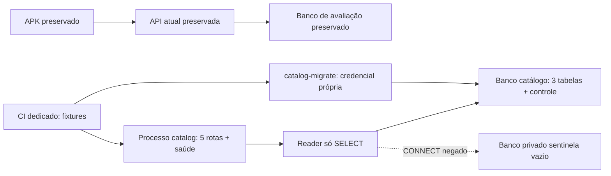
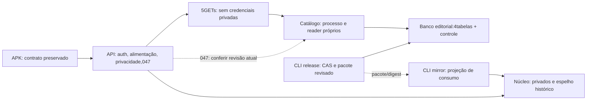

# Reavaliar microserviços Go — 29/10/2026

**Direção escolhida pelo autor em29/10: microserviços por etapas.** Autor autorizou a implementação isolada M1 em29/10, somente fixtures/CI. M2–M4, processos/dados/rotas da avaliação continuam sem cutover aprovado. O autor esclareceu que pretendia microserviços desde o início e continua propenso a esse rumo. A escolha Go permanece; a recomendação anterior de monólito modular deixa de representar uma decisão definitiva sobre a arquitetura de execução. O APK25, os contratos e os dados existentes são a referência de compatibilidade.

## O que existe e o que está acoplado

services/api/cmd/api/main.go compõe um processo com auth, catalog, nutrition, privacy e trainingconfig. Activity ainda não entrega execução. Há um pool e um schema PostgreSQL,13migrations/30tabelas; Go0.8.1/34operações. O Graphify existente cobre Dart; foi consultado para MealRepository, não é evidência das relações Go/SQL.

- Auth.Authorize entrega principal verificado. Escritas privadas revalidam sessão/família/token dentro de transações SQL. Não basta substituir essa fronteira por userId vindo de outro serviço ou do Flutter.
- MealStore confirma grupo, consumos, versões e replay juntos. Separar refeição e seus alimentos em serviços distintos quebraria essa atomicidade sem um protocolo adicional.
- Privacy.Postgres conhece dados privados dos módulos, coordena exportação, exclusão e proteção de restore. Em serviços com bancos próprios, precisará de coordenação com confirmação e impedimento de leitura/recriação após exclusão.
- O runtime atual tem privilégios compartilhados entre módulos. Criar vários executáveis usando o mesmo usuário e as mesmas tabelas manteria esse acoplamento.

## Comparação aplicada ao TrainForge

| Aspecto | Monólito modular atual | Microserviços com propriedade de dados |
|---|---|---|
| Execução/publicação | Um processo; módulos publicados juntos | Processos e versões publicáveis separadamente |
| Escala | Réplicas do conjunto; revisar estado local, limites e pool | Escalar cada domínio; coordenar limites, conexões e dependências |
| Refeição e consumos | Uma transação já testada | Continuam juntos no mesmo serviço alimentar; distribuição não exige separar cada tabela |
| Falhas | Menos chamadas de rede; uma falha pode afetar o processo | Isolamento potencial, condicionado a timeouts, filas e tratamento de indisponibilidade |
| Segurança | Menos fronteiras remotas; runtime compartilhado ainda deve melhorar | Identidade entre serviços, credenciais e privilégios por dono; mais fronteiras para auditar |
| Dados/privacidade | Exclusão/exportação coordenadas no banco atual | Contratos de exportação, exclusão, tombstones e restore por serviço |
| Desenvolvimento | Menor custo operacional inicial | Contratos e testes entre serviços, tracing e operação de versões coexistentes |

Publicação e escala independentes são benefícios possíveis; consistência, testes e operação distribuídos têm custo. Essa comparação segue os [benefícios e desafios descritos pela Microsoft](https://learn.microsoft.com/en-us/azure/architecture/guide/architecture-styles/microservices), sem escolher hospedagem ou Kubernetes.

## Uma proposta concreta de divisão

Dividir por capacidade de negócio, sem serviço para cada endpoint ou tabela. Candidatos, ainda sujeitos a validar fronteiras:

1. **Alimentação:** alimentos particulares, consumos, refeições, versões e cálculo. Um único dono preserva o commit atômico de grupo/itens. Nomes e versões externas usados no cálculo precisam de contrato/snapshot verificável, não joins no banco de outro serviço.
2. **Treinos:** configuração, adesão, composição permitida, agenda, execução e histórico; as partes ainda ausentes continuam ausentes. Conteúdo editorial aprovado é pré-requisito para prática.
3. **Catálogo editorial:** referências públicas e suas versões/direitos. Separar leitura de catálogo não autoriza prática ou mídia sem licença. Examinar consultas e dependências antes de mover tabelas.
4. **Fotos/processamento:** candidato com perfil de carga próprio. A042 ainda não existe; armazenamento, reconhecimento, consentimento e exclusão precisam ser desenhados. Não há modelo/provedor contratado ou aprovado por esta proposta.
5. **Identidade/privacidade:** contratos transversais a desenhar antes de extrair auth. A dependência atual de sessão viva nas funções SQL torna essa extração sensível. Revogação e exclusão não podem aceitar falha de rede como autorização nem prometer consistência imediata sem protocolo comprovado.

Um monorepositório pode conter esses serviços. Microserviços não exigem vários repositórios ou cloud. O ambiente de prova pode ser local, com processos Go e bancos/roles isolados. Não foi medido esforço em dias nem custo de operação; não há previsão de milhões simultâneos sustentada por carga.

## Sequência se o autor escolher migrar

Preferência técnica inicial: migração progressiva, mantendo avaliação do APK. A [AWS descreve extração gradual e seus riscos](https://docs.aws.amazon.com/prescriptive-guidance/latest/cloud-design-patterns/strangler-fig.html); isso não obriga usar serviços AWS.

1. Aprovar limites, propriedade das tabelas, contratos e ordem. Definir autenticação interna, versões, prazo/retry, idempotência, observabilidade e ciclo de exclusão/restore.
2. Escolher uma fatia e comparar o mesmo comportamento antes/depois em dados descartáveis. Levantar queries, transações e dependências; não fazer uma reescrita geral baseada apenas no nome dos pacotes.
3. Manter a API pública consumida pelo Flutter compatível. Um componente de entrada pode encaminhar para o dono da capacidade; testar indisponibilidade sem gravar em dois lugares.
4. Fazer checkpoint, ensaio de migração/restore e troca explícita de dono. Um escritor por dado. Rollback exige compatibilidade verificada; não consultar/gravar indiscriminadamente no sistema antigo se o novo estiver indisponível, pois isso pode recriar dados excluídos.
5. Comprovar isolamento entre contas/serviços, expiração/revogação, exclusão concorrente, replay, timeout, recuperação e observabilidade. Medir carga por domínio antes de prometer capacidade.

## Decisão recebida e limites

O autor escolheu **microserviços por etapas** ao responder à pergunta de qual caminho detalhar antes de mudar a arquitetura. Essa direção substitui a indecisão entre manter o processo atual e uma reescrita ampla. Não autoriza implicitamente migrar o banco real, mover sessões ou trocar o APK. CI/segurança continuam independentemente; práticas015/016 permanecem bloqueadas por falta de conteúdo aprovado.

## Dependências Go conferidas por go list

Imports de produção internos: auth→httpapi;catalog→httpapi;nutrition→auth/httpapi;privacy→auth/httpapi;trainingconfig→auth/httpapi;foodnamesops→nutrition/postgres. Platform não importa domínios. Testes não entraram nessa contagem. Isso mostra dependências de pacotes; não prova isolamento dos dados: as referências SQL entre sessões, alimentação e privacidade continuam existindo. A prontidão0.8.1 é um adaptador daAPI atual e deverá receber requisitos por serviço se a extração for aprovada.

## Primeiro incremento proposto: leitura do catálogo público

**M1 concluída no recorte isolado em29/10, sem cutover.** Usar o catálogo de movimentos/programas como primeira prova de processo separado. Seu pacote só importa a camadaHTTP interna; leitura depende de `sources`, `content_versions` e `content_withdrawals`. A propriedade editorial completa não estará extraída apenas por abrir outro processo.

| Parte | Prova isolada proposta | Condição para a troca real |
|---|---|---|
| Processo | Novo executável Go no monorepositório, reutilizando domínio/DTOs do catálogo e composição própria | Build e publicação independentes, configuração/dependências mínimas verificadas |
| Banco | Base descartável própria noCI, migrator e reader exclusivos; reader sóSELECT nas3tabelas editoriais necessárias | Banco e migrations sob um único dono editorial; nenhuma credencial do banco privado |
| Conteúdo | Fixtures explicitamente sintéticas, incluindo retiradas; nada importado na avaliação | Conteúdo real já permitido, versões/direitos/retiradas reconciliados antes da troca |
| Entrada |HTTP da prova emloopback/httptest, sem redirecionar Flutter ouAPI atual | Encaminhamento só das5rotas aprovadas; sem repassar Authorization/cookies para o catálogo público |
| Escrita | Nenhuma rota pública de escrita; publicação real continua com o dono atual | Transferência editorial explícita, com um escritor, revisor e trilha de retirada |
| Treinos | Configuração047 continua no processo/banco atual | Substituir a consulta editorial compartilhada por contrato que preserve validação e versões |
| Saúde | live do processo e ready verificando apenas seus objetos/reader; falha genérica | Limites de conexão, cancelamento, shutdown e indisponibilidade exercitados |

Não clonar migrations privadas para o serviço de catálogo. Compartilhar código dentro do monorepositório é transitório e não equivale a isolamento de dados. Criar executáveis com a mesma senha/runtime e o mesmo schema não satisfaz o objetivo.

### Contrato que deve permanecer compatível

Manter os caminhos atuais, sem login novo ou alteração noFlutter:

- GET `/api/v1/catalog/filters`;
- GET `/api/v1/catalog/programs`;
- GET `/api/v1/catalog/programs/{id}`;
- GET `/api/v1/catalog/movements`;
- GET `/api/v1/catalog/movements/{id}`.

PreservarIDs/versões, tiposprogram/collection/movement, filtros literais, cursores vinculados aos filtros, paginação, ausência explícita, autoria/fonte/direitos, consulta/prática e os códigos400/404/503. ConfirmarETag/If-None-Match e Cache-Control existentes. A checagem de retirada/permissão deve acontecer antes de responder304. Listagem escolhe a última versão antes de verificar direito/retirada; detalhe com versão explícita conserva o contrato atual, sem ressuscitar item retirado.

Proposta de teste contratual: mesma requisição e fixture para o handler atual e o processo isolado, comparando status, cabeçalhos relevantes e JSON canônico. Ignorar somente identificadores efêmeros de requisição devidamente identificados; não ignorar campos de negócio.

### Acoplamento que impede uma troca ingênua

A configuração047 usa funçãoSQL `save_training_configuration` e consultas de recursos sobre o conteúdo editorial. Nutrição/refeições e privacidade têm suas próprias transações privadas e ficam juntas por enquanto. Não remover tabelas/FKs ou aceitar recurso só porque um serviço remoto respondeu anteriormente.

Antes do cutover, levantar exatamente os consumidores de catálogo e funçõesSQL, definir snapshots históricos porID/versão e a regra de revalidação. Definir como publicação/retirada chega ao dono e como o consumidor comprova frescor. Enquanto isso não existir, a prova será uma **projeção de leitura em ambiente descartável**, sem promessa de serviço editorial completo.

Retirada tem precedência sobre cache. Sem prova atual de permissão, devolver indisponibilidade; nunca consultar uma cópia antiga como fallback silencioso. Uma indisponibilidade do catálogo não deve apagar sessão, gravar configuração ou trocar conteúdo por fixture. Nenhuma fila, produto cloud ou fornecedor é escolhido por esta proposta.

### Sequência e critérios de saída

| Passo | Entrega verificável | Estado |
|---|---|---|
| M0 | Direção gradual escolhida e acoplamentos Go/SQL documentados | Direção e limites M1 aceitos; migração real não autorizada |
| M1 | Processo de catálogo e reader próprio em fixtures/CI; contratos equivalentes e negativos de grants | Concluído:40860200717/ff8c8bb; fixtures removidas |
| M2 | Protocolo editorial de publicação/retirada, versões, frescor e treino047; um dono por dado | Concluído no recorte público:40874689251/c68b085 |
| M3 | Ensaio de migração/restore com dados descartáveis e comparação de hashes/visibilidade; falhas de rede | Concluído:prepare/withdraw/restore40874689251/c68b085 |
| M4 | Checkpoint real, troca controlada das5rotas, aceite doAPK e rollback ensaiado | Concluído localmente:checkpointrestaurado/30tabelas,5rotas/304,APK25,rollback/rede/recuperação; reciboM4 |

Aceite deM1 exige: processo sem auth/nutrition/privacy/trainingconfig; credencial incapaz de ler usuários/sessões/consumos ou gravar catálogo; migração idempotente somente editorial; testes de contrato, retirada, cache304, erro deDB, timeout/cancelamento e encerramento. Nenhum segredo ou corpo pessoal nos logs. Fixtures não validam loginGoogle nem prática real. Nenhuma nova prática será liberada.

M4 só ocorre depois deM2/M3. Rollback do caminhoHTTP só é permitido enquanto a autoridade editorial anterior continuar atualizada e válida; caso contrário,503 é preferível a publicar conteúdo retirado. Não fazer dual write. Não iniciar nova hospedagem, serviçoWindows, Docker local ou mudanças emDNS/HTTPS nesta prova.

### Próximas extrações, depois da prova

1. Consolidar catálogo editorial como dono e consumidor047 por contrato revisado.
2. Isolar alimentação como um domínio: refeições, itens, versões e cálculo preservam atomicidade. Foto/reconhecimento pode ser trabalho assíncrono com ciclo privado próprio, sem confirmar consumo automaticamente.
3. Isolar treinos quando configuração, conteúdo e jornadas tiverem contratos comprovados; manter histórico/parcial e regras humanas.
4. Extrair identidade e coordenação de privacidade somente com protocolo de revogação/exclusão/restore testado entre serviços. Nunca substituir principal verificado por userId do cliente ou aceitar timeout como autorização.

Essa ordem é candidata e poderá mudar por evidência de carga/acoplamento. Não é estimativa de prazo nem capacidade garantida. No momento, oAPK continua na arquitetura atual e continua faltando conteúdo humano, foto/análise, offline e os demais critérios do backlog.

## Propriedade candidata das30tabelas: levantamento estático

Conferido nas migrations1–13, sem consultar o banco de avaliação. A tabela de controleGoose não entra nessa conta. Os nomes abaixo já existem no schema; isso não significa que todas as jornadas estejam implementadas. A divisão é proposta, semALTER/DROP ou troca de escritor.

| Dono candidato | Tabelas atuais | Acoplamento a resolver |
|---|---|---|
| Identidade (4) | `users`, `auth_families`, `refresh_tokens`, `access_tokens` | As escritas privadas atuais revalidam usuário/família/token no mesmoSQL; preservar revogação ao criar fronteira remota. |
| Catálogo editorial (7) | `sources`, `content_versions`, `content_withdrawals`, `import_batches`, `batch_content`, `program_items`, `program_sessions` | sources também é referenciada por food_versions. Não mover todas as fontes para o catálogo de movimentos. Separar autoridade/proveniência por domínio; consumidor guarda versão necessária sem join remoto. |
| Treinos (5) | `enrollments`, `schedule_occurrences`, `activity_sessions`, `activity_events`, `training_configuration_versions` | HáFKs para versões/program_sessions editoriais. Adesão/agenda/execução ainda não entregues; histórico deve manter snapshot permitido e identidade da versão, com retirada governada. |
| Alimentação (11) | `food_versions`, `food_entries`, `food_import_batches`, `food_batch_versions`, `food_withdrawals`, `food_name_versions`, `food_name_withdrawals`, `food_name_catalogs`, `meals`, `meal_items`, `meal_versions` | Manter refeição/itens/consumos/cálculo no mesmo dono. Metadados de fontes alimentares precisam acompanhar este domínio; catálogo público de movimentos não pode virar dependência obrigatória de toda refeição. |
| Privacidade (2) | `account_deletion_intents`, `account_erasures` | Exclusão/exportação/restore exigem confirmações dos donos e proteção contra reaparecimento. Ledger atual não deve ser eliminado ou distribuído sem protocolo testado. |
| Idempotência transversal (1) | `idempotency_records` | Replays pertencem ao dono da operação; planejar separação por comando/domínio com compatibilidade e expiração. Não criar um serviço genérico de tabela para contornar a divisão. |

A provaM1 lê somente as três tabelas necessárias às cinco rotas públicas numa projeção descartável. A extração editorial completa também precisa tratar lotes, vínculos e estrutura de programas. Conteúdo continua sem prática aprovada. Fonte compartilhada, FKs editoriais de treinos e idempotência são motivos concretos para etapasM2/M3 antes do cutover; não são autorização para deixar vários serviços gravarem o mesmo banco.

Fotos não têm tabelas/armazenamento entregues só por estarem neste plano. Sua futura recuperação pela conta, cache e exclusão continuam nos critérios042/045/026, sem contratar provedor nesta rodada.

## Prova M1 concluída —29/10

Novos comandos `cmd/catalog` e `cmd/catalog-migrate`, sem editar `cmd/api`. Runtime só importa catálogo, alvo/configuração próprios e a fronteiraHTTP compartilhada. O móduloGo continua compartilhado no monorepositório; não alegar isolamento completo de dependências/builds ou transferência editorial.

O banco aceita somente `trainforge_catalog_test_<nonce>` em127.0.0.1:15432; papéis exclusivos `trainforge_catalog_reader` e `trainforge_catalog_migrator`. Leitor sóSELECT nas três tabelas; a migration1 própria adiciona somente essas tabelas e um controleGoose separado. O nome de schema `trainforge_v1` é conservado dentro de outro banco apenas para reutilizar o SQL existente, sem copiar tabelas privadas ou conectar à avaliação.

O contrato code-first separado está em `contracts/generated/catalog-m1.swagger.json`: cinco rotas públicas e duas de saúde, com operações/schemas conferidos contra aAPI atual. Nenhuma rota deauth/nutrição/privacidade/configuração ou SwaggerUI é registrada na prova. O processo restringe listener a127.0.0.1 e tem timeout/pool/shutdown próprios; logs continuam porallowlist.

CI dedicado cria também um banco sentinela privado vazio, só para comprovar recusa deCONNECT com a credencial do catálogo. Credenciais não vêm do notebook. Executa migration/reexecução, build separado, inventário de imports e teste do processo real contra o handler anterior emHTTP. Testa permissões, paginação/versões/ETag, retirada antes de304, negação de fallback, erroSQL, timeout/cancelamento e SIGTERM. Fixtures só existem no serviço descartável. O [run40860200717](https://github.com/richardcastrogois/TrainForge/actions/runs/40860200717), commitff8c8bb, passou o teste principal e seus cinco subtestes; logs e artefato conferidos no [recibo](../execucao/v1/catalog-m1-verification.json). Migration1/reexecução0, isolamento, contratos, cache/retirada, falhas/cancelamento eSIGTERM passaram. Bancos e papéis da prova foram removidos.

## Continuação autorizada: M2–M4

Autor solicitou implementar todas asM, corrigir verificações, commit/push. Autorização substitui a limitação anterior aM1 para esta transição local; nenhuma hospedagem ou reescrita forçada doGit foi autorizada.

M2 emimplementação: catálogo com revisão/digest/CAS/replay e snapshots append-only de movimentos/programas/coleções; fontes alimentares não migram. Pacote preserva versões, carimbos e retiradas; remoção/alteração histórica é recusada. CLI comcredencial própria, hash deconfirmação e pacote local não autentica revisor nemaprova novosdireitos. Leitor permanece semDML e semcredencial privada.

Configuração047 conserva a transação privada e revalida sessão noSQL. A projeção editorial no núcleo é um espelho de consumo/histórico para asFKs atuais, não outro escritor editorial. Operação comrecursos compara digest do espelho comrevisão remota, semcache, soblock deprojeção; divergência/rede retorna503 e não altera sessão ou rotina. Essa validação é da identidade dos recursos declarados, não elegibilidade ou prescrição. Uma publicação concorrente poderá se linearizar depois da consulta da requisição emcurso; não se promete autorização perpétua de prática.

Encaminhamento é opt-in porTF_CATALOG_URL fixo emloopback. Apenas5GETs, semAuthorization/cookies/identidade, semproxy deambiente/redirect, comdeadline e resposta limitada. Falha não busca dados antigos como fallback. M3 precisa provar publicação/replay/retirada, espelho/hash, falhas, restore e preservação privada antes deM4; os marcos não estão encerrados porcompilação.

### Operação preparada de M4

FonteAPI0.9.0 ecatálogo0.2.0 mantêm os5contratos/34operações públicas. O catálogo tem4tabelas maiscontroleGoose, schema próprio2; núcleo permanece13/30. `tools/catalog_local.py activate` verifica cluster/estado, protege credenciais novas, cria apenas obancoeditorial local, gera checkpoint do núcleo e restaura em alvooffline efêmero para comparar30tabelas. Somente depois debootstrap idêntico/prontidão alteraTF_CATALOG_URL/TF_CATALOG_READ_MODE. Nenhum registro privado é escrito por esse operador. O APKexistente continua compatível.

`catalog-transition` é o plano decontrole local: bootstrap só lê núcleo; mirror só avança as3tabelas editoriais comdigest/append-only; verify recusa divergência. `catalog-release` publica pacote exato na autoridade comCAS/replay, não noespelho. Importador legado fica bloqueado após registro daautoridade. Migration13/30tabelas e fontes alimentares continuam no dono anterior. Estrutura deprogramas/doses ainda não executável não ganha aprovação por esta separação.

Rollback explícito usa `local-verified`: conserva autoridade remota e exige revisão/digest iguais antes/depois da resposta local, incluindo304. Semautoridade ou comretirada nova/digest divergente retorna503. Não há retorno automático à cópia antiga. A seleção do modo exigeverify antes de reiniciar somente owatcher registrado. `activate`/`rollback` não instalam APK nemfazem OAuth; aceite nativo é conferido separadamente.

### M4 local encerrada no recorte —29/10

[Recibo porcritério](../execucao/v1/catalog-rollout-verification.json). API0.9.0/catálogo0.2.0 ativos em8082/18083; catálogo emtrainforge_catalog_dev comschema2 e papéis próprios, núcleo13/30preservado. Checkpointreal restaurado offline ecomparado em30tabelas;alvoefêmero removido. Cinco rotas equivalentes àorigem,304e detalhe negativo deprograma foram conferidos; não há programa real para um detalhe positivo. NativeAPK25mostroubiblioteca73/0 e detalhereal de referência comautoria/licença. Nãohouve reinstalação, novoGoogle ou prática.

Rollbacklocal-verified e voltaremoto foram executados, assimcomo indisponibilidade503 e recuperação200 do catálogo. Snapshot das30tabelas correspondeu antes/depois; nenhuma escritanegocial privada. Modofinalremoto; processoslocais ativos. M0–M4cobrem esta extração inicial, não todos osdomínios ou aV1inteira. Testes/hashesnãoautenticamrevisor ou aprovam instruções/doses/mídias.
