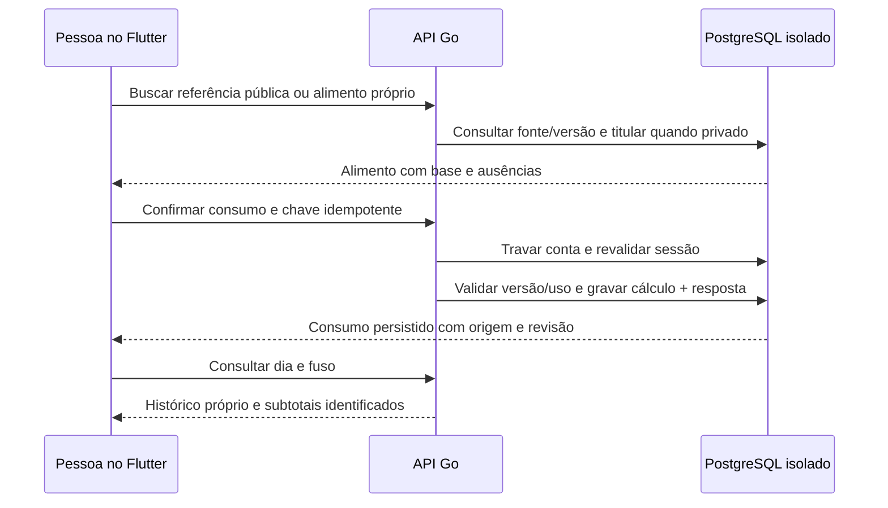

# V1-020 — alimentação particular e consumo

Implementação em23/10/2026: Go0.5.1,25operações noSwagger e Flutter0.1.5+8. V1-020 **done no recorte funcional**: titular criou um consumo, mostrou confirmação/histórico e confirmou que a quantidade era real. [AceiteAndroid](nutrition-real-android-verification.json). Fixtures SQL/HTTP não são consumo humano nem novo teste de loginGoogle. V1-025 tem preparação entregue neste incremento, sem concluir integraçãoHoje/dependência021.

## Atualização de 26/10 — idioma sem alterar consumo

Go 0.6.1 e cliente Flutter 0.3.3+16 preparado. Interface dos fluxos disponíveis em quatro idiomas; nomes públicos revisados usam a identidade e versão exatas, conservando o original nos detalhes. Zero nomes revisados publicados. O payload de consumo, a chave idempotente e o cálculo permanecem inalterados. Nomes particulares não são traduzidos. Como o cadastro não pergunta idioma, novas declarações passam a usar und; a migration 00011 não reescreve linhas nem snapshots antigos. [SQL descartável](nutrition-locale-verification.json) e [ativação local autorizada](food-names-local-activation.json).

O consumo humano real de 23/10 permanece preservado; estes testes técnicos não são um novo aceite humano. APK não instalado, sem ADB conectado.

## Fluxo disponível

Após login: **Minha alimentação e consumo**. AbaConsumo permite pesquisar nas6369referências existentes, conferir o detalhe/fonte/versão, escolher a versão e informar quantidade, g/ml, preparo observado, data/hora e se a quantidade foi medida ou estimada. O envio explícito confirma o lançamento. Cadastro e histórico começam vazios; não há refeições predefinidas.

AbaMeusAlimentos permite criar uma declaração particular com nome, preparo e base opcionais, até32nutrientes declarados e valores desconhecidos. **Salvar somente o alimento** não registra consumo nem publica o cadastro. Toque no alimento particular para registrar uma quantidade separadamente. A declaração é imutável/versionada; uma composição corrigida exige novo cadastro, preservando lançamentos anteriores.

Detalhe do consumo mostra origem, licença, versão, base/fator, valor exibido e fração exata, inclusive estado/célula/limite originais. Correção usa a mesma versão do alimento e revisão esperada; preserva quantidade/unidade/preparo/data/fuso/evidência anteriores. Até100correções por lançamento; exclusão continua permitida após esse limite. Versão retirada não pode gerar um novo cálculo; consumo histórico pode ser consultado ou excluído.

Excluir consumo retira-o do histórico ativo/subtotais. Registro e revisões continuam privados na exportação até exclusão confirmada da conta. Alimento próprio permanece. A exclusão da conta apaga alimentos, consumos, tombstones, idempotência e sessões através do ciclo013 existente. Nenhuma tabela privada ou coluna nova ficou fora do inventário013.

## Contrato implementado

Todas as rotas abaixo exigem Bearer opaco válido e retornam `Cache-Control:no-store`. Prefixo literal `/api/v1`; formatos/tipos completos noSwagger gerado de comentáriosGo.

| Método/rota | Envio / retorno |
|---|---|
| POST `/me/foods` | `OwnFoodInput`: nome/preparo/base e nutrientes próprios;201 `FoodDetail` |
| GET `/me/foods` | busca literal`q`, limit1–20 padrão10 e cursor vinculado à conta/filtro; somente declarações próprias |
| POST `/me/food-entries` | `EntryInput`: foodId/foodVersion, quantidade decimalstring, g/ml, preparo, occurredAt RFC3339, timezone, quantityEvidence measured/estimated, revision0;201 `Entry` |
| GET `/me/food-entries` | date YYYY-MM-DD, timezone, limit/cursor; histórico ativo do dia, ocorridoAt/id descendentes |
| PATCH `/me/food-entries/{id}` | substituição completa com versão inalterada e revision atual;200 `Entry` |
| DELETE `/me/food-entries/{id}` | corpo `{revision}`;200 registro removido do histórico ativo |
| GET `/me/food-summary` | date/timezone; subtotais completos de até100registros; acima disso não calcula nem exibe total parcial como completo |

Mutações exigem `Idempotency-Key` UUID, retida por24horas, vinculada ao titular/operação/recurso e hash do corpo canônico. Reenvio devolve resultado anterior; chave com outro corpo409. Transação serializa escritas por titular, revalida sessão e mantém mutação/resposta idempotente atômicas. Após24horas não há garantia de deduplicação pela chave antiga. AUI mantém corpo/chave congelados quando a resposta é incerta; permite repetir ou voltar para conferir o histórico. Não existe fila offline que invente sucesso.

`X-TrainForge-Account` é enviado peloFlutter vinculado à conta da tela. Se presente, oGo exige correspondência com a identidade autenticada; oheader nunca define o titularSQL. Isso impede que um formulário antigo seja enviado à conta nova durante a leitura assíncrona das credenciais. Troca de conta remove as telas privadas; respostas atrasadas são descartadas.

400 para entrada inválida,401 para credencial inválida/revogada,404 para recurso ausente/alheio/retirado,409 para revisão/chave/conta divergentes,413/415 para corpo/tipo inválidos,429 para limite e503 para indisponibilidade. Não há corpos/headers/URLs/valores privados em logs. JSON rejeita campos desconhecidos, chaves duplicadas e valores finais extras. Corpo máximo16KiB, quantidade até7dígitos inteiros/6decimais e texto limitado. Rate60/min por titular para o módulo; limites globais/timeouts existentes continuam.

## Cálculo e tempo

Algoritmo `source-rational-v1` usa `math/big.Rat`, sem ponto flutuante: valor da célula × quantidade/base declarada. Registra fator/fração exatos e exibe6casas decimais. Só escala célula numérica com unidade/base confirmadas, permissão de escala e unidade da porção compatível. Não infere densidade, porção caseira, nutrientes ausentes, efeito do preparo, doses ou adequação clínica.

Traço, N, limite superior, ausência, denominador desconhecido e unidade incompatível permanecem sem valor calculado. Limite/célula originais permanecem no snapshot. Quantidade estimada pode compor subtotal de estimativas, com contagens de medidas/estimativas explícitas; nunca é reclassificada como medida.

Subtotais ficam separados por coluna/método/unidade da fonte; não normalizam nutrientes entre fontes ou métodos. Cada subtotal informa incluídos e registros sem valor calculável. Ausência não vira zero; subconjunto calculável é explicitamente parcial. Sem dieta/meta ou compensação automática de calorias da atividade.

Go aceita IANA,UTC e offset fixo±14h. Limites do dia são calculados no fuso solicitado, incluindo DST. Flutter confirma data/hora local e grava UTC mais offset do aparelho naquele instante. Datas suportadas1900–2100; não alega capturar o nomeIANA do aparelho.

## Banco e validação

Migration00008 adiciona função `SECURITY DEFINER` de inserção particular e índice de histórico ativo. A função fixa search_path, verifica sessão viva, prefixoown:UUID/titular, origem particular/sem clínica, base/limites e insere source_idNULL. EXECUTE revogado dePUBLIC e concedido especificamente ao runtime; escrita editorial ampla continua negada. Nenhum dado editorial ou histórico humano foi inserido por essa migration.

[ProvaSQL/HTTP](nutrition-local-verification.json): banco descartável com duas identidades sintéticas explicitamente isoladas e uma referência já pesquisada copiada com sua fonte/lote. Cadastro com ausências, busca própria, isolamento, concorrência/idempotência, revisão, porção exata, dia/fuso, paginação cronológica, retirada, exportação e exclusão da conta passaram. Banco descartável removido; hash/contagem de alimentos e contas/consumos da base entregue preservados. Não repetiu coleta/importação completa/restore histórico.

TestesFlutter cobrem vazio real, quantidade/evidência explícitas, cadastro sem consumo, retry de chave/corpo estáveis, duplo toque, conta trocada/resposta atrasada e320x568comtexto2x. Leitor de tela físico, iOS e carga emmilhões não foram validados.

## Próxima prioridade e aceites visuais

O autor pediu alinhar **todo o frontend aoFigma vigente antes de novas funcionalidades**. [Plano](frontend-fidelidade-figma.md). Consumo real validado em23/10; cadastro próprio/correções/exclusão têm prova técnicaSQL/HTTP, mas seu aceite humano noFlutter permanece pendente na025. Fidelidade visual completa, Hoje integrado e iOS não foram concluídos. Não preencher dados para aparentar esses aceites.

Sem hospedagem/provisionamento/deploy/contratação. ReutilizaAPI8082,PostgreSQL15432 eADB reverse existentes. [AmbienteAndroid](avaliacao-android.md).

