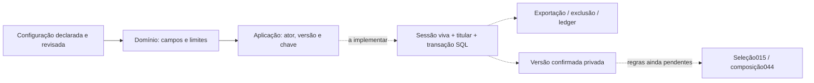

# V1-047 — configuração privada antes de procurar treino

Estado em27/10/2026: **doing**. Matriz e domínio/aplicação Go implementados/testados; adaptadorSQL, migration, endpoints eFlutter ainda não implementados. Nenhuma configuração foi salva para o usuário real. API continua0.6.2/26operações, banco schema11/26tabelas eAPK0.3.8+21.

## Finalidade e fundamento

[Q3/Q5](decisoes-piloto.md) definem configuração completa, etapas curtas e revisão final antes da seleção. [Escopo](escopo.md) preserva casa, praça/parque, academia, idosos e o próprio cuidador nas pausas. [Requisitos editoriais](../../arquitetura/contratos-v1.md) e catalog.Requirements mantêm identidade da fonte e equipamento; um código numérico de um fornecedor não equivale ao mesmo código de outro.

Completa significa responder os campos necessários abaixo e revisar; não comprova elegibilidade, aptidão clínica, supervisão ou direitos. Unknown/none não são o mesmo estado. A biblioteca pública, alimentação e privacidade continuam acessíveis sem esse contexto.

## Matriz de campos — contrato de domínio v1

| Campo | Origem/finalidade | Obrigatoriedade e validação | Persistência e uso planejados |
|---|---|---|---|
| environments | Q3:locais em que o próprio usuário pretende praticar | 1–3 escolhas únicas:home,park,gym. Nenhum local pré-marcado como fato | Contexto privado; futura compatibilidade compara requisitos humanos explícitos, sem deduzir ambiente ausente na fonte |
| resources.status | Q3:recursos declarados sem disponibilidade presumida | declared,none,unknown obrigatório. None/unknown exigem items[]; declared exige1–32refs | Unknown não satisfaz equipamento exigido. None não inventa cadeira/máquina. Escolher local não preenche recursos |
| resources.items[] | catalog.Requirements e fonte exata do equipamento | sourceId com1–100caracteres ASCII do conjunto A–Z/a–z/0–9/._-, começando alfanumérico;equipmentId1–2147483647;sem duplicar o par | Identidade(s) serão validadas contra catálogo/referência local no adaptadorSQL antes de salvar. O domínio só valida sintaxe; isso ainda não prova existência/direitos ou posse |
| context | Q3:praticante comum ou cuidador nas próprias pausas | personal oucaregiver_break obrigatório;sem cadastro de paciente | Preferência de contexto, não papel de acesso; não habilita terceiros nem define dose/duração de pausa |
| timezone | Q3:interpretar preferência de dias/horários | UTC,IANA comregião/nome ouoffsetHH:MMaté±14:00;Local/vazio/inválido recusados | Privado, explícito;futura agenda resolve datas/DST com regras próprias, não relógio do servidor |
| availability[] | Q3:tempo/dias/horários realmente disponíveis | 1–28preferências;weekday1=segunda até7=domingo;minutesAvailable inteiro1–1440;startTime null ouHH:MM00:00–23:59;par dia/horário sem duplicidade | Dia é o de início;preferência não cria recorrência/ocorrência. Null significa horário não fixo, nunca meia-noite. Pode atravessar meia-noite;agenda futura precisa resolver esse caso |
| revision | Atualização concorrente deQ3 | 0na primeira confirmação, até2147483646na substituição;resposta esperada+1 | Versão imutável privada;atualizar contexto não reescreve atividades/adesões antigas |
| reviewed | Q5:revisão final do conjunto pelo próprio usuário | true para salvar;avançar etapa não é confirmação | Registra confirmação de contexto, não aprovação editorial/clínica ou autenticidade de revisor |
| Idempotency-Key | Recuperar envio de configuração sem duplicar versão | UUIDestável porintenção;corpo/conta congelados no reenvio | Adaptador deve salvar resultado e versão na mesma transação;mesma chave com outro significado é conflito |

Limites32recursos/28preferências e24h são limites técnicos de entrada/armazenamento, não recomendação de treino ou frequência. Coleções excessivas são recusadas antes da iteração. Canonicalização ordena cópias independentes de locais/recursos/agenda, preservando os dados informados e o significado de null.

## O que fica fora desta coleta

Peso,altura,idade,gordura,diagnósticos,medicação e dados da pessoa assistida não têm uso fundamentado neste contexto e não são coletados. Objetivo/experiência, habilitação de apoio e outros requisitos de material só entram quando houver regra humana que justifique campo/obrigatoriedade; preferência não vira aptidão clínica. A disponibilidade real de programas continua zero e o gate de prática permanece fechado.

Não inferir que um item metadata éprograma, que duas fontes compartilham equipamento, que recursos emunknown são disponíveis ou que reviewed=true é revisão profissional. Futura seleção015/044 deve responder explicitamente quando faltar requisito de material, em vez de afirmar elegibilidade com este formulário.

## Responsabilidades implementadas e próximas

- model.go:declaracões/DTOs, validação com códigos porcampo, limites, datas/horas e cópia canônica;semHTTP,SQL,Flutter ou prescrição.
- service.go:portaRepository pequena, entrada de ator autenticado fora dobody, cancelamento, validação antes depersistência e validação do retorno. Conta sem configuração retorna nil, sem perfil preenchido. Códigos deconflito/revogação preservados. A verificação sintática doator não autentica/revalida sessão;SQL ainda precisará fazer isso.
- Próxima fatia:adaptadorPostgreSQL/migration forward, credencial viva e lock do titular, versões imutáveis/idempotência atômica e validação de referências de recursos. Incluir a tabela/colunas no inventário de privacidade, exportação, exclusão e restauração/ledger antes da ativação. Não quebrar a base schema11 com inventário de tabela futura.
- Depois:HTTPcomcontrato gerado, requisições estritas/limitadas/unknown fields/códigos decampo,no-store/ownership/rate limit;GETconta semconfiguração deve representar ausência. Swagger atual não anuncia endpoints inexistentes.
- Flutter:etapas porlocal,recursos,disponibilidade/contexto,revisão final;semdefaults fatuais, retorno/correção semperda, erro decampo/foco, saída/descarte/envioincerto e trocadeconta. Quatro idiomas/TF/Grafite-lima/movimentoreduzido. Não prometer rascunho durável sem fazê-lo.
- Aceite:SQLisolado comdoistitulares/revogação/conflito/replay, atualização sem mudarhistórico, matrizUI/API/BD,APKreal comcontexto informado pelo usuário;semfixtures noambiente entregue.

[Testes e limites desta fatia](training-configuration-foundation-verification.json). Domínio/portas testados com adapter isolado não são prova de persistência, autorização SQL ou nova jornada noAPK.
