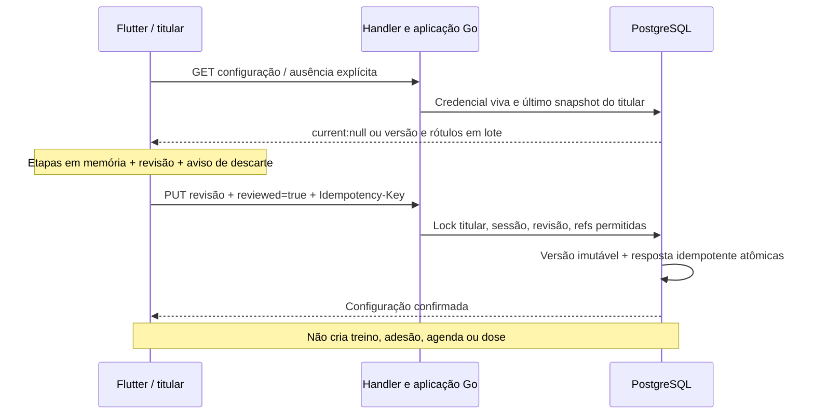
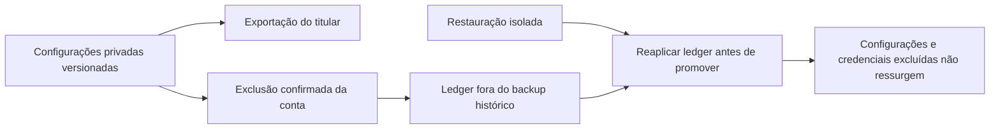

# V1-047 — configuração privada antes de procurar treino

Estado em **27/10/2026: doing, salvamento humano e recuperação reais validados; edição nativa pendente**. Go0.7.0/29operações, migration12 aplicada ao banco local (27tabelas), Flutter em quatro etapas e APKdebug0.4.0+22 instalado. Banco preservou 1conta/1consumo/6369versões alimentares; nenhuma configuração real foi criada pelo agente. [SQL](training-configuration-sql-verification.json), [privacidade/restore](training-configuration-privacy-verification.json), [ativação](training-configuration-local-activation.json).

## Finalidade e fundamento

[Q3/Q5](decisoes-piloto.md) definem configuração completa, etapas curtas e revisão final antes da seleção. [Escopo](escopo.md) preserva casa, praça/parque, academia, idosos e o próprio cuidador nas pausas. [Requisitos editoriais](../../arquitetura/contratos-v1.md) e catalog.Requirements mantêm identidade da fonte e equipamento; um código numérico de um fornecedor não equivale ao mesmo código de outro.

Completa significa responder os campos necessários abaixo e revisar; não comprova elegibilidade, aptidão clínica, supervisão ou direitos. Unknown/none não são o mesmo estado. A biblioteca pública, alimentação e privacidade continuam acessíveis sem esse contexto.

## Matriz de campos — contrato de domínio v1

| Campo | Origem/finalidade | Obrigatoriedade e validação | Persistência e uso planejados |
|---|---|---|---|
| environments | Q3:locais em que o próprio usuário pretende praticar | 1–3 escolhas únicas:home,park,gym. Nenhum local pré-marcado como fato | Contexto privado; futura compatibilidade compara requisitos humanos explícitos, sem deduzir ambiente ausente na fonte |
| resources.status | Q3:recursos declarados sem disponibilidade presumida | declared,none,unknown obrigatório. None/unknown exigem items[]; declared exige1–32refs | Unknown não satisfaz equipamento exigido. None não inventa cadeira/máquina. Escolher local não preenche recursos |
| resources.items[] | catalog.Requirements e fonte exata do equipamento | sourceId com1–100caracteres ASCII do conjunto A–Z/a–z/0–9/._-, começando alfanumérico;equipmentId1–2147483647;sem duplicar o par | SQL valida o par contra metadados atuais permitidos, com revisão/direitos de consulta e sem retirada; nomes ambíguos do mesmo par não são oferecidos. Isso não prova posse do equipamento nem direito de prática |
| context | Q3:praticante comum ou cuidador nas próprias pausas | personal oucaregiver_break obrigatório;sem cadastro de paciente | Preferência de contexto, não papel de acesso; não habilita terceiros nem define dose/duração de pausa |
| timezone | Q3:interpretar preferência de dias/horários | UTC,IANA comregião/nome ouoffsetHH:MMaté±14:00;Local/vazio/inválido recusados | Privado, explícito;futura agenda resolve datas/DST com regras próprias, não relógio do servidor |
| availability[] | Q3:tempo/dias/horários realmente disponíveis | 1–28preferências;weekday1=segunda até7=domingo;minutesAvailable inteiro1–1440;startTime null ouHH:MM00:00–23:59;par dia/horário sem duplicidade | Dia é o de início;preferência não cria recorrência/ocorrência. Null significa horário não fixo, nunca meia-noite. Pode atravessar meia-noite;agenda futura precisa resolver esse caso |
| revision | Atualização concorrente deQ3 | 0na primeira confirmação, até2147483646na substituição;resposta esperada+1 | Versão imutável privada;atualizar contexto não reescreve atividades/adesões antigas |
| reviewed | Q5:revisão final do conjunto pelo próprio usuário | true para salvar;avançar etapa não é confirmação | Registra confirmação de contexto, não aprovação editorial/clínica ou autenticidade de revisor |
| Idempotency-Key | Recuperar envio de configuração sem duplicar versão | UUIDestável porintenção;corpo/conta congelados no reenvio | Adaptador deve salvar resultado e versão na mesma transação;mesma chave com outro significado é conflito |

Limites32recursos/28preferências e24h são limites técnicos de entrada/armazenamento, não recomendação de treino ou frequência. Coleções excessivas são recusadas antes da iteração. Canonicalização ordena cópias independentes de locais/recursos/agenda, preservando os dados informados e o significado de null.

## O que fica fora desta coleta

Peso,altura,idade,gordura,diagnósticos,medicação e dados da pessoa assistida não têm uso fundamentado neste contexto e não são coletados. Objetivo/experiência, habilitação de apoio e outros requisitos de material só entram quando houver regra humana que justifique campo/obrigatoriedade; preferência não vira aptidão clínica. A disponibilidade real de programas continua zero e o gate de prática permanece fechado.

Não inferir que um item metadata éprograma, que duas fontes compartilham equipamento, que recursos emunknown são disponíveis ou que reviewed=true é revisão profissional. Futura seleção015/044 deve responder explicitamente quando faltar requisito de material, em vez de afirmar elegibilidade com este formulário.

## Implementação e responsabilidades

- model/serviceGo: DTOs/limites/cópia canônica e casos de uso pequenos, sem HTTP, SQL ou prescrição no domínio. RepositórioPostgres revalida credencial viva e titular; ausência é current:null.
- Migration12: training_configuration_versions imutável por(user_id,revision), índice primário usado na leitura mais recente. Função SECURITYDEFINER com search_path fixo serializa por titular, compara revisão e grava resultado idempotente/versão atomicamente. Runtime recebe SELECT/EXECUTE restritos, sem INSERT/UPDATE/DELETE direto nesta tabela.
- Recursos: view somente de metadados atuais permitidos, com identidade(sourceId,equipmentId); busca paginada e nomes originais com fonte. Resolução dos selecionados em lote, até32. Retirada posterior fica explícita fora do snapshot e não reescreve a configuração antiga.
- Privacidade: inventário de colunas, seção trainingConfigurations na exportação paginada privada, exclusão com intenção confirmada, ledger e restauração. Compatibilidade com schema11 mantém seção vazia somente se a nova tabela ainda não existir; armazenamento privado desconhecido continua bloqueando exportação/exclusão. Restore SQL e ledger foram executados em duas bases descartáveis, removidas no final.
- HTTP: GET/PUT /api/v1/me/training-configuration e GET /api/v1/me/training-configuration/resources. Bearer/sessão viva, guarda opcional de conta, no-store, limite60/min/conta, JSONestrito/UTF8/sem duplicidade ou campos desconhecidos,16KiB.400campos,401credencial,409conflito,413/415/429/503. Swagger gerado dos tipos/comentários.
- Flutter: repository/controller injetados por conta; quatro etapas locais/contexto, recursos, disponibilidade, revisão. Nenhum local/contexto/equipamento/dia/tempo predefinido como fato. Fuso começa com o desvio observado no aparelho e pode ser revisado. Tempo disponível não é dose; horário não fixo é null.
- Resposta incerta congela corpo/chave/conta em memória e permite repetir a mesma confirmação. Conflito preserva respostas e oferece recarregar versão guardada com confirmação de descarte. Troca de conta invalida respostas atrasadas e remove a rota antiga. Leitura inicial falha não libera formulário vazio para sobrescrever configuração existente.
- Entradas: conta → Configuração de treino e Planos → Criar meu plano. Biblioteca pública, alimentação e privacidade continuam independentes. Geradores legados permanecem fora da composição ativa.

## Decisão de rascunho e experiência

O autor escolheu **avisar antes de descartar**: respostas ficam em memória durante avanço, retorno e troca de idioma. Voltar no Android retorna à etapa anterior; sair do formulário alterado oferece continuar editando ou descartar. Não existe rascunho durável, gravação parcial no servidor ou recuperação prometida após matar o processo. Depois de envio incerto, sair avisa para conferir a configuração guardada ao regressar.

TF/Inter/Grafite-lima, quatro idiomas, validação/foco e rolagem existente preservados.59mensagens de configuração e1de entrada por idioma adicionadas (555no total). Testes percorrem as quatro etapas com320px/texto2x, revisão, troca de idioma e retry sem nova chave. Isso não equivale a usabilidade com todos os públicos ou execução iOS.

## Estado do aceite e próxima ação

IntegraçãoSQL/HTTP e privacidade verificadas em descartável; migration/grants ativados com checkpoint somente de schema e comparação das linhas reais. Checkpoint de schema não é backup completo restaurado. O ensaio nativo confirmou APK/hash, sessão existente, entrada da conta e primeira etapa com opções desmarcadas, sem salvar respostas por inferência. Não houve novo consentimentoGoogle.

O autor informou que revisou e confirmou sua rotina. O banco contém a revisão1; o agente reabriu pela abaPlanos e percorreu as quatro etapas, recuperando exatamente os valores e os rótulos de fonte. Navegação/revisão não criaram outra versão; snapshot/data de confirmação e hashes de conta/consumo/catálogo permaneceram iguais. [Aceite real parcial](training-configuration-human-verification.json). Falta validar uma edição real autorizada e sua recuperação; há uma divergência de horário esclarecida no chat, sem alteração por inferência. Não marcar047done antes desse aceite; completionEvidence permanece vazia. Seleção015/composição044 ainda têm implementação e gates próprios, com zero programa/dose/instrução/mídia aprovados para prática. Nenhuma configuração torna um programa elegível automaticamente.

### Refinamento solicitado para depois do teste funcional

O usuário confundiu o campo de fuso com a hora de início e relatou que a etapa não é didática. Orientação manual comoffset e nova validação permitiu confirmar. Isso não estabelece a causa da rejeição anterior de textoIANA: não diagnosticar espaço extra ou falha do backend sem evidência. A validação identificou ainda uma hora inicial diferente da mencionada no chat; o agente solicitou confirmação e preservou a revisão salva.

Rever identificação do fuso do aparelho e eventual troca sem digitar identificador técnico, separar visualmente fuso/hora de início, encurtar ajuda, tornar o seletor de horário claro e rever a hierarquia de Continuar/Concluir/Confirmar. Não alterar a rotina salva, traduzir equipamentos sem fonte ou tratar esse fluxo como usabilidade aprovada para idosos/cuidadores. O autor pediu primeiro concluir os testes e depois corrigir a interface; nenhum código/APK foi alterado nesta validação.

