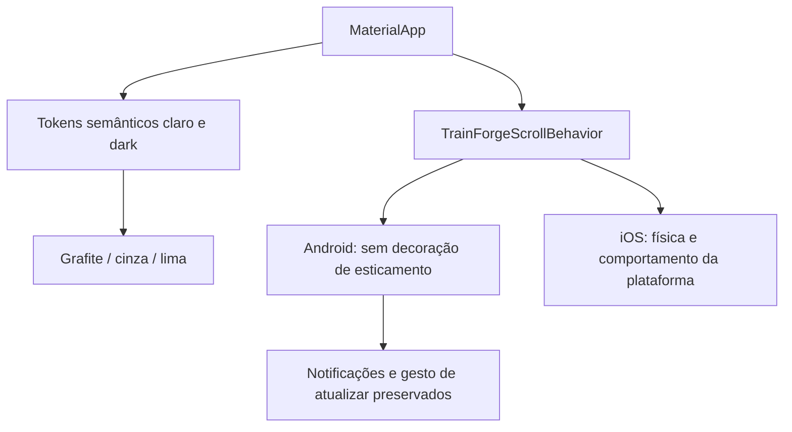

# Ajuste visual — Grafite e lima e rolagem

Atualizado em24/10/2026. O autor escolheu a terceira proposta, Grafite e lima, pediu mais clareza sobre a terceira cor e confirmou que o iOS deve seguir o comportamento da plataforma. A pergunta posterior sobre aplicação retomou a implementação; a rodada anterior havia produzido somente pesquisa e prévias.

## Resultado implementado

- Fundo grafite #111211; superfície cinza #242823 (um pouco mais clara que a prévia #1D1F1D para separar cartões); destaque lima #D8EB90, com texto escuro #263015 sobre ações preenchidas. Texto principal #F4F6EF e secundário #BFC7BA. Fundo, superfície e destaque são os três papéis; neutros também contam como cores.
- Cartões antes azuis/amarelos/rosados/marrons passam a superfícies neutras no dark. Hoje também usa superfície neutra no cartão principal, com títulos/destaques apropriados. Navegação selecionada em lima, com os SVGs originais apresentados em cor escura; paths/dimensões dos arquivos não mudaram. Modo claro e identidade nativa/splash preservados.
- 70–20–10 é uma orientação visual de predominância, separação e destaque, não uma porcentagem de pixels medida ou regra para limitar cores semânticas de erro/aviso. Não atribuir essa proporção como requisito universal de grandes marcas.
- MaterialApp recebe TrainForgeScrollBehavior. NoAndroid, buildOverscrollIndicator devolve o conteúdo sem StretchingOverscrollIndicator. A física e as notificações de rolagem não foram substituídas: inércia, limites, listas curtas e gesto de atualizar permanecem. No iOS, conserva-se o comportamento padrão doFlutter para a plataforma, com BouncingScrollPhysics.
- Não instalar GSAP/Motion nem alterar configurações globais do emulador. Esses ajustes usam o Flutter existente; nenhum pacote, API, migration ou dado alimentar novo.

## Validação e limites

90 testesFlutter passaram; analyze semissues. Cinco novos cenários cobrem bordas superior/inferior emclaro/escuro, rolagem real até o fim, lista curta com pull-to-refresh, elasticidade iOS por testeFlutter e composição doapp usando o comportamento central. Testes existentes conferem contraste≥4.5 dos tokens relevantes, texto2x/largura320, abas, rascunhos, identidade e preservação de sessão. Prévia do próprio Flutter conferida nas cinco áreas e perfil, com fixtures isoladas.

APKdebug0.2.1+12 preparado/instalado com certificadoOAuthdebug preservado. Recibo Android e hashes estão em [verificação](frontend-dark-scroll-verification.json) e [checkpoint atual](android-frontend-checkpoint.json). Conferência por contagens preserva a conta e o consumo reais, sem quantidade digitada nem lançamento peloagente. Nenhum novo loginGoogle consentido foi automatizado.

**iOS27 não foi executado nesta máquina Windows.** Flutter desenha os componentes; novidades de uma versão do sistema não são incorporadas automaticamente a todas as telas. A implementação mantém a física padrão da plataforma. Comparação nativa exata, incluindo bordas/barras/gestos do iOS27, continua dependente de macOS/Xcode e simulador/aparelho apropriado; não chamar teste dewidget de validação nativa.

Pesquisa já concluída, sem nova coleta nesta rodada: [Fluent sobre neutros/destaques](https://fluent2.microsoft.design/color), [overscroll MaterialFlutter](https://api.flutter.dev/flutter/material/MaterialScrollBehavior/buildOverscrollIndicator.html), [física por plataforma](https://api.flutter.dev/flutter/widgets/ScrollBehavior/getScrollPhysics.html) e [arquiteturaFlutter](https://docs.flutter.dev/resources/architectural-overview). Figma continua emquotaStarter; a direção foi escolhida peloautor entre prévias com os contextos já disponíveis, sem escrita ou nova chamada aoFigma.

## Composição

Pontos07–12 e novas funcionalidades permanecem fora desta rodada. Sem deploy, hospedagem, contratação ou pesquisa de exercícios. Swagger permanece Go0.5.1/25operações; não regenerar contrato sem mudança deAPI. Graphify atualizado porAST:80Dart/1185nós/1578arestas,5alterados/75inalterados, sem análise semântica e comHTMLexportado.
