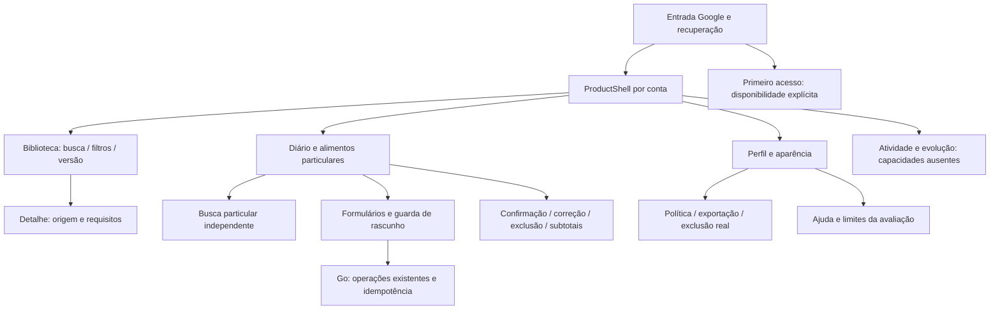

# Frontend — etapa 07 a 12

Checkpoint de 24/10/2026, solicitado pelo autor. Base f791011; APK debug incremental **0.3.0+13**. A numeração abaixo recupera a lista original da conversa.

**Este checkpoint entrega o acabamento dos fluxos disponíveis. Não encerra integralmente os seis pontos:** configuração persistida, treino/atividade completos, outras capacidades e referências visuais ainda possuem dependências explícitas.

| Ponto original | Implementado neste checkpoint | Pendência de fechamento integral |
|---|---|---|
| 07 · Entrada e configuração inicial | Estados Google, progresso indeterminado, ações concorrentes bloqueadas e guia do primeiro acesso, com retorno | Áreas/objetivos/ambientes/experiência/rotina/revisão persistidos; Apple/senha/recuperação; referências completas |
| 08 · Biblioteca, planos e treino | Busca, filtros com cancelar/aplicar, resultados, detalhe, fonte/versão, retirada/vazio/erro e recuperação | Conteúdo humano/instrução/dose/mídia autorizados; adesão/sessão/séries/pausa/encerramento; comparação exata de famílias sem contexto |
| 09 · Alimentação | Composição, cadastro particular, confirmação, histórico, subtotais, correção/exclusão e proteção dos formulários | Referências específicas faltantes, favoritos/hidratação/planejamento/aprendizagem e aceite humano do cadastro particular |
| 10 · Atividade e evolução | Estados de disponibilidade e caminhos úteis, sem métricas nem permissões fictícias | Serviços reais de registro/histórico/medidas/objetivos, GPS/sensores/dispositivos/OCR |
| 11 · Perfil, preferências e privacidade | Identidade, aparência, política da API, exportação/exclusão e ajuda/perguntas frequentes | Edição persistida de perfil/unidades/idioma, termos de produção aprovados e envio funcional de feedback |
| 12 · Acabamento e validação | Teclado/rolagem/voltar/cancelar/rascunhos, erros, texto2x em320, semântica e alvos Android48px | Comparação exata das famílias sem contexto e execução/aceite nativos iOS em macOS/Xcode |

## Implementação real

- Reutilizados FigmaRouteFrame, FigmaPageHeading, FigmaSection, Inter, SVGs e tokens previamente conferidos. Margem24 e seções22px nos fluxos reais adicionais. Nenhum ativo original foi redesenhado, nem URL temporária adicionada ao runtime.
- Biblioteca: busca com debounce400ms, texto inicial coerente com filtros, filtros com cancelar/aplicar e altura natural para texto ampliado. Origem/licença/autoria/requisitos/versão completos. Ausência e retirada têm recuperação alcançável; movimentos não viram programas. A geração da paginação impede resposta antiga de interferir no carregamento atual.
- Alimentação: quantidade, medida/estimativa, preparo, data/hora do aparelho e fuso registrado ficam distintos. Base/célula/fator/fração e revisões continuam acessíveis; detalhes extensos de cálculo são expansíveis. Nenhum novo arredondamento, soma de métodos ou dado demonstrativo.
- Busca particular com estado e geração próprios: digitar não refaz histórico/subtotais; falha ou resposta fora de ordem não esconde consumos confirmados. Paginação continua vinculada à consulta e à conta atuais.
- Formulários mantêm os campos montados ao rolar, validando nutrientes fora da tela; rolagem leva ao primeiro erro. Voltar pede confirmação ao descartar alterações; cancelar preserva o rascunho. Durante envio a saída é bloqueada. Resposta incerta mantém corpo/chave e explica que sair não cancela solicitação, orientando conferir histórico. Rascunhos ficam somente em memória.
- Perfil separa identidade, configuração, aparência, privacidade e ajuda. A página de configuração explica ausência de persistência e não coleta escolhas fictícias. Atividade/dispositivos/medidas não pedem permissões nem criam gráfico ou sessão.
- Privacidade mantém política efetiva da API, exportação paginada e exclusão com reautenticação, ciência e frase exata. Reautenticação/nova solicitação limpa frase anterior. Ajuda explica fontes e desconhecidos; feedback/termos de produção não são apresentados como prontos.
- Cabeçalhos semânticos e registros com ação agrupada; loaders de altura natural/rolagem e retorno acessível antes da resposta. Dark Grafite e lima inclui controles selecionados. Sem nova dependência.

## Referências e limites

O conector Figma já retornou quota Starter em23 e24/10. Não foi feita nova tentativa, contratação ou contorno. Campos reais adicionais foram compostos a partir dos primitives/tokens/assets já conferidos; **não são cópia imaginada nem aceite de quadros sem design context**.

Exemplos de nós ainda sem contexto integral:104:1260 cadastro manual;104:230/104:260 privacidade/dados;23:910/23:1021/23:1080 objetivo/rotina/revisão;104:704/104:780/104:810 atividade/históricos. Metadados identificam esses nós, mas não comprovam sua composição. Para fechar exatidão é preciso recuperar leitura dos contextos/screenshots vigentes dessas famílias. Não contratar nem contornar quota.

Configuração persistida, treino, atividade e demais capacidades ausentes continuam nas histórias funcionais e respectivas dependências. Nenhuma história021/022/025 foi marcada done por esses guias. Idosos, cuidadores, casa, praça e academia preservados, sem inferir elegibilidade ou apoio.

## Verificação

- **101 testes Flutter passaram; analyze0 issues.** Casos de voltar/cancelar/descartar nos dois formulários, saída durante envio, resposta incerta, nutriente fora da tela, busca fora de ordem, falha particular preservando diário, cancelamento de exclusão sem DELETE, ambos os temas em320/texto2x e alvos Android48px/rotulados.
- **20 prévias390x844 inspecionadas**, dez famílias em claro/escuro, somente fixtures isoladas. Não são teste Google, consumo humano novo ou comparação de frames não obtidos. Capturas ignoradas em.local/android-evaluation/remaining-*.png.
- Graphify incremental:83Dart,1235nós/1665arestas;18alterados/novos e65inalterados,0removidos. AST somente/HTML exportado; backup.local/graphify-backup-20261024-frontend-07-12. Sem leitura semântica/custo adicional.
- APK0.3.0+13 gerado e instalado com a mesma assinatura debug e preservação dos dados. Navegação de leitura e hash instalado no recibo desta etapa. Sem consentimento Google automatizado, quantidade preenchida, consumo ou alimento próprio criado pelo agente.
- API Go/SQL/Swagger permanecem0.5.1/25operações; nenhuma migration/contrato alterados. Não repetir importação/restore/login histórico sem motivo.

## Composição real

Sem nova API/migration, pesquisa ampla, conteúdo inventado, deploy ou contratação. Aparência e redução de requisições não comprovam milhões simultâneos; carga e infraestrutura continuam nas histórias próprias.

[Recibo integrado](frontend-stage07-12-verification.json). Android conferiu biblioteca vazia de programas, disponibilidade deatividade sem pedido depermissão, histórico, alimentos particulares sem cadastro novo, política daAPI eajuda; hash instalado coincide com fonte/artefato. Contagem deconsumo real1antes/1depois. Avaliação termina emHoje, com sessão preservada.

Revisão final: corrigida a paginação durante os400ms de debounce — cursor sempre usa a consulta aplicada à sua página, até a nova pesquisa começar. Regressão específica e suíte101testes passaram;76testesPython passaram. ReextraçãoGraphify final de1arquivo (82inalterados) resultou1235nós/1665arestas.
