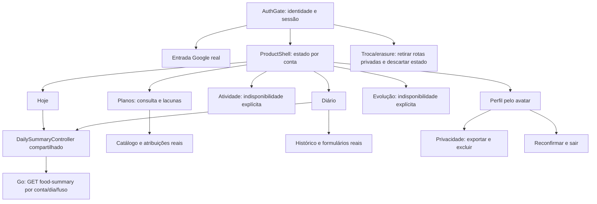

# Frontend — prioridade explícita de23/10/2026

Pedido do autor: **ajustar todo o frontend para ficar exatamente igual ao Figma antes de continuar novas funcionalidades**. O checkpoint funcional anterior não era a implementação visual do protótipo. Este documento registra a mudança de prioridade e separa comportamento real de fidelidade visual.

## Fonte vigente conferida

Arquivo[TrainForge](https://www.figma.com/design/bX6YjBBLIJgoo2MtiFLntl), página **0:1 · 01 · Produto interativo · v0.5**, conferida pelo conectorFigma em23/10. Arquivos126:2 e141:2 são históricos; não substituir o desenho atual pelos geradoresv0.4.

[Inventário vivo derivado](frontend-figma-inventory.json):401quadros de primeiro nível,398comlargura390. Inclui variantes, rascunhos, estados de entrada e exemplos do protótipo; não significa398funcionalidades nem398rotas distintas. Reconciliar famílias/estados antes de implementar cada fluxo.

| Referência lida com design context e screenshot | Nó |
|---|---|
| [Entrar](https://www.figma.com/design/bX6YjBBLIJgoo2MtiFLntl?node-id=23-735) |23:735 |
| [Hoje](https://www.figma.com/design/bX6YjBBLIJgoo2MtiFLntl?node-id=25-1667) |25:1667 |
| [Alimentação](https://www.figma.com/design/bX6YjBBLIJgoo2MtiFLntl?node-id=25-1992) |25:1992 |
| [Porção](https://www.figma.com/design/bX6YjBBLIJgoo2MtiFLntl?node-id=104-1233) |104:1233 |

Sessão de leitura do conector iniciada; nenhum elemento doFigma foi alterado. Para retomar o mesmo trabalho, reutilizar a sessão be13df9a-20a4-47d5-ba30-e854be04613e enquanto válida, ou abrir nova sessão se expirada. Antes de get_design_context ler figma-design-to-code e incluir skillNames; screenshot acompanha a referência. Metadados sozinhos não bastam para implementação.

## Primeiro ajuste entregue no código

Tokens extraídos do nóEntrar: fundo#F6F6F1, superfíciebranca, texto#142F2C/secundário#64736E, primária#215E52, acento#D8EB90, alimentação#F5E3D5, superfíciesuave#E8EEE3. MarcaTF/texto, hierarquia, formas e espaçamento inicial aplicados em `lib/core/theme/trainforge_theme.dart`, entrada e cabeçalho deconta. Formulários usam otema central. Texto de erro permite múltiplas linhas.

**Fidelidade visual completa pendente.** O incremento visual01 abaixo atualiza o estado de fonte, navegação, entrada e perfil. Aplicar componentes não encerra todas as famílias nem seus estados.

## Execução a partir daqui

1. Consolidar fundamentos/componentes e o inventário de rotas/estados doFigma vigente; carregar contexto de cada família e assets realmente usados. Reutilizar componentesFlutter e conexões reais. Nenhum geradorv0.4 será reaplicado noFigma.
2. Implementar shell/navegação e Hoje conforme desenho, com perfil peloavatar e comportamento acessível. Preservar sessão, abas e rascunhos; não reativar chamadasFastify/geradores legados.
3. Alinhar entrada/conta/privacidade, biblioteca/catálogo e alimentação, usando os contratosGo existentes. Busca, seleção, quantidade, preparo, data/fuso, confirmação, histórico, revisão/exclusão e subtotais continuam reais.
4. Cobrir demais famílias do protótipo com seus estados reais de disponibilidade e componentes correspondentes. Identificar precisamente onde falta contrato/conteúdo antes de prometer interação persistida.
5. Conferir cada tela noAndroid em tamanho390e em320comtexto ampliado, mais comparações visuais contra os nósFigma correspondentes. Assets locais corretos, geometria/legibilidade/estados/voltar/cancelar/teclado e leitor de tela. iOS continua alvo do produto, sem alegar validação nativa inexistente.
6. Atualizar inventário/diagramas/Graphify/Swagger quando afetados; commits pequenos validados e push já autorizados. Emitir APKs incrementais. Não trocar uma tela validada por mera alegação de semelhança.

As histórias021/022/025 e demais histórias deUI permanecem rastreadas por dependências e critérios; a prioridade visual não transforma serviços ausentes em implementados.020 é a API funcional e consumo real já concluídos, com evidências próprias.

## Dados e lacunas

OFigma contém refeições, calorias, planos, doses, fotos e semanas demonstrativas. Oapp deve usar valores efetivos doGo e estados vazios/desconhecidos/indisponíveis quando faltarem dados ou conteúdo aprovado. Não copiar exemplos de1480kcal, treinos ou históricos. Não converter mídia decorativa em instrução aprovada.

Preservar idosos, cuidadores, casa, praça e academia. Sem inventar nutrientes, instruções, dose, adequação clínica, tradução alimentar ou associação entre métodos. Adaptar visualmente campos extras exigidos pela segurança/consentimento, documentando a diferença necessária.

Sem hospedagem/deploy/compra/contato. Gratuitasprimeiro e eventual compraúnicaatéR$400 continua decisão futura doautor. Meta de escala deve ser testada em sua etapa; aparência não comprova milhões simultâneos.

## Incremento visual01 — shell, entrada e perfil

Implementado em23/10, APKdebug0.1.6+9. FonteInter4.1 regular/negrito distribuída localmente comOFL e registro de licença noapp;22SVGs originais obtidos dos contextosFigma, sem edição de paths/dimensões. Proveniência eSHA256 em assets/fonts/manifest.json e assets/figma/manifest.json. Sem URLs temporárias noruntime.

- CabeçalhoTF/marca/avatar, margem24, Inter, cores e formas doFigma; barra inferior arredondada com os cinco destinosHoje/Planos/Atividade/Diário/Evolução. Ícones originais ativos/inativos com dimensões intrínsecas e slots22/28; navegação66px e áreas de toque≥48px em320.
- Shell novo usa somente os fluxosGo atuais; AppShell legado permanece fora da composição. Abas criadas sob demanda, estado preservado emIndexedStack; voltarAndroid retorna aHoje, teclado perde foco ao mudar deaba. Conta peloavatar; logout/erasure/troca deidentidade retiram rotas privadas e o estado antigo. Uma reconfirmação de rede não desmonta o shell.
- Hoje eDiário compartilham DailySummaryController injetável, com GET do resumo real por dia/fuso e guardas deconta/geração/dispose. Carregamento/erro/ausência distintos. Retorno dohistórico atualiza o resumo. Sem widgets/Dio nodomínio.
- Prévia deenergia mostra apenas um subtotal completo emkcal de um método compatível, com medidas/estimativas explícitas. Métodos múltiplos, dados desconhecidos, subtotal incompleto e erro não viram soma arbitrária ouzero. Origem/método/fração permanecem nodetalhe real.
- Planos consulta disponibilidade real docatálogo e leva à biblioteca existente, incluindo programas vazios quando aAPI informa0. Busca não reativa geradores. Configuração/planos/dispositivos/atividade/medidas ausentes abrem explicação de indisponibilidade, sem persistir fatos fictícios.
- Entrada usaGoogle real, inclusive criação noprimeiro acesso, marca/cabeçalho/card deconvite doFigma. E-mail/senha/Apple permanecem explicitamente indisponíveis, sem campos preenchidos deexemplo.
- Perfil segue composição25:2152 e usa nome/e-mail reais doGoogle. Exportação/exclusão emPrivacidade e confirmação/logout mantidos. Localidade, medidas epreferências não são inferidas.

Contextos adicionais lidos comscreenshots: Planos25:1778, Atividade25:1913, Evolução25:2068, Perfil25:2152 e estadoPlanos23:1110; navegações146:4938/5069/5224. Inventário atualizado por nó. NenhumFigma foi escrito.

Validação:68testesFlutter, analyze0issues. Casos novos cobrem todas as abas/ícones, alvos em320, texto2x, rascunho preservado ao mudar aba, voltarAndroid, recuperação offline sem perder aaba, exclusão retirando rotas privadas, mudança deconta/respostas tardias, virada dedia e regras deenergia. Prévias390x844 geradas e inspecionadas para entrada/Hoje/Planos/Atividade/Diário/Evolução/perfil e componente de navegação. Fixtures ficam somente nostestes, sem novos dados noDBentregue. Isso não é novo aceite humanoGoogle nem aceitação visual de todas as telas.

### Diferenças necessárias e trabalho ainda aberto

A identidade e composição inicial avançaram; **todo o front exatamente igual ainda não foi concluído**. Oinventário mantém flutterVisualAcceptance=pending para os quadros completos.

| Família | Estado atual e limite |
|---|---|
| Navegação/cabeçalho/tokens | Componentes implementados e comparação visual inicial; sistema/status/gestos nativos, sem desenhar relógio fictício |
| Hoje | Estrutura inicial e resumo real; fotografia, treino deexemplo, semana e minutos demonstrativos não copiados |
| Planos | Estrutura e biblioteca real; filtros visuais deambiente/catálogo/detalhe ainda aalinhar. Sem fotos ou prática semdireitos |
| Atividade/Evolução | Composição inicial com lacunas; semmapa/percurso/gráfico/métricas fictícias. Contratos funcionais continuam ausentes |
| Diário | Visão inicial com resumo real e acesso aohistórico; formulários/quantidade/detalhe/revisões/subtotais existentes ainda exigem conversão visual pelos nós próprios |
| Entrada/perfil | Layout inicial e ações reais; canais ausentes explicitados. Preferências/objetivos/localidade ainda não persistidos |
| Privacidade/biblioteca e demais famílias | Comportamento existente preservado; conversão visual/estados e aceite integrado pendentes |

Próxima fatia: biblioteca e alimentação, buscando os contextos vigentes e mantendo fonte, idioma original, base/unidade, quantidade explícita, estimativa/medida, preparo, data/fuso, idempotência, revisão e cancelamento. Não iniciar histórias novas debackend para contornar esta prioridade.

## Composição Flutter vigente — incremento visual01

UI nova usa os contratosGo existentes; nenhum endpoint novo nesta fatia. Swagger permanece Go0.5.1/25operações. Atividade, sensores, planos e metas não foram implementados por haver navegação. Diagramas são derivados da composição real e não comprovam aceite visual ou capacidade de carga.
