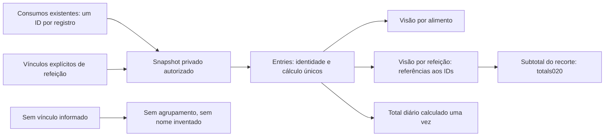

# V1-045 — refeições e alimentos sobre os mesmos registros

Estado em **28/10/2026: doing, persistência SQL e contrato HTTP validados em bases descartáveis**. A configuração047 foi encerrada; 045 continua como trabalho independente do bloqueio editorial de treinos015/016. Código Go **0.8.0 / 34 operações**. Migration13 cria três tabelas, mas **não foi aplicada ao banco real**, que permanece no schema12/27tabelas. APK0.4.0+22 preservado. O consumo humano existente não foi agrupado ou alterado. [SQL, HTTP e restore](meal-grouping-sql-verification.json).

## Incremento SQL e HTTP — 28/10

meals_commands.go separa os comandos e sua validação. MealStore em meals_postgres.go implementa as portas de criação e diário, detalhe privado e correção/exclusão de grupo. Reutiliza a transação autenticada e o cálculo source-rational-v1 da020. Grupo e 1–32 consumos novos são confirmados na mesma transação, incluindo resposta idempotente. Falha em qualquer item desfaz tudo. Quantidades numericamente equivalentes conservam seu significado; o contrato de refeição aceita precisão de microssegundos, que é preservada pelo PostgreSQL.

Migration13 acrescenta meals, meal_items e meal_versions, sem backfill de consumos. Cada vínculo tem FK composta de titular, identidade de consumo única e posição no grupo. Runtime só recebe SELECT e funções restritas de confirmação/exclusão, que revalidam a sessão viva e travam o titular; não recebe DML direto nessas tabelas. Metadados de grupo são versionados; os cálculos e as revisões dos consumos continuam independentes.

GET /api/v1/me/meal-diary recebe date/timezone e locale opcional. Retorna até100 consumos, uma única lista de identidades, grupos por referência e registros sem agrupamento. Incompletude e itens da mesma refeição fora do recorte ficam explícitos. Nomes revisados usam até duas consultas em lote no mesmo snapshot editorial, sem mudar cálculo ou mutação. POST /api/v1/me/meals confirma a refeição; GET/PATCH/DELETE /api/v1/me/meals/{id} consultam, corrigem metadados ou excluem o grupo inteiro.

Corrigir metadados não desloca os horários individuais nem muda quantidades. Corrigir/excluir um item usa as rotas existentes e aparece nas duas visões; não apaga os demais itens. Excluir o grupo torna seus consumos restantes inativos na mesma transação. Reenvio de criação depois de alteração/exclusão retorna conflito, sem recriar registros. A retenção idempotente atual é24h; isso ainda não é a outbox durável da026. Uma refeição sem itens ativos preserva seus metadados no detalhe; não aparece no recorte diário baseado em consumos.

Exportação inclui meals/mealItems/mealVersions. Exclusão confirmada da conta remove grupos, vínculos e versões; o gate de restore reaplica o ledger antes de liberar qualquer recuperação. Novas seções retornam vazio antes da migration13, mantendo o banco12 utilizável. Testes descartáveis cobriram duas contas, rollback do segundo item, concorrência/replay, limites/dias diferentes, edição/exclusão de item e grupo, HTTP nos quatro idiomas, rejeições e dump/restore com outra conta preservada. Fixtures não são refeição real nem login Google.

Próximo incremento: cliente Flutter, suas duas visões e rascunho/revisão/reenvio por conta. Depois, ativação local com checkpoint e comparação de dados, APK e aceite humano. Foto042 e exclusão de mídia continuam pendentes; nenhuma foto foi enviada ou adicionada por esta implementação.

## Decisões que governam a implementação

Q2 pede agrupar por refeição e oferecer também visão por alimento. Q4 exige exclusão da refeição com foto/miniaturas e distingue excluir um item de excluir o grupo. Foto042propõe candidatos; alimento/versão e quantidade por item são confirmados pelo titular, sem peso/nutriente inferido. Histórico/análise/dicas046 usa os registros confirmados, sem diagnóstico de diário incompleto.

O grupo não é prescrição, receita, prova de consumo ou cópia dos nutrientes. Cada consumo continua com seuID,foodId/foodVersion,quantidade,unidade,data/fuso,cálculo exato e revisões. Correção existente recusa trocar a identidade/versão alimentar; agrupamento deve preservar essa regra.

## Modelo de leitura implementado

| Elemento interno | Finalidade e invariantes |
|---|---|
| MealMetadata | IDopaco, título informado opcional0–80caracteres semcontrole/espaço externo, data/fuso declarados, revisão positiva e quantidade total de itens ativos. Título vazio não vira “café/almoço/jantar” por inferência |
| MealMembership | Relação explícita EntryID→MealID. Cada registro pertence no máximo a uma refeição. Não inferir vínculo por proximidade de horário/nome/foto |
| MealDaySource | Porta de um snapshot autorizado:entries,meals,memberships ecomplete explícitos. Coleçõesnil e vínculos sem alvo são erro; arrays vazios representam ausência conhecida |
| MealDiary | Entries contém cada consumo uma vez; grupos e semagrupamento referenciamIDs, permitindo duas apresentações sem persistir outro consumo |
| MealGroup.Totals | Reutiliza totals da020sobre os itens incluídos neste recorte. Não soma o subtotal do grupo novamente ao total diário |
| OtherActiveItems | Itens ativos da refeição fora deste recorte. Pode incluir outro dia e truncamento; não alegar que o subtotal visível é a refeição inteira |
| Complete | Limite atual100consumos, alinhado ao resumo existente. Snapshot incompleto não exibe totais nutricionais como completos; não transforma ausência emzero |
| Dia e fuso | As duas visões selecionam pelo occurredAt de cada consumo e o fuso consultado, com limites semiabertos/DST da020. Horário da refeição é metadado; uma refeição pode atravessar meia-noite |

meals.go aplica invariantes, ordena por data/ID e monta projeção independente do snapshot de origem. Preserva nomes/unidades/quantidades/fracões/desconhecidos. meals_service.go recebe ator autenticado fora de dados de cliente, valida formato/contexto/cancelamento e delega à portaMealDayRepository; erro interno vira indisponibilidade. **Validação sintática do ator não autentica nem comprova ownershipSQL.** O adaptador revalida a credencial viva e consulta exclusivamente o titular na transação protegida pelo lock da conta.

## Caso de criação revisada — domínio/aplicação

meals_create.go define NewMealCommand e MealCreateService. Title opcional é declaração do titular; OccurredAt/Timezone do grupo são explícitos, reviewed precisa sertrue e items contém1–32EntryInput completos com revisão0.32é limite técnico, não recomendação alimentar. Campos/quantidade/unidade/evidência/versão e tempo por item reutilizam020; itens iguais confirmados não são mesclados automaticamente. Não recebeIDs de consumos antigos para agrupá-los porinferência.

MealCreateRepository é implementado por MealStore: **todos os itens e grupo na mesma transação**, com sessão viva/titular, versões/cálculos da020 e chave idempotente. A aplicação valida antes de chamar e confere retorno completo, IDs únicos, algoritmo, versão, quantidades, evidência, revisões e tempos equivalentes, sem rótulo inventado. O recibo SQL/HTTP acima comprova o adaptador em base descartável; não representa criação real na conta.

## Plano original e situação após o incremento SQL

1. Escritor atômico de criação, comandos de metadados/exclusão e idempotência implementados e testados. Não agrupar automaticamente o legado nem simular transação com gravações sequenciais no Flutter.
2. Migration13 criada e validada em descartável; ativação local ainda pendente. Não alterar foodId/versão ou sobrescrever o snapshot alimentar.
3. Correção/exclusão de consumo aparece no grupo; revisão do consumo é independente da revisão dos metadados. Exclusão do grupo e reenvios tardios testados. Remoção de foto depende da042; não manter foto acessível como revisão.
4. Inventário/exportação/exclusão/restore e privilégios implementados e testados em descartável. Não usar dados reais como fixture.
5. Handlers/Swagger implementados; repository/controller/Flutter ainda pendentes. Duas visões devem compartilhar o estado e preservar erros, revisão, rascunho, conta e quatro idiomas. Conferir formulário antes de atualizar o APK.
6. Aceite real de refeição por seu titular e teste das duas visões semduplicar consumo. Fotos042 e dicas046 têm implementação/validação próprias; esta fundação não as entrega.

[Recibo de testes e limites](meal-grouping-foundation-verification.json). Fixtures do domínio não comprovam persistência, autorizaçãoSQL, refeição criada ou jornada disponível noAPK.
