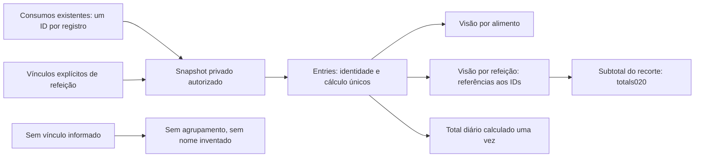

# V1-045 — refeições e alimentos sobre os mesmos registros

Estado em27/10/2026: **doing, fundação de leitura implementada e testada**. Trabalho independente enquanto047aguarda aceite humano; depende de020/021concluídas. Nenhuma migration/rota/tela de refeição foi criada. API0.7.0/29operações, schema12/27tabelas eAPK0.4.0+22 permanecem. O consumo humano existente não foi agrupado ou alterado.

## Decisões que governam a implementação

Q2 pede agrupar por refeição e oferecer também visão por alimento. Q4 exige exclusão da refeição com foto/miniaturas e distingue excluir um item de excluir o grupo. Foto042propõe candidatos; alimento/versão e quantidade por item são confirmados pelo titular, sem peso/nutriente inferido. Histórico/análise/dicas046 usa os registros confirmados, sem diagnóstico de diário incompleto.

O grupo não é prescrição, receita, prova de consumo ou cópia dos nutrientes. Cada consumo continua com seuID,foodId/foodVersion,quantidade,unidade,data/fuso,cálculo exato e revisões. Correção existente recusa trocar a identidade/versão alimentar; agrupamento deve preservar essa regra.

## Modelo de leitura implementado

| Elemento interno | Finalidade e invariantes |
|---|---|
| MealMetadata | IDopaco, título informado opcional0–80caracteres semcontrole/espaço externo, data/fuso declarados, revisão positiva e quantidade total de itens ativos. Título vazio não vira “café/almoço/jantar” por inferência |
| MealMembership | Relação explícita EntryID→MealID. Cada registro pertence no máximo a uma refeição. Não inferir vínculo por proximidade de horário/nome/foto |
| MealDaySource | Porta de um snapshot autorizado:entries,meals,memberships ecomplete explícitos. Coleçõesnil e vínculos sem alvo são erro; arrays vazios representam ausência conhecida |
| MealDiary | Entries contém cada consumo uma vez; grupos e semagrupamento referenciamIDs, permitindo duas apresentações sem persistir outro consumo |
| MealGroup.Totals | Reutiliza totals da020sobre os itens incluídos neste recorte. Não soma o subtotal do grupo novamente ao total diário |
| OtherActiveItems | Itens ativos da refeição fora deste recorte. Pode incluir outro dia e truncamento; não alegar que o subtotal visível é a refeição inteira |
| Complete | Limite atual100consumos, alinhado ao resumo existente. Snapshot incompleto não exibe totais nutricionais como completos; não transforma ausência emzero |
| Dia e fuso | As duas visões selecionam pelo occurredAt de cada consumo e o fuso consultado, com limites semiabertos/DST da020. Horário da refeição é metadado; uma refeição pode atravessar meia-noite |

meals.go aplica invariantes, ordena por data/ID e monta projeção independente do snapshot de origem. Preserva nomes/unidades/quantidades/fracões/desconhecidos. meals_service.go recebe ator autenticado fora de dados de cliente, valida formato/contexto/cancelamento e delega à portaMealDayRepository; erro interno vira indisponibilidade. **Validação sintática do ator não autentica nem comprova ownershipSQL.** O adaptador precisará revalidar a credencial viva e consultar exclusivamente o titular no mesmo snapshot.

## Próxima fatia — ainda não implementada

1. Fechar comandos de criação/edição/exclusão por refeição e vínculo de itens, com revisão/confirmacão/chave estável. Criar grupo e itens novos atomicamente; falha não deixa refeição ou consumo parcial. Não implementar gravações sequenciais noFlutter simulando uma transação.
2. Migrationforward para grupos/vínculos e histórico de alterações, com integridade composta de titular, índices e tombstone. Nenhum agrupamento automático dos registros anteriores. Não alterarfoodId/versão ou sobrescrever snapshot alimentar.
3. Integrar correção/exclusão de um consumo: mesma transação valida revisão da refeição e mantém os demais itens; replay não incrementa revisão duas vezes. Exclusão de refeição remove seus itens ativos, bloqueia reenvios recriadores e prepara limpeza de imagem042. Sem manter foto acessível como revisão.
4. Atualizar inventário/exportação/exclusão/restore/ledger e privilégios antes da ativação. SQLisolado: duas contas, concorrência, idempotência, vínculos/revisões, rollback, exclusão e restauração. Não usar dados reais comofixture.
5. Só então handlers/Swagger e repository/controller/Flutter, duas visões sobre o mesmo estado, com erros/revisão/rascunho/conta e quatro idiomas. Preservar o formulário047em uso no emulador; não publicar endpoint fictício ou atualizarAPK comrascunho aberto.
6. Aceite real de refeição por seu titular e teste das duas visões semduplicar consumo. Fotos042 e dicas046 têm implementação/validação próprias; esta fundação não as entrega.

[Recibo de testes e limites](meal-grouping-foundation-verification.json). Fixtures do domínio não comprovam persistência, autorizaçãoSQL, refeição criada ou jornada disponível noAPK.
